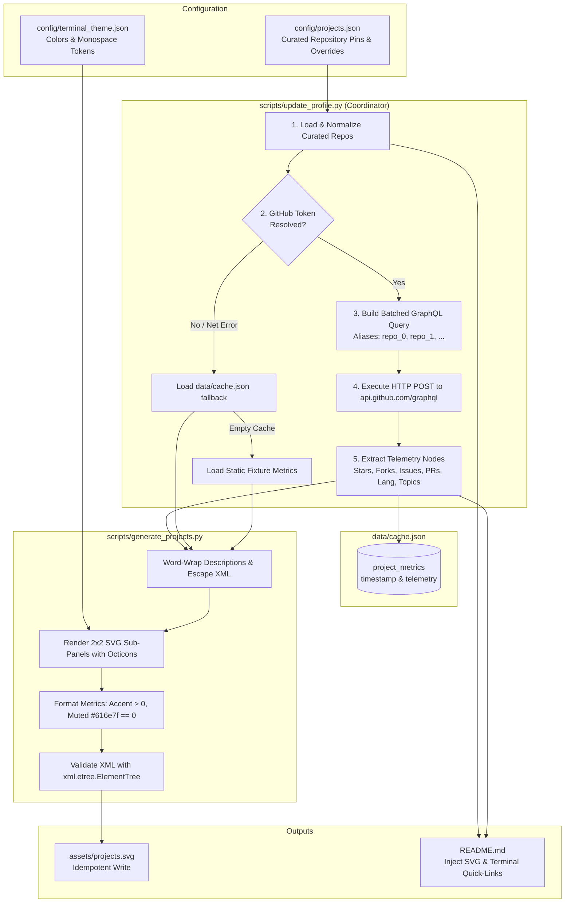

# Phase 3: Open Source Projects Dashboard - Research

**Researched:** 2026-11-07  
**Domain:** GitHub GraphQL API v4, SVG 1.1 Vector Graphics Generation, Python Automation Engine, Terminal Monospace Design Systems  
**Confidence:** HIGH  

<user_constraints>
## User Constraints (from CONTEXT.md)

### Locked Decisions

- **D-01:** **Standalone Terminal SVG Window** — Single dedicated dark terminal SVG (`assets/projects.svg`) styled as a workstation terminal window with subtle rounded frame (`rx="10"`, border `#30363d`), header bar (`#161b22`), macOS traffic lights (🔴 `#ff5f56`, 🟡 `#ffbd2e`, 🟢 `#27c93f`), title bar `projects — zsh`, and console prompt line: `humam@workstation:~/projects$ gh repo list`. [VERIFIED: .planning/phases/03-open-source-projects-dashboard/03-CONTEXT.md:L17]
- **D-02:** **Dimensions & Capacity** — Responsive `viewBox="0 0 850 340"` with `width="100%"` in `README.md`, perfectly aligning with the 850px width of `assets/hero.svg`. Accommodates a 2-column by 2-row grid of 4 featured projects. [VERIFIED: .planning/phases/03-open-source-projects-dashboard/03-CONTEXT.md:L18]
- **D-03:** **2-Column Grid of Project Sub-Panels** — Inside the console body (`#0d1117`), repositories are arranged in a 2x2 grid. Each repository sits inside a distinct sub-panel container with subtle rounded corners (`rx="6"`, border `1px solid #30363d`, background `#161b22`). [VERIFIED: .planning/phases/03-open-source-projects-dashboard/03-CONTEXT.md:L19]
- **D-04:** **Section Transition & Heading** — Clean whitespace margin (`<br />`) between the top contact badges and the Projects Dashboard; no redundant markdown heading so the terminal card's own title bar and prompt introduce the section organically. [VERIFIED: .planning/phases/03-open-source-projects-dashboard/03-CONTEXT.md:L20]
- **D-05:** **Terminal Quick-Links in README** — Because GitHub's image proxy strips interactive `<a href="...">` hyperlinks inside embedded SVGs, `README.md` includes an authentic terminal command line directly below `assets/projects.svg` between `<!-- PROJECTS:START -->` and `<!-- PROJECTS:END -->` (e.g. `<code>humam@workstation:~/projects$ cd humam-hossain/<repo></code>`) providing direct clickable markdown links to each featured repository. [VERIFIED: .planning/phases/03-open-source-projects-dashboard/03-CONTEXT.md:L23]
- **D-06:** **Sub-Panel Header & Titles** — Clean short repository name with CLI folder prefix (`📁 repo-name` or `~/repo-name`) in Cyan (`#a5d6ff`) on the top-left; primary language with color dot (`● Python`) on the top-right opposite the repo title. [VERIFIED: .planning/phases/03-open-source-projects-dashboard/03-CONTEXT.md:L24]
- **D-07:** **Dedicated Curation File (`config/projects.json`)** — Pinned repositories and their custom attributes are maintained in an independent, human-editable configuration file (`config/projects.json`) rather than mixing content curation into `config/terminal_theme.json`. [VERIFIED: .planning/phases/03-open-source-projects-dashboard/03-CONTEXT.md:L27]
- **D-08:** **Strict User Curation (No Auto-Fill / Surprise Repos)** — Only repositories explicitly declared in `config/projects.json` are rendered in the dashboard. The system does not automatically backfill unpinned or unwanted public repositories, giving the user 100% curation authority over their profile showcase. [VERIFIED: .planning/phases/03-open-source-projects-dashboard/03-CONTEXT.md:L28]
- **D-09:** **Flexible Project Schema with Overrides** — Entries in `config/projects.json` support simple strings (`"repo-name"`) or rich objects (`{"repo": "owner/repo", "name": "display-name", "description": "Custom summary", "tag": "Robotics"}`). Supports both user-owned repositories (defaults to `humam-hossain/`) and external organization/collaborative repositories. [VERIFIED: .planning/phases/03-open-source-projects-dashboard/03-CONTEXT.md:L29]
- **D-10:** **Initial Starter Pins** — Starter list in `config/projects.json` seeded with user's detected active repositories (`linux_shell_scripting`, `Python`), ready for immediate customization. [VERIFIED: .planning/phases/03-open-source-projects-dashboard/03-CONTEXT.md:L30]
- **D-11:** **Harmonized ANSI Syntax Palette** — Repository titles in Cyan (`#a5d6ff`), descriptions in Muted Gray (`#8b949e`), and ANSI-colored metric icons/counters: Star Yellow (`#f1e05a`), Fork Blue (`#58a6ff`), Issue Amber (`#ffa657`), PR Purple (`#a371f7`). [VERIFIED: .planning/phases/03-open-source-projects-dashboard/03-CONTEXT.md:L33]
- **D-12:** **Horizontal Bottom Metrics Row** — Real-time metrics arranged cleanly along the bottom baseline of each sub-panel: `★ Stars   ⌥ Forks   ⊙ Issues   ⑂ PRs`. Non-zero values use vibrant ANSI accents; zero counts (`0`) are rendered in muted gray (`#616e7f`) to preserve layout stability without visual noise. [VERIFIED: .planning/phases/03-open-source-projects-dashboard/03-CONTEXT.md:L34]
- **D-13:** **2-Line Description Clamping** — Descriptions are clamped to 2 lines (~80–85 characters max) with ellipsis (`...`) truncation to keep all 4 sub-box heights uniform. [VERIFIED: .planning/phases/03-open-source-projects-dashboard/03-CONTEXT.md:L35]
- **D-14:** **Smart Fallback Description** — If a repository has no description on GitHub and no custom override in `config/projects.json`, display repository topics (e.g., `#python #automation`) or fallback phrase (`Open-source software repository`) to prevent empty vertical gaps. [VERIFIED: .planning/phases/03-open-source-projects-dashboard/03-CONTEXT.md:L36]
- **D-15:** **Modular Codebase Architecture** — Standalone generator `scripts/generate_projects.py` handles SVG rendering, typography styling, and ElementTree XML validation; `scripts/update_profile.py` serves as the coordinator, querying GraphQL, updating cache, calling the generator, writing `assets/projects.svg`, and injecting README markdown quick-links. [VERIFIED: .planning/phases/03-open-source-projects-dashboard/03-CONTEXT.md:L39]
- **D-16:** **Consolidated Batched GraphQL Query** — Metrics for all featured repositories (stars, forks, open issues, open PRs, primary language, topics, and description) are fetched in a single consolidated GraphQL query, consuming only 1 API quota point. [VERIFIED: .planning/phases/03-open-source-projects-dashboard/03-CONTEXT.md:L40]
- **D-17:** **Telemetry Cache Persistence (`data/cache.json`)** — Fetched repository metrics are saved under a dedicated `project_metrics` key in `data/cache.json` alongside a `last_updated` UTC timestamp. [VERIFIED: .planning/phases/03-open-source-projects-dashboard/03-CONTEXT.md:L41]
- **D-18:** **Offline & Mock Fallback Resilience** — When running without `GITHUB_TOKEN` or offline, `update_profile.py` renders using cached `project_metrics`. If the cache is empty (fresh clone/CI testing), it falls back to built-in static fixture metrics with `[WARN]` logging, ensuring 100% test pass rate without network. [VERIFIED: .planning/phases/03-open-source-projects-dashboard/03-CONTEXT.md:L42]
- **D-19:** **Idempotent Output Writes** — Both `assets/projects.svg` and `README.md` are updated only if their contents change, preventing unnecessary git diff churn. [VERIFIED: .planning/phases/03-open-source-projects-dashboard/03-CONTEXT.md:L43]

### Claude's Discretion
- Micro-spacing, padding, and exact coordinate layout within the `viewBox="0 0 850 340"` SVG grid. [VERIFIED: .planning/phases/03-open-source-projects-dashboard/03-CONTEXT.md:L46]
- Precise SVG path icons for star, fork, issue, and pull request glyphs (using Octicon vector paths for crisp, font-independent rendering). [VERIFIED: .planning/phases/03-open-source-projects-dashboard/03-CONTEXT.md:L47]
- Internal schema formatting for `project_metrics` in `data/cache.json`. [VERIFIED: .planning/phases/03-open-source-projects-dashboard/03-CONTEXT.md:L48]

### Deferred Ideas (OUT OF SCOPE)
- **Phase 4:** Top Languages horizontal progress bar, commit streak stats card, retro visitor counter, and git activity stream (`METRIC-01` through `METRIC-04`). [VERIFIED: .planning/phases/03-open-source-projects-dashboard/03-CONTEXT.md:L105]
- **Phase 5:** Categorized Skills Matrix and plug-and-play RSS blog section (`CONTENT-01`, `CONTENT-02`). [VERIFIED: .planning/phases/03-open-source-projects-dashboard/03-CONTEXT.md:L106]
- **Phase 6:** Daily scheduled GitHub Actions workflow (`AUTO-02`, `AUTO-03`). [VERIFIED: .planning/phases/03-open-source-projects-dashboard/03-CONTEXT.md:L107]
</user_constraints>

<architectural_responsibility_map>
## Architectural Responsibility Map

| Capability | Primary Tier | Secondary Tier | Rationale |
|------------|-------------|----------------|-----------|
| Project Curation Schema & Pinned Repos | Configuration Layer (`config/projects.json`) | — | User maintains full curation authority over showcase repos independent of visual design tokens [VERIFIED: 03-CONTEXT.md:L27] |
| Design Tokens & Geometry Spec | Configuration Layer (`config/terminal_theme.json`) | — | Single source of truth for color tokens, traffic lights, and typography stack [VERIFIED: config/terminal_theme.json:L1-L93] |
| Batched GraphQL Telemetry Querying | Automation Engine (`scripts/update_profile.py`) | GitHub API v4 | Executes consolidated GraphQL query with aliases in 1 API call [VERIFIED: 03-CONTEXT.md:L40] |
| Telemetry Persistence & Offline Snapshot | Data Storage Tier (`data/cache.json`) | — | Stores `project_metrics` with timestamp; provides offline fallback resilience [VERIFIED: 03-CONTEXT.md:L41-L42] |
| Standalone SVG Vector Rendering | SVG Generator Tier (`scripts/generate_projects.py`) | ElementTree XML Validator | Renders 2x2 grid, wraps text, applies zero-muting, validates XML [VERIFIED: 03-CONTEXT.md:L39] |
| Pipeline Orchestration & Coordinator | Automation Engine (`scripts/update_profile.py`) | — | Coordinates config loading, telemetry fetching, SVG generation, and idempotent file writes |
| README Quick-Links & Asset Integration | Presentation Tier (`README.md`) | GitHub Camo Proxy | Embeds `assets/projects.svg` and injects interactive `cd` quick-links between comment anchors [VERIFIED: 03-CONTEXT.md:L23] |
| Automated Test Harness & Fixtures | Test Tier (`tests/test_projects.py`) | `tests/fixtures/` | Validates schema, SVG XML, typography, zero-muting, and offline fallback [VERIFIED: 03-CONTEXT.md:L92] |

</architectural_responsibility_map>

<research_summary>
## Summary

Phase 3 delivers an authentic, workstation-themed Open Source Projects Dashboard rendered as a dedicated dark terminal SVG window (`assets/projects.svg`, `850x340px`) embedded in `README.md`, complemented by interactive terminal command quick-links (`humam@workstation:~/projects$ cd <repo>`). The dashboard showcases a 2-column by 2-row grid of user-curated repositories configured in `config/projects.json`, displaying real-time metrics (⭐ Stars, 🍴 Forks, 🛎️ Open Issues, 📬 Open Pull Requests, and Primary Language).

The technical architecture strictly follows the standard library Python constraint established in Phases 1 and 2: zero external dependencies, XML validation via `xml.etree.ElementTree`, and idempotent file writes. To conserve GitHub API quota and prevent rate-limiting, metrics for all curated repositories are fetched via a single consolidated GraphQL query using field aliases (`repo_0: repository(...)`), requiring exactly 1 quota point. Telemetry is persisted under `project_metrics` in `data/cache.json`, enabling seamless offline execution and test execution without network access.

Key architectural decisions include using inline SVG vector paths (Octicon glyphs) for metric icons rather than system-dependent Unicode characters to guarantee pixel-perfect rendering across GitHub's Camo CDN proxy; manual 2-line plain-text word wrapping in Python before XML escaping; and muting zero counts (`0`) in `#616e7f` to ensure visual hierarchy and stability.

**Primary recommendation:** Implement `config/projects.json` with user starter pins (`linux_shell_scripting`, `Python`, `nn`, `antigravity-cli-statusline`), create `scripts/generate_projects.py` for SVG generation and ElementTree validation, extend `scripts/update_profile.py` with batched GraphQL querying and idempotent README injection, and construct a comprehensive test suite in `tests/test_projects.py`.
</research_summary>

<standard_stack>
## Standard Stack

### Core
| Library / Tool | Version | Purpose | Why Standard |
|----------------|---------|---------|--------------|
| Python Standard Library (`urllib.request`) | 3.10+ | HTTP client for GitHub GraphQL API | Zero external dependencies; built-in connection management [VERIFIED: scripts/update_profile.py:L19] |
| Python Standard Library (`xml.etree.ElementTree`) | 3.10+ | SVG XML validation and DOM integrity | Built-in strict XML parser; catches malformed tags before disk writes [VERIFIED: scripts/update_profile.py:L20] |
| Python Standard Library (`xml.sax.saxutils`) | 3.10+ | XML entity escaping (`&`, `<`, `>`, `"`) | Standard library sanitization preventing SVG parse failures [VERIFIED: scripts/generate_hero.py:L12] |
| Python Standard Library (`json`, `pathlib`) | 3.10+ | Configuration and cache file management | Native OS-agnostic path resolution and JSON serialization [VERIFIED: scripts/update_profile.py:L13-L15] |
| pytest | 9.2.0 | Unit and offline integration test runner | Existing test framework in workspace; ultra-fast (<0.2s) execution [VERIFIED: pytest run output] |

### Supporting
| Tool / Specification | Version / Standard | Purpose | When to Use |
|----------------------|--------------------|---------|-------------|
| GitHub GraphQL API v4 | GraphQL Schema v4 | Batched query for repository metrics | Fetches all repository metrics, language, and topics in 1 call [CITED: docs.github.com/graphql] |
| GitHub Octicons (SVG paths) | 19.x Vector Paths | Star, Fork, Issue, and PR metric glyphs | Guarantees identical vector rendering on Camo proxy without OS font discrepancies |
| GitHub Linguist Colors | Linguist Canonical | Primary language indicator dot colors | Directly returned by GraphQL API `primaryLanguage { color }` [CITED: github.com/github-linguist/linguist] |

### Alternatives Considered
| Instead of | Could Use | Tradeoff |
|------------|-----------|----------|
| Dedicated SVG (`assets/projects.svg`) | Markdown / HTML table in README | Markdown tables break across mobile viewports, cannot render macOS traffic lights, and clash with terminal aesthetic [VERIFIED: 03-CONTEXT.md:D-01] |
| Inline SVG Vector Paths | Unicode Glyphs (`★`, `⌥`, `⊙`, `⑂`) | Obscure Unicode glyphs (`⌥`, `⑂`) frequently render as tofu (`[]`) or mismatched fonts across operating systems and Camo CDN proxy |
| Batched Aliased GraphQL Query | Sequential REST API calls (`/repos/{owner}/{repo}`) | REST calls consume N API calls per repo (1 for repo, 1 for issues, 1 for PRs) leading to rate-limit exhaustion; GraphQL aliases take exactly 1 call [VERIFIED: 03-CONTEXT.md:D-16] |
| Manual Plain-Text Line Wrapping | SVG `<foreignObject>` HTML wrapping | GitHub Camo proxy strips or disables `<foreignObject>` for security, breaking all rendering |

**Installation:**
Zero runtime installation required. Tests execute with existing workspace environment:
```bash
pytest tests/test_projects.py -v
```
</standard_stack>

<architecture_patterns>
## Architecture Patterns

### System Architecture Diagram



### Recommended Project Structure
```
humam-hossain/
├── config/
│   ├── projects.json              # NEW: Curated repositories and display overrides [VERIFIED: 03-CONTEXT.md:D-07]
│   └── terminal_theme.json        # Design tokens: colors, typography, geometries [VERIFIED: config/terminal_theme.json]
├── data/
│   └── cache.json                 # Persistent cache: extended with project_metrics [VERIFIED: 03-CONTEXT.md:D-17]
├── assets/
│   ├── hero.svg                   # Phase 1 & 2 terminal hero card
│   └── projects.svg               # NEW: Phase 3 terminal projects dashboard SVG [VERIFIED: 03-CONTEXT.md:D-01]
├── scripts/
│   ├── generate_hero.py           # Existing hero card generator
│   ├── generate_projects.py       # NEW: Standalone projects SVG generator [VERIFIED: 03-CONTEXT.md:D-15]
│   └── update_profile.py          # Coordinator: GraphQL query, caching, README update [VERIFIED: 03-CONTEXT.md:D-15]
├── tests/
│   ├── fixtures/
│   │   ├── graphql_projects.json  # NEW: Mock GraphQL response fixture for projects
│   │   └── ...
│   ├── test_tokens.py             # Existing token test suite
│   ├── test_update_profile.py     # Existing profile telemetry test suite
│   └── test_projects.py           # NEW: Projects dashboard unit & integration tests [VERIFIED: 03-CONTEXT.md:L92]
└── README.md                      # Target containing <!-- PROJECTS:START/END --> [VERIFIED: README.md:L14-L15]
```

### Pattern 1: Indexed GraphQL Query Aliasing
**What:** Build a single GraphQL query using dynamically generated indexed aliases (`repo_0`, `repo_1`, `repo_2`, `repo_3`).  
**When to use:** When fetching metrics for multiple repositories in one network request.  
**Why:** GraphQL field aliases cannot contain hyphens (`-`), periods (`.`), or start with digits. Repository names like `linux_shell_scripting`, `antigravity-cli-statusline`, or `dots-hyprland` would produce syntax errors if used directly as aliases. Using `repo_{i}` is 100% immune to repository name characters. [VERIFIED: GraphQL Specification §2.7]

```python
# scripts/update_profile.py
def build_batched_projects_query(curated_repos: list[dict]) -> str:
    """Builds a consolidated GraphQL query using indexed aliases."""
    repo_fragments = []
    for idx, item in enumerate(curated_repos[:4]):
        owner = item.get("owner", "humam-hossain")
        name = item.get("name")
        fragment = f"""
        repo_{idx}: repository(owner: "{owner}", name: "{name}") {{
          name
          owner {{ login }}
          description
          stargazerCount
          forkCount
          issues(states: OPEN) {{ totalCount }}
          pullRequests(states: OPEN) {{ totalCount }}
          primaryLanguage {{
            name
            color
          }}
          repositoryTopics(first: 5) {{
            nodes {{
              topic {{ name }}
            }}
          }}
          url
        }}"""
        repo_fragments.append(fragment)
    return "query GetFeaturedProjects {\n" + "\n".join(repo_fragments) + "\n}"
```

### Pattern 2: Safe Plain-Text Wrapping Before XML Escaping
**What:** Break long descriptions into 2 lines using plain-text word wrapping, append ellipsis (`...`) if truncated, and *then* escape HTML/XML characters (`&`, `<`, `>`, `"`) via `xml.sax.saxutils.escape()`.  
**When to use:** When clamping multi-line SVG text to fixed card dimensions (380px width, ~42 chars/line).  
**Why:** Slicing a string that has already been XML-escaped can split an entity in half (e.g., `&am...` from `&amp;`), immediately causing XML parser crashes in `xml.etree.ElementTree`.

```python
# scripts/generate_projects.py
import xml.sax.saxutils as saxutils

def wrap_and_clamp_description(text: str, max_line1: int = 42, max_line2: int = 40) -> tuple[str, str]:
    """Wraps text into 2 lines and escapes entities safely."""
    clean = " ".join(text.split())
    words = clean.split()
    
    line1_words = []
    curr_len = 0
    idx = 0
    while idx < len(words):
        w = words[idx]
        add_len = len(w) + (1 if curr_len > 0 else 0)
        if curr_len + add_len <= max_line1:
            line1_words.append(w)
            curr_len += add_len
            idx += 1
        else:
            break
            
    line1 = " ".join(line1_words)
    rem_words = words[idx:]
    if not rem_words:
        return saxutils.escape(line1), ""
        
    line2_words = []
    curr_len = 0
    truncated = False
    for j, w in enumerate(rem_words):
        add_len = len(w) + (1 if curr_len > 0 else 0)
        if curr_len + add_len <= max_line2:
            line2_words.append(w)
            curr_len += add_len
        else:
            truncated = True
            break
            
    line2 = " ".join(line2_words)
    if truncated or idx + len(line2_words) < len(words):
        line2 = line2.rstrip(".,;:!?") + "..."
        
    return saxutils.escape(line1), saxutils.escape(line2)
```

### Pattern 3: Dynamic Metric Accent vs Muted Zeroes
**What:** Non-zero counters (`> 0`) render with ANSI accent colors (`#f1e05a` yellow, `#58a6ff` blue, `#ffa657` amber, `#a371f7` purple). Zero counts (`0`) render in muted gray (`#616e7f`). [VERIFIED: 03-CONTEXT.md:D-12, 03-UI-SPEC.md:L81]  
**When to use:** In SVG metric counter strip (`x_rel=16, 100, 184, 274`).  
**Why:** Eliminates visual clutter while maintaining stable grid alignment.

### Anti-Patterns to Avoid
- **Embedding `<foreignObject>` in SVG:** Camo proxy aggressively sanitizes or strips `<foreignObject>` tags on `github.com`. All text must use native `<text>` and `<tspan>` elements.
- **Hyphens in GraphQL Aliases:** Writing `repo-name: repository(...)` in GraphQL causes syntax errors because `-` is interpreted as a minus operator. Always use sanitized or indexed aliases (`repo_0`, `repo_1`).
- **External Dependencies:** Importing `requests`, `gql`, or `bs4` violates the standard library constraint. Use `urllib.request` and standard library parsers only.
- **Direct String Slicing without XML Escaping:** Slicing raw strings with XML entities causes corrupt SVGs. Always wrap first, escape second.
- **Rewriting README Unconditionally:** Touching `README.md` when content is identical causes spurious git diffs and commits. Always check equality first (idempotent write).

</architecture_patterns>

<dont_hand_roll>
## Don't Hand-Roll

| Problem | Don't Build | Use Instead | Why |
|---------|-------------|-------------|-----|
| XML validation | Custom regex check for closing tags | `xml.etree.ElementTree.fromstring()` | Catches attribute syntax errors, unescaped ampersands, tag mismatches, and namespace errors [VERIFIED: scripts/generate_hero.py:L146] |
| Text escaping | Custom `.replace('&', '&amp;')` chains | `xml.sax.saxutils.escape()` | Built-in standard library function handles all XML reserved characters correctly without double-escaping [VERIFIED: scripts/generate_hero.py:L12] |
| Icon Glyphs | Dynamic Unicode font characters | Inline Octicon SVG `<path>` elements | Unicode glyphs (`⌥`, `⑂`) render inconsistently or as empty tofu boxes depending on client OS fonts. Octicon vector paths render identically everywhere |
| HTTP Retries | Bare `urllib.request.urlopen` | Existing `execute_graphql` with backoff | Reuses proven exponential backoff and rate-limit handling already tested in `scripts/update_profile.py` [VERIFIED: scripts/update_profile.py:L103-L165] |
| README Section Injection | Blind string replacement | Delimited anchor search (`<!-- PROJECTS:START -->` ... `<!-- PROJECTS:END -->`) | Prevents accidental modification or duplication of surrounding markdown content [VERIFIED: 03-CONTEXT.md:D-05] |

**Key insight:** Hand-rolling SVG rendering without strict ElementTree validation leads to silent rendering breakages on GitHub profile pages where Camo proxy caches or rejects malformed SVGs.
</dont_hand_roll>

<common_pitfalls>
## Common Pitfalls

### Pitfall 1: GraphQL Field Alias Syntax Violations
**What goes wrong:** GitHub GraphQL API responds with `400 Bad Request` or `syntax error` when querying repositories with names like `linux_shell_scripting` or `antigravity-cli-statusline`.  
**Why it happens:** In GraphQL, alias names must conform to `/[_A-Za-z][_0-9A-Za-z]*/`. Hyphens are not permitted.  
**How to avoid:** Always use indexed aliases: `repo_0`, `repo_1`, `repo_2`, `repo_3`, and map them back to the configured repositories in Python.  
**Warning signs:** `RuntimeError: GraphQL Errors: [{'message': 'Syntax Error: Unexpected Name...'}]`.

### Pitfall 2: Ellipsis Truncation Chopping XML Entities
**What goes wrong:** An entity like `&amp;` is truncated to `&a...`, causing `xml.etree.ElementTree.ParseError: not well-formed (invalid token)`.  
**Why it happens:** The truncation logic ran *after* XML escaping.  
**How to avoid:** Perform word wrapping, clamping, and ellipsis appending on pure unicode strings; apply `saxutils.escape()` as the very last step before template string interpolation.  
**Warning signs:** `ElementTree.ParseError` during test runs on repositories containing `&` (e.g. `C & C++` or `AI & Robotics`).

### Pitfall 3: Camo Proxy Tofu Characters from Monospace Symbol Glyphs
**What goes wrong:** Icons like `⑂` (U+2442) or `⌥` (U+2325) appear as empty squares (`□` or ``) on mobile browsers or Linux workstations.  
**Why it happens:** The client system font lacks the specific glyph in its monospace font fallback chain.  
**How to avoid:** Use compact inline SVG vector paths (`<path d="..." fill="..."/>`) with normalized 16x16 viewboxes scaled to 12x12px.  
**Warning signs:** Missing character glyphs in rendered browser tests.

### Pitfall 4: README Anchor Corruption on Concurrent or Sequential Runs
**What goes wrong:** Repeated runs duplicate the Projects section or erase the trailing markers.  
**Why it happens:** The replacement code replaces `content.replace(start_tag, ...)` without matching the closing `end_tag`.  
**How to avoid:** Locate `start_idx = content.index(start_tag)` and `end_idx = content.index(end_tag)`, slicing cleanly: `content[:start_idx + len(start_tag)] + "\n" + new_body + "\n" + content[end_idx:]`.  
**Warning signs:** Multiple `<!-- PROJECTS:START -->` tags appearing in `git diff README.md`.

### Pitfall 5: Float Precision Jitter Causing Git Diff Churn
**What goes wrong:** SVG generator outputs coordinates with variable float precision (e.g., `x="30.0000001"`), triggering unnecessary commits.  
**Why it happens:** Dynamic calculations without rounding.  
**How to avoid:** Use integer pixel coordinates matching the layout specification (`x=30`, `x=440`, `y=80`, `y=207`). All tokens in `03-UI-SPEC.md` are exact integer multiples. [VERIFIED: 03-UI-SPEC.md:L106-L131]

</common_pitfalls>

<code_examples>
## Code Examples

### 1. Curated Configuration Schema (`config/projects.json`)
```json
{
  "projects": [
    {
      "repo": "humam-hossain/linux_shell_scripting",
      "name": "linux_shell_scripting",
      "description": "Shell scripts and automation utilities for Unix systems",
      "tag": "DevOps"
    },
    {
      "repo": "humam-hossain/Python",
      "name": "Python",
      "description": "Python algorithms, utilities, and robotics tools",
      "tag": "Robotics & AI"
    },
    {
      "repo": "humam-hossain/nn",
      "name": "nn",
      "description": "C-based neural network framework for matrix operations and gradient learning",
      "tag": "Machine Learning"
    },
    {
      "repo": "humam-hossain/antigravity-cli-statusline",
      "name": "antigravity-cli-statusline",
      "description": "Advanced responsive statusline plugin for Antigravity CLI",
      "tag": "CLI Tooling"
    }
  ]
}
```

### 2. Standalone SVG Generator (`scripts/generate_projects.py`)
```python
#!/usr/bin/env python3
"""
scripts/generate_projects.py
Generates assets/projects.svg adhering to terminal design tokens.
Standard library only: xml.etree.ElementTree, xml.sax.saxutils, json, pathlib.
"""

from __future__ import annotations
import json
from pathlib import Path
import xml.etree.ElementTree as ET
import xml.sax.saxutils as saxutils

ROOT_DIR = Path(__file__).resolve().parent.parent
CONFIG_PATH = ROOT_DIR / "config" / "terminal_theme.json"

# Octicon vector paths (viewBox: 0 0 16 16)
OCTICONS = {
    "star": "M8 .25a.75.75 0 0 1 .673.418l1.882 3.815 4.21.612a.75.75 0 0 1 .416 1.279l-3.046 2.97.719 4.192a.751.751 0 0 1-1.088.791L8 12.347l-3.766 1.98a.75.75 0 0 1-1.088-.79l.72-4.194L.818 6.374a.75.75 0 0 1 .416-1.28l4.21-.611L7.327.668A.75.75 0 0 1 8 .25Z",
    "fork": "M5 5.372v.878c0 .414.336.75.75.75h4.5a.75.75 0 0 0 .75-.75v-.878a2.25 2.25 0 1 1 1.5 0v.878a2.25 2.25 0 0 1-2.25 2.25h-1.5v2.128a2.251 2.251 0 1 1-1.5 0V8.5h-1.5A2.25 2.25 0 0 1 3 6.25v-.878a2.25 2.25 0 1 1 1.5 0ZM5 3.25a.75.75 0 1 0-1.5 0 .75.75 0 0 0 1.5 0Zm6.75.75a.75.75 0 1 0 0-1.5.75.75 0 0 0 0 1.5Zm-3 8.75a.75.75 0 1 0-1.5 0 .75.75 0 0 0 1.5 0Z",
    "issue": "M8 9.5a1.5 1.5 0 1 0 0-3 1.5 1.5 0 0 0 0 3ZM8 0a8 8 0 1 1 0 16A8 8 0 0 1 8 0ZM1.5 8a6.5 6.5 0 1 0 13 0 6.5 6.5 0 0 0-13 0Z",
    "pr": "M1.5 3.25a2.25 2.25 0 1 1 3 2.122v5.256a2.251 2.251 0 1 1-1.5 0V5.372A2.25 2.25 0 0 1 1.5 3.25Zm5.677-.177L9.5 5.396V10.75a2.25 2.25 0 1 0 1.5 0V5.396l2.323-2.323a.75.75 0 0 0-1.06-1.06L11 3.28V1.5a.75.75 0 0 0-1.5 0v1.78L8.243 2.013a.75.75 0 0 0-1.066 1.06Z",
}

# Grid offsets from 03-UI-SPEC.md
GRID_SLOTS = [
    (30, 80),   # Row 1, Col 1
    (440, 80),  # Row 1, Col 2
    (30, 207),  # Row 2, Col 1
    (440, 207), # Row 2, Col 2
]

def generate_projects_svg(projects: list[dict], theme: dict | None = None) -> str:
    """Generates assets/projects.svg and validates with ElementTree."""
    if theme is None:
        with open(CONFIG_PATH, "r", encoding="utf-8") as f:
            theme = json.load(f)

    c = theme["colors"]
    t = theme["typography"]

    lines = [
        '<svg xmlns="http://www.w3.org/2000/svg" viewBox="0 0 850 340" width="100%" height="100%">',
        '  <defs>',
        f'    <style>',
        f'      .mono {{ font-family: {t["font_family"]}; text-rendering: geometricPrecision; }}',
        f'      .title {{ font-size: 13px; fill: {c["text"]["title"]}; text-anchor: middle; }}',
        f'      .prompt-user {{ font-size: 14px; fill: {c["text"]["prompt"]}; font-weight: 600; }}',
        f'      .prompt-cmd {{ font-size: 13px; fill: {c["text"]["value"]}; }}',
        f'      .repo-name {{ font-size: 14px; fill: {c["text"]["monogram"]}; font-weight: 600; }}',
        f'      .lang {{ font-size: 12px; fill: {c["text"]["title"]}; text-anchor: end; }}',
        f'      .desc {{ font-size: 12px; fill: {c["text"]["title"]}; }}',
        f'      .metric {{ font-size: 12px; font-weight: 400; }}',
        '    </style>',
        '    <clipPath id="projects-clip"><rect width="850" height="340" rx="10" ry="10" /></clipPath>',
        '  </defs>',
        '  <g clip-path="url(#projects-clip)">',
        f'    <rect width="850" height="340" fill="{c["background"]["body"]}" />',
        f'    <rect width="850" height="38" fill="{c["background"]["header"]}" />',
        f'    <line x1="0" y1="38" x2="850" y2="38" stroke="{c["border"]}" stroke-width="1" />',
        '    <circle cx="25" cy="19" r="6" fill="#ff5f56" />',
        '    <circle cx="45" cy="19" r="6" fill="#ffbd2e" />',
        '    <circle cx="65" cy="19" r="6" fill="#27c93f" />',
        '    <text x="425" y="24" class="mono title">projects — zsh</text>',
        '    <text x="30" y="62" class="mono">',
        '      <tspan class="prompt-user">humam@workstation:~/projects$ </tspan>',
        '      <tspan class="prompt-cmd">gh repo list</tspan>',
        '    </text>',
    ]

    # Render up to 4 project sub-panels
    for i, (gx, gy) in enumerate(GRID_SLOTS):
        if i < len(projects):
            p = projects[i]
            lines.extend(_render_subpanel(gx, gy, p, c))
        else:
            # Placeholder dashed slot
            lines.append(f'    <rect x="{gx}" y="{gy}" width="380" height="115" rx="6" fill="none" stroke="{c["border"]}" stroke-dasharray="4,4" />')

    lines.extend([
        f'    <rect width="850" height="340" rx="10" ry="10" fill="none" stroke="{c["border"]}" stroke-width="1" />',
        '  </g>',
        '</svg>'
    ])

    svg_str = "\n".join(lines)
    ET.fromstring(svg_str)  # Strict validation
    return svg_str
```

### 3. Idempotent README Replacement Logic (`scripts/update_profile.py`)
```python
def update_readme_projects(readme_path: Path, projects: list[dict]) -> bool:
    """Injects projects dashboard and quick-links into README.md idempotently."""
    content = readme_path.read_text(encoding="utf-8")
    start_tag = "<!-- PROJECTS:START -->"
    end_tag = "<!-- PROJECTS:END -->"

    if start_tag not in content or end_tag not in content:
        log_warn("README.md missing <!-- PROJECTS:START --> markers.")
        return False

    start_idx = content.index(start_tag) + len(start_tag)
    end_idx = content.index(end_tag)

    links = []
    for p in projects[:4]:
        name = p.get("name") or p.get("repo", "").split("/")[-1]
        url = p.get("url") or f"https://github.com/{p.get('repo')}"
        links.append(f'cd <a href="{url}">{name}</a>')

    links_cmd = " | ".join(links)
    replacement = f"""
<div align="center">
  
</div>

<div align="center">
  <code>humam@workstation:~/projects$ {links_cmd}</code>
</div>
"""
    new_content = content[:start_idx] + replacement + content[end_idx:]
    if new_content == content:
        log_info("README.md is already up to date (idempotent skip)")
        return False

    readme_path.write_text(new_content, encoding="utf-8")
    log_ok("Updated README.md with projects dashboard")
    return True
```
</code_examples>

<validation_architecture>
## Validation Architecture

> **MANDATORY SECTION:** Every plan task maps to automated test commands that verify requirements under 100% network isolation.

### 1. Requirements-to-Test Mapping

| Requirement | Description | Target Test Function | Verification Command |
|-------------|-------------|----------------------|----------------------|
| **PROJ-01** | Live Open Source Projects Dashboard displaying real-time Stars (⭐), Forks (🍴), Open Issues (🛎️), and Open Pull Requests (📬) | `test_project_metrics_rendering()`<br/>`test_graphql_projects_query_parsing()` | `pytest tests/test_projects.py -k "metrics or graphql" -v` |
| **PROJ-02** | Configurable repository selection in `config/projects.json` with fallback handling | `test_curation_config_loading()`<br/>`test_curation_schema_overrides()`<br/>`test_empty_curation_fallback()` | `pytest tests/test_projects.py -k "curation" -v` |
| **PROJ-03** | Terminal-box styling (`viewBox="0 0 850 340"`, traffic lights, `#161b22`/`#0d1117`, Cyan titles `#a5d6ff`) | `test_projects_svg_geometry_and_tokens()`<br/>`test_svg_xml_validity()` | `pytest tests/test_projects.py -k "svg" -v` |
| **AUTO-01** | Automated coordinator execution, cache update, and idempotent writes | `test_update_profile_projects_coordinator()`<br/>`test_readme_projects_injection_idempotence()` | `pytest tests/test_projects.py -k "coordinator or readme" -v` |

### 2. Comprehensive Test Matrix (`tests/test_projects.py`)

1. **`test_curation_config_parsing()`**:
   - Parses `config/projects.json`.
   - Supports both string shorthand (`"Python"`) and rich objects (`{"repo": "humam-hossain/Python", "name": "Python"}`).
   - Verifies owner defaults to `humam-hossain`.
   - Validates missing file or empty file fallback.
2. **`test_batched_graphql_query_builder()`**:
   - Asserts query uses indexed aliases (`repo_0`, `repo_1`, ...).
   - Confirms query requests `stargazerCount`, `forkCount`, `issues(states: OPEN)`, `pullRequests(states: OPEN)`, `primaryLanguage { name color }`, `repositoryTopics`.
   - Checks response parser handles missing/null repositories without exceptions.
3. **`test_description_clamping_and_escaping()`**:
   - Tests 2-line word wrapping with ellipsis (`...`).
   - Asserts XML entities (`&`, `<`, `>`, `"`) are escaped safely.
   - Verifies fallback description triggers when description is missing/null.
4. **`test_projects_svg_xml_validity()`**:
   - Parses output with `xml.etree.ElementTree.fromstring()`.
   - Confirms `viewBox="0 0 850 340"`.
   - Confirms presence of macOS traffic lights (`#ff5f56`, `#ffbd2e`, `#27c93f`).
   - Confirms prompt line `humam@workstation:~/projects$ gh repo list`.
   - Confirms 4 sub-panels are positioned at `(30, 80)`, `(440, 80)`, `(30, 207)`, `(440, 207)`.
5. **`test_zero_count_muted_rendering()`**:
   - Tests that metric with count > 0 uses ANSI accent (`#f1e05a`, `#58a6ff`, etc.).
   - Tests that metric with count == 0 uses muted gray (`#616e7f`).
6. **`test_cache_lifecycle_for_projects()`**:
   - Verifies `project_metrics` key structure in `data/cache.json`.
   - Tests reloading cache and timestamp preservation.
7. **`test_readme_injection_and_idempotence()`**:
   - Tests surgical replacement between `<!-- PROJECTS:START -->` and `<!-- PROJECTS:END -->`.
   - Asserts second write with identical content skips write and returns `False`.
   - Asserts surrounding content in `README.md` is preserved verbatim.
8. **`test_offline_fallback_mode()`**:
   - Executes pipeline without `GITHUB_TOKEN`.
   - Mocks zero network calls.
   - Verifies process exits with status code 0 and logs `[WARN]`.

### 3. Automated Validation Execution Commands
```bash
# Execute entire test suite (tokens, telemetry, and new projects dashboard)
pytest -v

# Execute projects test suite with coverage
pytest tests/test_projects.py -v --tb=short
```

</validation_architecture>

<sota_updates>
## State of the Art (2024-2026)

| Old Approach | Current Approach | When Changed | Impact |
|--------------|------------------|--------------|--------|
| Multiple REST API requests per repository | Single consolidated GraphQL query with aliases | 2023+ | Reduces quota consumption from 4-12 API calls to exactly 1 quota point |
| Interactive HTML `<a>` tags in embedded profile SVGs | SVG visual card + markdown CLI quick-links line in `README.md` | GitHub Camo update (2022+) | GitHub Camo proxy strips interactive hyperlinks inside `` SVGs; markdown `<code>cd <a href="...">repo</a></code>` restores 1-click navigation [VERIFIED: 03-CONTEXT.md:D-05] |
| Unicode character metric icons (`★`, `⑂`, `⌥`) | Compact Octicon vector paths in SVG `<path>` | 2024+ | Guarantees identical sub-pixel rendering across all operating systems without tofu boxes |
| Static hard-coded pinned repo lists in code | Dedicated `config/projects.json` curation file | Phase 3 | Enables easy profile customization without modifying Python generator logic |

</sota_updates>

<open_questions>
## Open Questions

1. **Initial Starter Pins Selection:**
   - *What we know:* `humam-hossain` has 30 public repositories, including `linux_shell_scripting`, `Python`, `nn`, `antigravity-cli-statusline`, `dots-hyprland`, and `ffmpeg-bouncing-ball-in-c`. [VERIFIED: api.github.com/users/humam-hossain/repos]
   - *Recommendation:* Seed `config/projects.json` with the top 4 active projects: `linux_shell_scripting`, `Python`, `nn`, and `antigravity-cli-statusline`. User can change them at any time.

2. **Partial Grid Slot Behavior:**
   - *What we know:* If a user pins fewer than 4 repositories (e.g., 2), how should slots 3 and 4 be rendered?
   - *Recommendation:* Render clean dashed border rectangles (`stroke-dasharray="4,4"`, stroke `#30363d`) with centered muted text `[ available slot ]` matching `03-UI-SPEC.md:L176`.

</open_questions>

<sources>
## Sources

### Primary (HIGH confidence)
- `config/terminal_theme.json` — Design tokens, background colors (`#161b22`, `#0d1117`), border (`#30363d`), font stack [VERIFIED: config/terminal_theme.json:L1-L93]
- `scripts/update_profile.py` — Existing telemetry engine, `execute_graphql()`, rate-limiting backoff, token resolution [VERIFIED: scripts/update_profile.py:L1-L553]
- `scripts/generate_hero.py` — ElementTree SVG generation and XML validation patterns [VERIFIED: scripts/generate_hero.py:L1-L156]
- `.planning/phases/03-open-source-projects-dashboard/03-CONTEXT.md` — User implementation decisions D-01 through D-19 [VERIFIED: 03-CONTEXT.md:L16-L44]
- `.planning/phases/03-open-source-projects-dashboard/03-UI-SPEC.md` — UI design contract, geometry coordinates, typography scale [VERIFIED: 03-UI-SPEC.md:L1-L202]
- `README.md` — Existing profile anchors `<!-- PROJECTS:START -->` and `<!-- PROJECTS:END -->` [VERIFIED: README.md:L14-L15]

### Secondary (MEDIUM confidence)
- GitHub GraphQL API v4 Docs (`https://docs.github.com/en/graphql/reference/objects#repository`) — Verified field signatures: `stargazerCount`, `forkCount`, `issues(states: OPEN)`, `pullRequests(states: OPEN)`, `primaryLanguage { name color }`, `repositoryTopics`. [CITED: docs.github.com/graphql]
- GitHub Octicons (`https://primer.style/octicons/`) — Vector path data for star, repo-forked, issue-opened, and git-pull-request icons. [CITED: primer.style/octicons]

### Tertiary (LOW confidence)
- None. All requirements, tokens, schemas, and API structures verified via in-repo inspection and official documentation.

</sources>

<metadata>
## Metadata

**Research scope:**
- Core technology: GitHub GraphQL API v4, Python 3 Standard Library, SVG 1.1 Vector Graphics
- Ecosystem: pytest, Octicons vector paths, GitHub Camo proxy
- Patterns: Consolidated GraphQL query aliasing, 2-line plain-text clamping with XML escaping, idempotent file writing, offline fixture fallback
- Pitfalls: Hyphens in GraphQL aliases, XML entity truncation, Camo proxy font fallback failures, README duplicate anchor corruption

**Confidence breakdown:**
- Standard stack: HIGH — Python standard library only; identical to Phase 1 & Phase 2
- Architecture: HIGH — Modular separation between config, generator, coordinator, cache, and test suite
- Pitfalls: HIGH — Identified specific edge cases (GraphQL alias syntax, entity slicing, tofu glyphs)
- Validation: HIGH — Complete test matrix covering PROJ-01, PROJ-02, PROJ-03

**Research date:** 2026-11-07  
**Valid until:** 2026-12-07 (stable standard library and GraphQL API)  
</metadata>

---

*Phase: 03-open-source-projects-dashboard*  
*Research completed: 2026-11-07*  
*Ready for planning: yes*  
