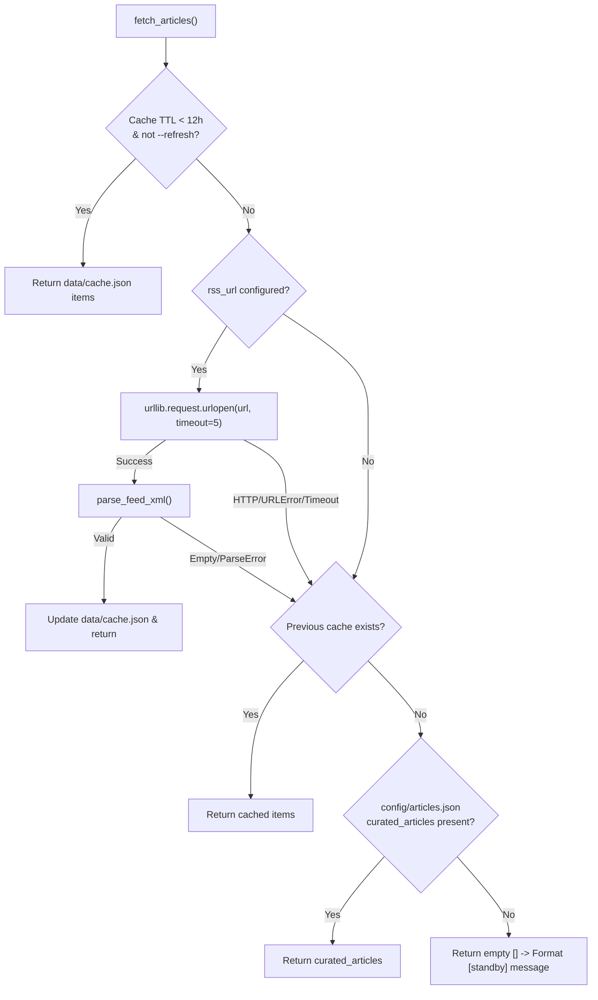

# Phase 5: Skills Matrix & Blog Section — Pattern Map

**Date:** 2026-11-08  
**Status:** Ready for Planning  
**Target Output File:** `.planning/phases/05-skills-matrix-blog-section/05-PATTERNS.md`  
**Phase Directory:** `.planning/phases/05-skills-matrix-blog-section/`  

---

## 1. Executive Summary & File Mapping

This document provides the planner and implementation agents with concrete code patterns, structural templates, and exact analogs extracted from the existing codebase for Phase 5 (`05-skills-matrix-blog-section`).

Phase 5 delivers two core features:
1. **Categorized Skills Matrix SVG (`assets/skills.svg`)**: An 850x380px terminal-themed window rendering a symmetrical 2x2 quadrant grid of core competencies (AI & Data Science, Backend & Systems, SQA & Automation, Embedded & Robotics) with monospaced pill badges, accent dots, and desktop hover transitions.
2. **Plug-and-Play Blog & Publications Section (`README.md`)**: A resilient RSS 2.0 / Atom 1.0 feed ingestion engine in `scripts/update_profile.py` backed by `config/articles.json` and `data/cache.json` (12h TTL), rendering an authentic terminal log box (`cat ~/articles.log`) with clickable hyperlinks.

All code strictly enforces the project's zero-external-dependency rule (pure Python standard library), offline unit test isolation, XML validation, and idempotent file operations.

### Target Files Inventory

| Target File | Operation | Role Classification | Data Flow Description | Closest Codebase Analog |
|---|---|---|---|---|
| `config/skills.json` | **CREATE** | Curated Data Configuration | Loaded by `generate_skills.py` & `update_profile.py`; defines 4 quadrants, accents, and skill arrays | `config/projects.json` |
| `config/articles.json` | **CREATE** | Feed & Fallback Configuration | Loaded by `update_profile.py`; defines `rss_url`, `max_display`, and fallback `curated_articles` | `config/projects.json` |
| `scripts/generate_skills.py` | **CREATE** | Standalone SVG Generator | CLI/Coordinator -> Theme & Config -> Flow-pack Layout -> ElementTree Validation -> `assets/skills.svg` | `scripts/generate_projects.py` & `scripts/generate_metrics.py` |
| `assets/skills.svg` | **CREATE** | Generated Terminal Window Asset | Rendered by generator; committed to repo; embedded into `README.md` (`<!-- SKILLS:START -->`) | `assets/projects.svg` & `assets/metrics.svg` |
| `data/cache.json` | **MODIFY** | Persistent State Cache | Extended with `"articles"` cache section (12h TTL) to avoid external network calls | `data/cache.json` (`project_metrics`, `recent_activity`) |
| `scripts/update_profile.py` | **MODIFY** | Central Coordinator Engine | Ingests configs -> executes generators -> parses feeds -> caches -> patches `README.md` | `scripts/update_profile.py` (Phases 1–4 methods) |
| `README.md` | **MODIFY** | Profile Presentation Target | Surgical injection between `<!-- SKILLS:START -->` and new `<!-- BLOG:START -->` anchors | `README.md` (`<!-- PROJECTS:START -->`, `<!-- METRICS:START -->`) |
| `tests/fixtures/feed_rss2.xml` | **CREATE** | Test Fixture (RSS 2.0) | Offline mock XML feed with `<item>`, `<pubDate>`, and channel title for unit testing | `tests/fixtures/graphql_projects.json` |
| `tests/fixtures/feed_atom.xml` | **CREATE** | Test Fixture (Atom 1.0) | Offline mock XML feed with `<entry>`, `<link href="..." />`, and namespaces for testing | `tests/fixtures/graphql_languages.json` |
| `tests/test_skills.py` | **CREATE** | Offline Test Suite (Skills) | Pytest suite validating skills config, pill packing, XML integrity, hover CSS, and idempotence | `tests/test_projects.py` |
| `tests/test_blog.py` | **CREATE** | Offline Test Suite (Blog) | Pytest suite validating RSS/Atom parsing, date normalizer, cache TTL, network fallbacks, and HTML escaping | `tests/test_metrics.py` |

---

## 2. Per-File Pattern Assignments & Analog Excerpts

---

### 2.1 `config/skills.json` (CREATE)

- **Role:** Central taxonomy and skill inventory data source.
- **Data Flow:** Loaded by `scripts/generate_skills.py` (or fallback `DEFAULT_SKILLS_DATA` if missing/corrupt). Decouples content from SVG rendering logic (Decision D-07).
- **Closest Analog:** `config/projects.json`.

#### Pattern to Implement
```json
[
  {
    "id": "ai-data-science",
    "title": "AI & Data Science",
    "accent": "#a5d6ff",
    "skills": ["PyTorch", "OpenCV", "Scikit-learn", "Pandas", "PyBullet"]
  },
  {
    "id": "backend-systems",
    "title": "Backend & Systems",
    "accent": "#ffa657",
    "skills": ["Python", "Node.js", "Linux/Bash", "MongoDB", "SQLite"]
  },
  {
    "id": "sqa-automation",
    "title": "SQA & Automation",
    "accent": "#3fb950",
    "skills": ["PyTest", "Jest", "CI/CD", "Test Planning", "Static Analysis"]
  },
  {
    "id": "embedded-robotics",
    "title": "Embedded & Robotics",
    "accent": "#d2a8ff",
    "skills": ["C/C++", "ROS2", "Arduino", "ESP32", "Kinematics"]
  }
]
```

*Note:* Supports either a top-level list of quadrant objects or a dict with a `"categories"` key. Plain string skill names avoid dead `url` fields that GitHub `` embeds cannot activate.

---

### 2.2 `config/articles.json` (CREATE)

- **Role:** RSS feed endpoint configuration and curated fallback inventory.
- **Data Flow:** Loaded by `scripts/update_profile.py`. If `rss_url` is configured and accessible, feed is fetched; otherwise, falls back to `data/cache.json`, then to `curated_articles` (Decisions D-13, D-14).
- **Closest Analog:** `config/projects.json`.

#### Pattern to Implement
```json
{
  "rss_url": "",
  "max_display": 4,
  "curated_articles": [
    {
      "title": "Autonomous Rover Navigation with ROS2 and PyBullet",
      "url": "https://github.com/humam-hossain",
      "date": "2024-04-15",
      "platform": "Project Note"
    },
    {
      "title": "Continuous Test Automation Architecture for Linux Embedded Systems",
      "url": "https://github.com/humam-hossain",
      "date": "2024-02-10",
      "platform": "Whitepaper"
    }
  ]
}
```

---

### 2.3 `scripts/generate_skills.py` (CREATE)

- **Role:** Standalone CLI SVG generator producing `assets/skills.svg` (850x380px).
- **Data Flow:** Ingests skills data and theme tokens, computes 2x2 quadrant sub-panel coordinates and dynamic pill widths, validates XML tree via `xml.etree.ElementTree`, and writes to disk.
- **Closest Analogs:** `scripts/generate_projects.py` and `scripts/generate_metrics.py`.

#### Concrete Code Patterns to Copy from Existing Generators

**Standard File Header, Type Annotations, and Imports:**
```python
# [Copy pattern from scripts/generate_projects.py:1-21]
#!/usr/bin/env python3
"""
scripts/generate_skills.py
Standalone SVG vector graphics generator for Categorized Skills Matrix.
Terminal-themed 2x2 quadrant display (850x380) with Neofetch prompt and monospaced badges.
Standard library only: json, pathlib, sys, xml.etree.ElementTree, xml.sax.saxutils.
Zero external dependencies.
"""

from __future__ import annotations

import json
from pathlib import Path
import sys
import xml.etree.ElementTree as ET
import xml.sax.saxutils as saxutils

ROOT_DIR = Path(__file__).resolve().parent.parent
CONFIG_PATH = ROOT_DIR / "config" / "terminal_theme.json"
SKILLS_CONFIG_PATH = ROOT_DIR / "config" / "skills.json"
OUTPUT_PATH = ROOT_DIR / "assets" / "skills.svg"
```

**Quadrant Slot Geometry Definition:**
```python
# [Copy 2x2 grid coordinate pattern from scripts/generate_projects.py:22-27]
QUADRANT_SLOTS = [
    {"x": 30, "y": 80, "width": 380, "height": 135},   # Top-Left: AI & Data Science
    {"x": 440, "y": 80, "width": 380, "height": 135},  # Top-Right: Backend & Systems
    {"x": 30, "y": 230, "width": 380, "height": 135},  # Bottom-Left: SQA & Automation
    {"x": 440, "y": 230, "width": 380, "height": 135}, # Bottom-Right: Embedded & Robotics
]
```

**Built-in Fallback Fixtures (Decision D-11):**
```python
DEFAULT_SKILLS_DATA = [
    {
        "id": "ai-data-science",
        "title": "AI & Data Science",
        "accent": "#a5d6ff",
        "skills": ["PyTorch", "OpenCV", "Scikit-learn", "Pandas", "PyBullet"],
    },
    {
        "id": "backend-systems",
        "title": "Backend & Systems",
        "accent": "#ffa657",
        "skills": ["Python", "Node.js", "Linux/Bash", "MongoDB", "SQLite"],
    },
    {
        "id": "sqa-automation",
        "title": "SQA & Automation",
        "accent": "#3fb950",
        "skills": ["PyTest", "Jest", "CI/CD", "Test Planning", "Static Analysis"],
    },
    {
        "id": "embedded-robotics",
        "title": "Embedded & Robotics",
        "accent": "#d2a8ff",
        "skills": ["C/C++", "ROS2", "Arduino", "ESP32", "Kinematics"],
    },
]
```

**Theme Loading & Monospace Font Resolution:**
```python
# [Copy pattern from scripts/generate_projects.py:211-227]
if theme is None:
    if CONFIG_PATH.is_file():
        try:
            with open(CONFIG_PATH, "r", encoding="utf-8") as f:
                theme = json.load(f)
        except Exception:
            theme = {}
    else:
        theme = {}

colors = theme.get("colors", {})
bg_body = colors.get("background", {}).get("body", "#0d1117")
bg_header = colors.get("background", {}).get("header", "#161b22")
border_color = colors.get("border", "#30363d")
t = theme.get("typography", {})
font_family = t.get(
    "font_family",
    'ui-monospace, SFMono-Regular, Menlo, Monaco, Consolas, "Liberation Mono", "Courier New", monospace',
)
```

**Terminal Window Chrome, Traffic Lights, and Neofetch Prompt (Decisions D-01, D-04, D-05, D-06):**
```python
# [Copy window chrome structure from scripts/generate_projects.py:229-268]
lines = [
    '<svg xmlns="http://www.w3.org/2000/svg" viewBox="0 0 850 380" width="100%" height="100%">',
    '  <defs>',
    '    <style>',
    f'      .mono {{ font-family: {font_family}; text-rendering: geometricPrecision; }}',
    '      .title { font-size: 13px; fill: #8b949e; text-anchor: middle; font-weight: 400; }',
    '      .prompt-cmd { font-size: 13px; }',
    '      .prompt-user { fill: #58a6ff; font-weight: 600; }',
    '      .prompt-arg { fill: #c9d1d9; font-weight: 400; }',
    '      .cat-title { font-size: 13px; font-weight: 600; }',
    '      .pill-text { font-size: 11px; fill: #c9d1d9; font-weight: 500; }',
    '      .skill-pill { transition: transform 0.15s ease-in-out; }',
    '      .skill-pill:hover .pill-bg { fill: #282e37; stroke: #8b949e; }',
    '      .skill-pill:hover .pill-text { fill: #f0f6fc; }',
    '    </style>',
    '  </defs>',
    '',
    '  <!-- Terminal Window Frame -->',
    f'  <rect width="850" height="380" rx="10" ry="10" fill="{bg_body}" stroke="{border_color}" stroke-width="1" />',
    '',
    '  <!-- Header Bar -->',
    f'  <rect width="850" height="38" rx="10" ry="10" fill="{bg_header}" />',
    f'  <rect y="28" width="850" height="10" fill="{bg_header}" />',
    f'  <line x1="0" y1="38" x2="850" y2="38" stroke="{border_color}" stroke-width="1" />',
    '',
    '  <!-- Traffic Lights -->',
    '  <circle cx="25" cy="19" r="6" fill="#ff5f56" />',
    '  <circle cx="45" cy="19" r="6" fill="#ffbd2e" />',
    '  <circle cx="65" cy="19" r="6" fill="#27c93f" />',
    '',
    '  <!-- Window Title -->',
    '  <text x="425" y="24" class="mono title">skills — zsh</text>',
    '',
    '  <!-- Prompt Line -->',
    '  <text x="30" y="62" class="mono prompt-cmd">',
    '    <tspan class="prompt-user">humam@workstation:~$ </tspan>',
    '    <tspan class="prompt-arg">neofetch --skills</tspan>',
    '  </text>',
    '',
    '  <!-- 2x2 Quadrant Grid -->',
]
```

**Dynamic Flow-Pack Pill Rendering Loop (Decisions D-02, D-03, D-08):**
```python
for idx, slot in enumerate(QUADRANT_SLOTS):
    if idx >= len(skills_data):
        break
    cat = skills_data[idx]
    title = saxutils.escape(cat.get("title", f"Category {idx+1}"))
    accent = cat.get("accent", "#58a6ff")
    skills = cat.get("skills", [])[:6]  # Hard capacity cap at 6

    px, py, pw, ph = slot["x"], slot["y"], slot["width"], slot["height"]

    # Quadrant container sub-panel
    lines.append(f'  <g id="quadrant-{cat.get("id", idx)}">')
    lines.append(f'    <rect x="{px}" y="{py}" width="{pw}" height="{ph}" rx="6" fill="#161b22" stroke="{border_color}" stroke-width="1" />')
    lines.append(f'    <text x="{px + 16}" y="{py + 25}" fill="{accent}" class="mono cat-title">{title}</text>')

    cur_x = px + 16
    cur_y = py + 44
    max_x = px + pw - 16
    pill_h = 26
    row_gap = 10
    col_gap = 8

    for skill in skills:
        escaped_skill = saxutils.escape(skill)
        pill_w = round(32 + len(skill) * 6.8)
        if cur_x + pill_w > max_x and cur_x > px + 16:
            cur_x = px + 16
            cur_y += pill_h + row_gap

        lines.append(
            f'    <g class="skill-pill">'
            f'<rect x="{cur_x}" y="{cur_y}" width="{pill_w}" height="{pill_h}" rx="4" class="pill-bg" fill="#21262d" stroke="{border_color}" stroke-width="1" />'
            f'<circle cx="{cur_x + 12}" cy="{cur_y + 13}" r="3" fill="{accent}" />'
            f'<text x="{cur_x + 22}" y="{cur_y + 17}" class="mono pill-text">{escaped_skill}</text>'
            f'</g>'
        )
        cur_x += pill_w + col_gap

    lines.append('  </g>')

lines.append('</svg>\n')
svg_text = "\n".join(lines)

# Strict XML validation before returning
ET.fromstring(svg_text)
return svg_text
```

**CLI Entrypoint & Standalone Execution:**
```python
# [Copy pattern from scripts/generate_projects.py:286-297]
def main() -> int:
    """CLI Entry point for standalone SVG generation."""
    print("Generating assets/skills.svg...")
    skills = load_skills_config(SKILLS_CONFIG_PATH)
    svg_content = generate_skills_svg(skills)
    OUTPUT_PATH.parent.mkdir(parents=True, exist_ok=True)
    OUTPUT_PATH.write_text(svg_content, encoding="utf-8")
    print(f"Successfully generated {OUTPUT_PATH}")
    return 0


if __name__ == "__main__":
    sys.exit(main())
```

---

### 2.4 `data/cache.json` (MODIFY)

- **Role:** Persistent telemetry cache storing feed entries and TTL timestamp.
- **Data Flow:** Read/written by `update_profile.py`. Stores `"articles"` payload.
- **Closest Analog:** `data/cache.json` (`project_metrics`, `recent_activity`).

#### Existing Cache Section Pattern
```json
// [From data/cache.json:24-26]
  "project_metrics": {
    "last_updated": "2026-11-08T03:29:48Z",
    "projects": [ ... ]
  }
```

#### Cache Section Extension for Articles
```json
  "articles": {
    "last_updated": "2026-11-08T14:45:04Z",
    "items": [
      {
        "title": "Autonomous Rover Navigation with ROS2 and PyBullet",
        "url": "https://github.com/humam-hossain",
        "date": "2024-04-15",
        "platform": "Project Note"
      },
      {
        "title": "Continuous Test Automation Architecture for Linux Embedded Systems",
        "url": "https://github.com/humam-hossain",
        "date": "2024-02-10",
        "platform": "Whitepaper"
      }
    ]
  }
```

---

### 2.5 `scripts/update_profile.py` (MODIFY)

- **Role:** Central coordinator engine orchestrating skills generation, article fetching, caching, and README anchor updates.
- **Data Flow:**
  1. Loads `config/skills.json` -> calls `generate_skills_svg()` -> writes `assets/skills.svg` -> updates `<!-- SKILLS:START -->` in `README.md`.
  2. Loads `config/articles.json` -> checks `data/cache.json` TTL (12h) -> fetches RSS/Atom or uses cache/fallback -> formats terminal log -> updates `<!-- BLOG:START -->` in `README.md`.
- **Closest Analog:** Existing methods in `scripts/update_profile.py`.

#### Concrete Methods to Add to `scripts/update_profile.py`

**Import Integration:**
```python
# [scripts/update_profile.py:27-49 extension]
try:
    from scripts.generate_skills import generate_skills_svg, DEFAULT_SKILLS_DATA
except (ImportError, ModuleNotFoundError):
    from generate_skills import generate_skills_svg, DEFAULT_SKILLS_DATA

SKILLS_CONFIG_PATH = ROOT_DIR / "config" / "skills.json"
ARTICLES_CONFIG_PATH = ROOT_DIR / "config" / "articles.json"
SKILLS_SVG_PATH = ROOT_DIR / "assets" / "skills.svg"
```

**Skills Config Loader:**
```python
def load_skills_config(config_path: Path) -> list[dict]:
    """Loads config/skills.json with graceful fallback to DEFAULT_SKILLS_DATA."""
    if not config_path.is_file():
        log_warn(f"Skills config not found at {config_path}. Using default categories.")
        return DEFAULT_SKILLS_DATA
    try:
        with open(config_path, "r", encoding="utf-8") as f:
            data = json.load(f)
            if isinstance(data, dict):
                return data.get("categories", DEFAULT_SKILLS_DATA)
            if isinstance(data, list):
                return data
    except Exception as e:
        log_warn(f"Failed to parse {config_path}: {e}. Using default categories.")
    return DEFAULT_SKILLS_DATA
```

**Articles Config Loader:**
```python
def load_articles_config(config_path: Path) -> dict:
    """Loads config/articles.json with clean defaults."""
    default_config = {
        "rss_url": "",
        "max_display": 4,
        "curated_articles": [],
    }
    if not config_path.is_file():
        log_warn(f"Articles config not found at {config_path}. Using defaults.")
        return default_config
    try:
        with open(config_path, "r", encoding="utf-8") as f:
            return {**default_config, **json.load(f)}
    except Exception as e:
        log_warn(f"Failed to parse {config_path}: {e}. Using defaults.")
        return default_config
```

**Dual-Format RSS 2.0 & Atom 1.0 XML Feed Parser (Decision D-16):**
```python
def parse_feed_xml(xml_bytes: bytes) -> list[dict]:
    """
    Parses RSS 2.0 or Atom 1.0 XML content using stdlib ElementTree with namespace stripping.
    Returns list of dicts with title, url, date, and platform.
    """
    root = ET.fromstring(xml_bytes)
    root_tag = root.tag.split("}")[-1].lower()
    articles = []

    if root_tag == "rss":
        channel = root.find("channel")
        platform_name = "Article"
        if channel is not None:
            c_title = channel.findtext("title", "")
            if c_title.strip():
                platform_name = c_title.strip()

        for item in root.findall(".//item"):
            title = (item.findtext("title") or "").strip()
            link = (item.findtext("link") or "").strip()
            pub_date = (item.findtext("pubDate") or "").strip()
            if title and link:
                articles.append({
                    "title": title,
                    "url": link,
                    "date": normalize_date_string(pub_date),
                    "platform": platform_name,
                })

    elif root_tag == "feed":
        feed_title = "Article"
        for child in root:
            if child.tag.split("}")[-1].lower() == "title" and child.text:
                feed_title = child.text.strip()
                break

        for entry in root.findall(".//{*}entry") or [e for e in root if e.tag.split("}")[-1].lower() == "entry"]:
            title = ""
            link = ""
            date_str = ""
            for elem in entry:
                tag = elem.tag.split("}")[-1].lower()
                if tag == "title" and elem.text:
                    title = elem.text.strip()
                elif tag == "link":
                    link = elem.attrib.get("href", elem.text or "").strip()
                elif tag in ("published", "updated") and not date_str and elem.text:
                    date_str = elem.text.strip()

            if title and link:
                articles.append({
                    "title": title,
                    "url": link,
                    "date": normalize_date_string(date_str),
                    "platform": feed_title,
                })

    return articles
```

**Date Normalizer (Decision D-17):**
```python
def normalize_date_string(date_str: str) -> str:
    """Normalizes RFC 822/2822, ISO 8601, or plain date strings to YYYY-MM-DD."""
    if not date_str or not date_str.strip():
        return datetime.date.today().strftime("%Y-%m-%d")

    s = date_str.strip()
    if len(s) == 10 and s[4] == "-" and s[7] == "-":
        return s

    # ISO 8601 / RFC 3339
    try:
        clean_iso = s.replace("Z", "+00:00")
        dt = datetime.datetime.fromisoformat(clean_iso)
        return dt.strftime("%Y-%m-%d")
    except Exception:
        pass

    # RFC 822 / 2822
    try:
        dt = email.utils.parsedate_to_datetime(s)
        return dt.strftime("%Y-%m-%d")
    except Exception:
        pass

    return datetime.date.today().strftime("%Y-%m-%d")
```

**Resilient Article Fetcher with 12h Cache TTL & Cascading Fallback (Decisions D-13, D-15, D-18):**
```python
def fetch_articles(
    articles_config: dict,
    cache: dict,
    force_refresh: bool = False,
) -> list[dict]:
    """
    Retrieves articles through resilient fallback cascade:
    1. Checks cache TTL (12h). If cache is valid and not force_refresh, returns cached items.
    2. Fetches live RSS/Atom feed if rss_url configured (timeout 5s).
    3. On failure/timeout/empty url, falls back to cache['articles']['items'].
    4. If cache empty, falls back to config['curated_articles'].
    """
    rss_url = (articles_config.get("rss_url") or "").strip()
    cached_articles = cache.get("articles", {})
    last_updated_str = cached_articles.get("last_updated")
    now_utc = datetime.datetime.now(datetime.timezone.utc)

    # 1. Cache TTL Check (12 hours)
    if not force_refresh and last_updated_str and cached_articles.get("items"):
        try:
            cached_dt = parse_iso_datetime(last_updated_str)
            elapsed_seconds = (now_utc - cached_dt).total_seconds()
            if 0 <= elapsed_seconds < 12 * 3600:
                log_info("Using cached articles from data/cache.json (TTL valid)")
                return cached_articles["items"]
        except Exception:
            pass

    # 2. Live Feed Fetch
    if rss_url:
        try:
            req = urllib.request.Request(
                rss_url,
                headers={"User-Agent": "humam-hossain-profile-updater"},
            )
            with urllib.request.urlopen(req, timeout=5) as resp:
                xml_bytes = resp.read(1024 * 1024)  # Clamped to 1MB
                parsed = parse_feed_xml(xml_bytes)
                if parsed:
                    cache["articles"] = {
                        "last_updated": now_utc.strftime("%Y-%m-%dT%H:%M:%SZ"),
                        "items": parsed,
                    }
                    log_ok(f"Fetched {len(parsed)} articles from {rss_url}")
                    return parsed
        except Exception as e:
            log_warn(f"Failed to fetch live feed ({e}). Triggering fallback cascade.")

    # 3. Fallback to existing cached articles
    if cached_articles.get("items"):
        log_info("Using previously cached articles as fallback")
        return cached_articles["items"]

    # 4. Fallback to curated articles from config
    curated = articles_config.get("curated_articles", [])
    if curated:
        log_info("Using curated articles from config/articles.json")
        cache["articles"] = {
            "last_updated": now_utc.strftime("%Y-%m-%dT%H:%M:%SZ"),
            "items": curated,
        }
        return curated

    return []
```

**Terminal Log Block Formatter (Decisions D-17, D-19, D-20, D-21):**
```python
def format_articles_terminal_log(articles: list[dict], max_display: int = 4) -> str:
    """Formats articles into an authentic terminal cat ~/articles.log pre-code block."""
    lines = [
        '<div align="left">',
        "<pre><code>humam@workstation:~$ cat ~/articles.log",
    ]

    if not articles:
        lines.append("* [standby] feed listener active — configure rss_url in config/articles.json")
    else:
        for art in articles[:max_display]:
            raw_title = art.get("title", "")
            # Strip potential HTML tags before unescaping
            clean_title = re.sub(r"<[^>]+>", "", raw_title)
            unescaped = html.unescape(clean_title)
            display_title = unescaped if len(unescaped) <= 55 else unescaped[:52] + "..."
            safe_title = html.escape(display_title)

            raw_url = art.get("url", "#")
            safe_url = raw_url if raw_url.startswith(("http://", "https://")) else "#"
            safe_url = html.escape(safe_url)

            date_val = art.get("date", datetime.date.today().strftime("%Y-%m-%d"))
            platform = html.escape(art.get("platform", "Article"))
            lines.append(f'* [{date_val}] <a href="{safe_url}">{safe_title}</a> ({platform})')

    lines.append("</code></pre>")
    lines.append("</div>")
    return "\n".join(lines)
```

**Surgical README Patching for Skills & Blog (Decisions D-19, D-22):**
```python
def update_readme_skills(readme_path: Path) -> bool:
    """Injects skills SVG card between <!-- SKILLS:START --> and <!-- SKILLS:END --> idempotently."""
    if not readme_path.is_file():
        log_warn(f"README file not found at {readme_path}")
        return False

    content = readme_path.read_text(encoding="utf-8")
    start_tag = "<!-- SKILLS:START -->"
    end_tag = "<!-- SKILLS:END -->"

    if start_tag not in content or end_tag not in content:
        log_warn("README.md missing <!-- SKILLS:START --> or <!-- SKILLS:END --> markers.")
        return False

    start_idx = content.index(start_tag) + len(start_tag)
    end_idx = content.index(end_tag)

    replacement = """
<div align="center">
  
</div>
"""
    new_content = content[:start_idx] + "\n" + replacement.strip() + "\n" + content[end_idx:]
    if new_content == content:
        log_info("README.md skills section already up to date (idempotent skip)")
        return False

    readme_path.write_text(new_content, encoding="utf-8")
    log_ok("Updated README.md with categorized skills matrix")
    return True


def update_readme_blog(readme_path: Path, blog_html: str) -> bool:
    """
    Injects terminal articles log between <!-- BLOG:START --> and <!-- BLOG:END --> idempotently.
    Automatically inserts markers directly below <!-- SKILLS:END --> if missing.
    """
    if not readme_path.is_file():
        log_warn(f"README file not found at {readme_path}")
        return False

    content = readme_path.read_text(encoding="utf-8")
    start_tag = "<!-- BLOG:START -->"
    end_tag = "<!-- BLOG:END -->"

    # Auto-insert markers if not present
    if start_tag not in content or end_tag not in content:
        skills_end = "<!-- SKILLS:END -->"
        if skills_end in content:
            idx = content.index(skills_end) + len(skills_end)
            marker_block = "\n\n<!-- BLOG:START -->\n<!-- BLOG:END -->"
            content = content[:idx] + marker_block + content[idx:]
        else:
            log_warn("README.md missing <!-- SKILLS:END --> marker; cannot position blog section.")
            return False

    start_idx = content.index(start_tag) + len(start_tag)
    end_idx = content.index(end_tag)

    new_content = content[:start_idx] + "\n" + blog_html.strip() + "\n" + content[end_idx:]
    if new_content == content:
        log_info("README.md blog section already up to date (idempotent skip)")
        return False

    readme_path.write_text(new_content, encoding="utf-8")
    log_ok("Updated README.md with publications and articles log")
    return True
```

---

### 2.6 `README.md` (MODIFY)

- **Role:** Main public presentation target.
- **Data Flow:** Injected with `assets/skills.svg` inside `<!-- SKILLS:START -->` and `<pre><code>` block inside `<!-- BLOG:START -->`.
- **Closest Analog:** Existing `<!-- PROJECTS:START -->` and `<!-- METRICS:START -->` blocks in `README.md`.

#### Target Sequence in `README.md` (Decision D-22)
```markdown
<!-- METRICS:START -->
...
<!-- METRICS:END -->

<!-- SKILLS:START -->
<div align="center">
  
</div>
<!-- SKILLS:END -->

<!-- BLOG:START -->
<div align="left">
<pre><code>humam@workstation:~$ cat ~/articles.log
* [2024-04-15] <a href="https://github.com/humam-hossain">Autonomous Rover Navigation with ROS2 and PyBullet</a> (Project Note)
* [2024-02-10] <a href="https://github.com/humam-hossain">Continuous Test Automation Architecture for Linux Embedded Systems</a> (Whitepaper)
</code></pre>
</div>
<!-- BLOG:END -->

<br />

<div align="center">
  <code>humam@workstation:~$ exit</code>
</div>
```

---

### 2.7 Test Fixtures (`tests/fixtures/`) (CREATE)

- **Role:** Offline static XML feeds for 100% network isolation during pytest runs.
- **Closest Analogs:** `tests/fixtures/graphql_projects.json` and `tests/fixtures/rest_events.json`.

#### 1. `tests/fixtures/feed_rss2.xml`
```xml
<?xml version="1.0" encoding="UTF-8" ?>
<rss version="2.0">
  <channel>
    <title>Dev Engineering Log</title>
    <link>https://example.com</link>
    <description>Engineering notes and whitepapers</description>
    <item>
      <title>Building High-Throughput Robotics Simulators with ROS2</title>
      <link>https://example.com/robotics-sim</link>
      <pubDate>Sun, 19 May 2024 14:30:00 GMT</pubDate>
      <description>Practical guide to low-latency simulations.</description>
    </item>
    <item>
      <title>Real-Time Embedded &amp; Edge AI Inference Optimization</title>
      <link>https://example.com/edge-ai</link>
      <pubDate>Mon, 01 Apr 2024 09:15:00 +0000</pubDate>
      <description>Quantization techniques for ARM microcontrollers.</description>
    </item>
  </channel>
</rss>
```

#### 2. `tests/fixtures/feed_atom.xml`
```xml
<?xml version="1.0" encoding="utf-8"?>
<feed xmlns="http://www.w3.org/2005/Atom">
  <title>Workstation Research Notes</title>
  <link href="https://example.com/atom" rel="self" />
  <updated>2024-05-20T10:00:00Z</updated>
  <id>urn:uuid:60a76c80-d399-11d9-b93C-0003939e0af6</id>
  <entry>
    <title>Continuous Integration for Embedded Firmware with PyTest</title>
    <link href="https://example.com/embedded-ci" rel="alternate" />
    <id>urn:uuid:1225c695-cfb8-4ebb-aaaa-80da344efa6a</id>
    <published>2024-05-18T08:00:00Z</published>
    <summary>Automated hardware-in-the-loop test runners.</summary>
  </entry>
</feed>
```

---

### 2.8 `tests/test_skills.py` (CREATE)

- **Role:** Pytest suite testing categorized skills generation, layout math, and XML integrity.
- **Closest Analog:** `tests/test_projects.py`.

#### Concrete Test Patterns to Copy from `tests/test_projects.py`

**Imports & Fixture Paths:**
```python
# [Copy pattern from tests/test_projects.py:1-38]
from __future__ import annotations

import json
from pathlib import Path
import xml.etree.ElementTree as ET

import pytest

from scripts.generate_skills import (
    DEFAULT_SKILLS_DATA,
    QUADRANT_SLOTS,
    generate_skills_svg,
)
from scripts.update_profile import (
    SKILLS_CONFIG_PATH,
    SKILLS_SVG_PATH,
    load_skills_config,
    update_readme_skills,
    write_svg_idempotent,
)
```

**Test Implementations:**
```python
def test_skills_config_loading(tmp_path):
    """Verify loading config/skills.json and schema fallback when corrupt/missing."""
    # 1. Existing checked-in config
    categories = load_skills_config(SKILLS_CONFIG_PATH)
    assert len(categories) == 4
    assert categories[0]["id"] == "ai-data-science"
    assert categories[0]["accent"] == "#a5d6ff"
    assert "PyTorch" in categories[0]["skills"]

    # 2. Corrupted file fallback
    corrupt_file = tmp_path / "corrupt_skills.json"
    corrupt_file.write_text("{bad json", encoding="utf-8")
    fallback = load_skills_config(corrupt_file)
    assert fallback == DEFAULT_SKILLS_DATA


def test_generate_skills_svg_structure():
    """Verify SVG root, geometry floor (850x380), chrome, traffic lights, and Neofetch prompt."""
    svg = generate_skills_svg()
    root = ET.fromstring(svg)

    assert root.tag.endswith("svg")
    assert root.attrib.get("viewBox") == "0 0 850 380"
    assert "skills — zsh" in svg
    assert "humam@workstation:~$" in svg
    assert "neofetch --skills" in svg
    assert '#ff5f56' in svg  # Red traffic light
    assert '#ffbd2e' in svg  # Yellow traffic light
    assert '#27c93f' in svg  # Green traffic light


def test_skills_quadrants_and_accents():
    """Verify all 4 quadrants render with rounded rects and designated ANSI accents."""
    svg = generate_skills_svg()
    assert 'id="quadrant-ai-data-science"' in svg
    assert 'id="quadrant-backend-systems"' in svg
    assert 'id="quadrant-sqa-automation"' in svg
    assert 'id="quadrant-embedded-robotics"' in svg

    assert '#a5d6ff' in svg  # Cyan
    assert '#ffa657' in svg  # Amber
    assert '#3fb950' in svg  # Green
    assert '#d2a8ff' in svg  # Purple


def test_skills_pill_wrapping_and_capping():
    """Verify dynamic pill wrapping and hard capacity capping at 6 skills."""
    test_data = [
        {
            "id": "test-cat",
            "title": "Test Category",
            "accent": "#58a6ff",
            "skills": [
                "SkillOne", "SkillTwo", "SkillThree",
                "SkillFour", "SkillFive", "SkillSix",
                "SkillSevenOverflow",
            ],
        }
    ]
    svg = generate_skills_svg(test_data)
    assert "SkillSix" in svg
    assert "SkillSevenOverflow" not in svg  # Capped at 6


def test_skills_hover_css_and_xml_validity():
    """Verify desktop hover CSS pseudo-classes and validate clean ElementTree parsing."""
    svg = generate_skills_svg()
    assert ".skill-pill:hover" in svg
    assert ".pill-bg" in svg
    # Must parse without throwing ParseError
    parsed_root = ET.fromstring(svg)
    assert parsed_root is not None


def test_skills_idempotent_write(tmp_path):
    """Verify write_svg_idempotent returns False on identical second write."""
    target = tmp_path / "skills.svg"
    svg = generate_skills_svg()
    assert write_svg_idempotent(target, svg) is True
    assert write_svg_idempotent(target, svg) is False
```

---

### 2.9 `tests/test_blog.py` (CREATE)

- **Role:** Pytest suite testing RSS 2.0 / Atom 1.0 parsing, date normalization, cache TTL, fallback cascade, and README injection.
- **Closest Analog:** `tests/test_metrics.py`.

#### Concrete Test Patterns to Copy from `tests/test_metrics.py`

**Imports & Mock Setup:**
```python
# [Copy pattern from tests/test_metrics.py:1-40]
from __future__ import annotations

import datetime
import json
from pathlib import Path
from unittest.mock import MagicMock, patch
import urllib.error

import pytest

from scripts.update_profile import (
    ARTICLES_CONFIG_PATH,
    fetch_articles,
    format_articles_terminal_log,
    load_articles_config,
    normalize_date_string,
    parse_feed_xml,
    update_readme_blog,
)

FIXTURES_DIR = Path(__file__).resolve().parent / "fixtures"
```

**Test Implementations:**
```python
def test_articles_config_loading():
    """Verify config/articles.json schema and default fallbacks."""
    cfg = load_articles_config(ARTICLES_CONFIG_PATH)
    assert "rss_url" in cfg
    assert "max_display" in cfg
    assert isinstance(cfg.get("curated_articles"), list)


def test_rss2_feed_parsing():
    """Verify offline parsing of RSS 2.0 XML fixture with channel title and items."""
    fixture_path = FIXTURES_DIR / "feed_rss2.xml"
    xml_bytes = fixture_path.read_bytes()
    articles = parse_feed_xml(xml_bytes)

    assert len(articles) == 2
    assert articles[0]["title"] == "Building High-Throughput Robotics Simulators with ROS2"
    assert articles[0]["url"] == "https://example.com/robotics-sim"
    assert articles[0]["date"] == "2024-05-19"
    assert articles[0]["platform"] == "Dev Engineering Log"


def test_atom1_feed_parsing():
    """Verify offline parsing of Atom 1.0 XML fixture with namespace stripping."""
    fixture_path = FIXTURES_DIR / "feed_atom.xml"
    xml_bytes = fixture_path.read_bytes()
    articles = parse_feed_xml(xml_bytes)

    assert len(articles) == 1
    assert articles[0]["title"] == "Continuous Integration for Embedded Firmware with PyTest"
    assert articles[0]["url"] == "https://example.com/embedded-ci"
    assert articles[0]["date"] == "2024-05-18"
    assert articles[0]["platform"] == "Workstation Research Notes"


def test_date_normalization():
    """Verify normalize_date_string handles RFC 822, ISO 8601, and YYYY-MM-DD."""
    assert normalize_date_string("Sun, 19 May 2024 14:30:00 GMT") == "2024-05-19"
    assert normalize_date_string("2024-05-18T08:00:00Z") == "2024-05-18"
    assert normalize_date_string("2024-04-15") == "2024-04-15"
    assert normalize_date_string("") == datetime.date.today().strftime("%Y-%m-%d")


def test_title_clamping_and_escaping():
    """Verify titles >55 chars are clamped with '...' and HTML entities unescaped/escaped."""
    articles = [
        {
            "title": "A Very Long Title That Definitely Exceeds The Strict Monospace Fifty-Five Character Limit For Terminal Display",
            "url": "https://example.com/long",
            "date": "2024-05-19",
            "platform": "Blog & Tech",
        },
        {
            "title": "Clean &amp; Safe &lt;Code&gt; &quot;Testing&quot;",
            "url": "https://example.com/safe",
            "date": "2024-05-19",
            "platform": "Notes",
        },
    ]
    output = format_articles_terminal_log(articles, max_display=2)
    assert "A Very Long Title That Definitely Exceeds The Stric..." in output
    assert "Clean &amp; Safe &lt;Code&gt; &quot;Testing&quot;" in output
    assert "Blog &amp; Tech" in output


def test_security_url_sanitization():
    """Verify unsafe protocols (javascript:) are sanitized to '#'."""
    articles = [
        {
            "title": "Malicious Link Test",
            "url": "javascript:alert('xss')",
            "date": "2024-05-19",
            "platform": "Test",
        }
    ]
    output = format_articles_terminal_log(articles)
    assert '<a href="#">' in output
    assert "javascript:" not in output


def test_cache_ttl_and_refresh():
    """Verify 12h TTL prevents network call unless force_refresh is True."""
    now = datetime.datetime.now(datetime.timezone.utc)
    recent_ts = (now - datetime.timedelta(hours=2)).strftime("%Y-%m-%dT%H:%M:%SZ")

    cache = {
        "articles": {
            "last_updated": recent_ts,
            "items": [{"title": "Cached Post", "url": "https://example.com/cached", "date": "2024-05-01"}],
        }
    }
    cfg = {"rss_url": "https://example.com/feed.xml", "curated_articles": []}

    # Should hit cache without making network request
    with patch("urllib.request.urlopen") as mock_url:
        res = fetch_articles(cfg, cache, force_refresh=False)
        assert len(res) == 1
        assert res[0]["title"] == "Cached Post"
        mock_url.assert_not_called()

        # force_refresh bypasses cache
        mock_url.side_effect = urllib.error.URLError("Simulated offline")
        res_forced = fetch_articles(cfg, cache, force_refresh=True)
        assert mock_url.called
        assert len(res_forced) == 1  # Falls back to cache on error


def test_network_fallbacks():
    """Verify HTTPError / URLError / timeout gracefully cascade to cache then curated."""
    cfg = {
        "rss_url": "https://example.com/offline-feed.xml",
        "curated_articles": [
            {"title": "Curated Backup", "url": "https://example.com/backup", "date": "2024-01-01"}
        ],
    }
    empty_cache = {}

    with patch("urllib.request.urlopen", side_effect=urllib.error.HTTPError(None, 404, "Not Found", None, None)):
        res = fetch_articles(cfg, empty_cache)
        assert len(res) == 1
        assert res[0]["title"] == "Curated Backup"


def test_standby_formatting():
    """Verify standby message formatting when article list is empty."""
    output = format_articles_terminal_log([])
    assert "* [standby] feed listener active — configure rss_url in config/articles.json" in output


def test_readme_blog_injection(tmp_path):
    """Verify idempotent README injection between <!-- BLOG:START --> and <!-- BLOG:END -->."""
    mock_readme = tmp_path / "README.md"
    original = (
        "# Profile\n\n"
        "<!-- SKILLS:END -->\n\n"
        "<code>humam@workstation:~$ exit</code>\n"
    )
    mock_readme.write_text(original, encoding="utf-8")
    mock_html = "<pre><code>humam@workstation:~$ cat ~/articles.log\n* [2024-05-19] Test Post</code></pre>"

    # 1. First injection auto-creates markers and updates
    res1 = update_readme_blog(mock_readme, mock_html)
    assert res1 is True

    content = mock_readme.read_text(encoding="utf-8")
    assert "<!-- BLOG:START -->" in content
    assert "<!-- BLOG:END -->" in content
    assert "* [2024-05-19] Test Post" in content

    # 2. Idempotent second injection
    res2 = update_readme_blog(mock_readme, mock_html)
    assert res2 is False
```

---

## 3. Core Algorithms to Implement

### 3.1 Flow-Pack Dynamic Pill Layout Algorithm (Decisions D-02, D-03, D-05, D-08)

The pill packer calculates individual pill dimensions dynamically based on character length and monospace aspect ratio (~6.8px width per 11px glyph).

```
   Panel Width = 380px (Usable width: 380 - 2 * 16 = 348px)
   ┌────────────────────────────────────────────────────────────┐
   │ AI & Data Science                                          │
   │                                                            │
   │ ┌──────────────┐  ┌──────────────┐  ┌───────────────────┐  │
   │ │  ● PyTorch   │  │  ● OpenCV    │  │  ● Scikit-learn   │  │ (Row 1)
   │ └──────────────┘  └──────────────┘  └───────────────────┘  │
   │                                                            │
   │ ┌──────────────┐  ┌──────────────┐                         │
   │ │  ● Pandas    │  │  ● PyBullet  │                         │ (Row 2)
   │ └──────────────┘  └──────────────┘                         │
   └────────────────────────────────────────────────────────────┘
```

#### Mathematical Invariants
- `pill_width = round(32 + len(skill) * 6.8)` (where 32px accounts for 12px dot offset, 6px radius, and 14px right margin).
- `cur_x + pill_width > max_x`: if true and `cur_x > px + 16`, line wraps:
  - `cur_x = px + 16`
  - `cur_y += 26 (pill_h) + 10 (row_gap) = 36px`
- Hard capacity capping: `skills = cat.get("skills", [])[:6]`.
- Guarantee: 5–6 curated skills will always pack cleanly into exactly 2 rows with `cur_y = py + 80` (bottom of row 2 at `py + 106`, leaving 29px breathing room above quadrant bottom at `py + 135`).

---

### 3.2 Dual-Format XML Feed Parser with Namespace Stripping (Decision D-16)

Standard Python `xml.etree.ElementTree` retains full XML namespaces in element tags (e.g. `{http://www.w3.org/2005/Atom}entry`). Hand-rolling namespace prefixes makes feed ingestion brittle across publishers.

#### Invariant
Tag normalization using `local_tag = elem.tag.split("}")[-1].lower()` allows unified querying across both standards:
- **RSS 2.0**:
  - Item container: `root.findall(".//item")`
  - Title: `item.findtext("title")`
  - Link: `item.findtext("link")`
  - Date: `item.findtext("pubDate")`
  - Platform: `channel.findtext("title")`
- **Atom 1.0**:
  - Entry container: `root.findall(".//{*}entry")` or child tag check
  - Title: child element with tag `title`
  - Link: child element with tag `link` using `elem.attrib.get("href")` or text
  - Date: child element with tag `published` or `updated`
  - Platform: feed-level `title`

---

### 3.3 Multi-Format Date Normalizer (Decision D-17)

RFC 822 / 2822 timestamps from RSS feeds feature complex timezone designations (`GMT`, `EDT`, `+0000`, `-0400`) and weekday abbreviations, whereas Atom feeds utilize ISO 8601 / RFC 3339 timestamps.

#### Invariant Pipeline
1. Direct check: `len(s) == 10 and s[4] == '-' and s[7] == '-'` -> return as-is.
2. `datetime.datetime.fromisoformat(s.replace("Z", "+00:00"))` -> format `YYYY-MM-DD`.
3. `email.utils.parsedate_to_datetime(s)` -> format `YYYY-MM-DD`.
4. Fallback on malformed date string: `datetime.date.today().strftime("%Y-%m-%d")`.

---

### 3.4 Multi-Layer Defensive Fallback Cascade (Decisions D-11, D-13, D-15)

The profile update engine must never throw unhandled exceptions or fail CI builds due to network outages, 404/500 HTTP responses, or DNS timeouts.



---

### 3.5 Terminal Log Formatter & Safe HTML Clamping (Decisions D-17, D-19, D-21)

Feed titles must fit within standard 80-column terminal bounds without breaking markdown formatting.

#### Invariant Pipeline
1. Strip HTML tags from raw titles: `re.sub(r'<[^>]+>', '', raw_title)`.
2. Decode HTML entities: `unescaped = html.unescape(stripped)`.
3. Clamp to 55 characters: `display = unescaped if len(unescaped) <= 55 else unescaped[:52] + "..."`.
4. Re-escape for safe HTML embedding: `safe_title = html.escape(display)`.
5. URL validation: require `http://` or `https://`; otherwise default to `#`.
6. Output format: `* [{date}] <a href="{safe_url}">{safe_title}</a> ({platform})`.

---

## 4. Cross-Cutting Patterns Checklist

Before committing any implementation file in Phase 5, verify conformance against these architectural invariants:

- [ ] **Pure Python Standard Library Exclusively**: No imports of `requests`, `feedparser`, `bs4`, `svgwrite`, or any other third-party pip packages.
- [ ] **Strict XML Validation**: Every generated SVG string must pass `xml.etree.ElementTree.fromstring(svg_str)` before being written or returned.
- [ ] **Idempotent File Writes**: All writes to `assets/skills.svg`, `README.md`, and `data/cache.json` must compare buffer contents before disk write, preventing unnecessary git dirty churn on unchanged runs.
- [ ] **100% Offline Test Isolation**: All tests in `tests/test_skills.py` and `tests/test_blog.py` must run with 0 external network requests, using `tests/fixtures/feed_rss2.xml` and `tests/fixtures/feed_atom.xml`.
- [ ] **Graceful Failure Defaults**: Missing configuration files (`config/skills.json`, `config/articles.json`) or network timeouts must never raise unhandled exceptions; they must log warnings via ANSI console loggers and fall back seamlessly.
- [ ] **Aesthetic Consistency**: `assets/skills.svg` must match `assets/hero.svg`, `assets/projects.svg`, and `assets/metrics.svg` in outer dimensions (850px width, 380px height), corner radii (`rx="10"`), window chrome, traffic light colors, and monospace font stack.
