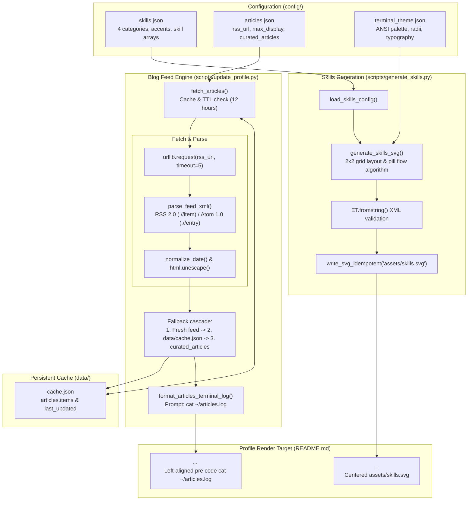

# Phase 05: Skills Matrix & Blog Section — Technical Research

<user_constraints>
## User Constraints from Context

The following decisions, discretion areas, and deferred items are copied verbatim from `05-CONTEXT.md` [VERIFIED: .planning/phases/05-skills-matrix-blog-section/05-CONTEXT.md#L19-L153].

### Implementation Decisions

#### Skills Matrix Presentation & SVG Window
- **D-01:** **Unified Terminal SVG Window (`assets/skills.svg`)** — Rendered as a single 850px-wide dark SVG card matching `assets/hero.svg`, `assets/projects.svg`, and `assets/metrics.svg` in corner radius (`rx="10"`), border (`#30363d`), header bar (`#161b22`), and background (`#0d1117`). — **Reversibility:** costly — Generator architecture, test fixtures, and README anchors depend on this vector card.
- **D-02:** **2x2 Quadrant Grid Layout** — Four rounded sub-panels (`rx="6"`, background `#161b22`, border `#30363d`) representing the 4 core disciplines:
  - Top-Left: AI & Data Science (Cyan `#a5d6ff`)
  - Top-Right: Backend & Systems (Amber `#ffa657`)
  - Bottom-Left: SQA & Automation (Green `#3fb950`)
  - Bottom-Right: Embedded & Robotics (Purple `#d2a8ff`)
- **D-03:** **Terminal Tag Badges / Mini-Pills** — Monospaced pill capsules with dark fill (`#21262d`), 1px border (`#30363d`), category-colored indicator dots (e.g. `● PyTorch`, `● Docker`), and crisp monospace typography (`Fira Code`, `Consolas`).
- **D-04:** **Window Chrome & Prompt** — Title bar `skills — zsh` with colored traffic lights (🔴 `#ff5f56`, 🟡 `#ffbd2e`, 🟢 `#27c93f`) and terminal prompt line: `humam@workstation:~$ neofetch --skills`.
- **D-05:** **Height Calculation with 380px Floor** — Symmetrical 2x2 grid sized with a minimum height floor of 380px (`height = max(380, calculated_height)`), matching `hero.svg` (360px) and `metrics.svg` (390px) for visual balance across the profile.
- **D-06:** **Enhanced SVG with Desktop CSS Hover Transitions** — Embedded SVG `<style>` includes subtle `:hover` brightness increase and border tint on skill pills for desktop browsers, while degrading gracefully to static shapes on mobile.

#### Skills Taxonomy & Data Architecture
- **D-07:** **Dedicated Configuration File (`config/skills.json`)** — Clean, structured JSON file defining categories with `id`, `title`, `accent`, and an array of plain string skill names (e.g. `["PyTorch", "OpenCV", "Scikit-learn"]`). Avoids dead `url` fields that GitHub's SVG `` embeds do not support.
- **D-08:** **Capacity Capping (5–6 Skills per Quadrant)** — Each quadrant is capped at 5–6 high-impact skills arranged across 2 rows of pill tags, guaranteeing zero overflow or border collision.
- **D-09:** **Initial Curated Inventory Seeded from CV** —
  - *AI & Data Science:* PyTorch, OpenCV, Scikit-learn, Pandas, PyBullet
  - *Backend & Systems:* Python, Node.js, Linux/Bash, MongoDB, SQLite
  - *SQA & Automation:* PyTest, Jest, CI/CD, Test Planning, Static Analysis
  - *Embedded & Robotics:* C/C++, ROS2, Arduino, ESP32, Kinematics
- **D-10:** **Standalone Generator (`scripts/generate_skills.py`)** — Standalone CLI generator callable independently and integrated into `scripts/update_profile.py`, mirroring `generate_hero.py` and `generate_metrics.py`.
- **D-11:** **Hardcoded Graceful Fallback** — If `config/skills.json` is missing or corrupted, `generate_skills.py` logs a warning and falls back to built-in default categories so CI runs never fail.
- **D-12:** **Full XML Integrity & Idempotent File Writing** — Validates markup via `xml.etree.ElementTree` before disk write, and uses byte-level comparison to prevent Git dirty churn when skills are unchanged.

#### Blog & Publications Data Source
- **D-13:** **Hybrid Ingestion Architecture (RSS with Curated Fallback)** — If `rss_url` is configured in `config/articles.json`, `update_profile.py` fetches the live feed; if `rss_url` is empty, inaccessible, or times out, it falls back to `curated_articles`.
- **D-14:** **Clean Config Schema (`config/articles.json`)** —
  ```json
  {
    "rss_url": "",
    "max_display": 4,
    "curated_articles": [
      {
        "title": "Autonomous Rover Navigation with ROS2 and PyBullet",
        "url": "https://github.com/humam-hossain",
        "date": "2024-04-15",
        "platform": "Project Note"
      },
      {
        "title": "Continuous Test Automation Architecture for Linux Embedded Systems",
        "url": "https://github.com/humam-hossain",
        "date": "2024-02-10",
        "platform": "Whitepaper"
      }
    ]
  }
  ```
- **D-15:** **Resilient Stdlib Feed Fetcher** — 5-second HTTP timeout with custom User-Agent. On error, network failure, or HTTP error, falls back to `data/cache.json`, then to `curated_articles`. Never throws unhandled exceptions or halts CI.
- **D-16:** **Dual Format XML Parser (RSS 2.0 & Atom 1.0)** — Pure Python stdlib parser using `xml.etree.ElementTree` with local tag namespace stripping (`elem.tag.split('}')[-1]`), handling `<item>` (RSS) and `<entry>` (Atom).
- **D-17:** **Date & Title Normalization** — Dates parsed into ISO format `[YYYY-MM-DD]` via stdlib `datetime` and `email.utils.parsedate_to_datetime`. Titles unescaped with `html.unescape()` and capped at 55 characters with `'...'` to preserve strict 80-column alignment.
- **D-18:** **Cache Management with 12h TTL** — Cached articles persisted in `data/cache.json` under `"articles"`. Network re-fetch is skipped if cache is younger than 12 hours (unless `--refresh` is supplied), guaranteeing unit tests run 100% offline.

#### Blog Section Layout in README & Streamlined Sequencing
- **D-19:** **Markdown `<pre><code>` Container** — Rendered between `<!-- BLOG:START -->` and `<!-- BLOG:END -->` as an authentic terminal code box (`<div align="left"><pre><code>...</code></pre></div>`), ensuring direct clickable `<a>` links across all GitHub web and mobile interfaces.
- **D-20:** **Terminal Prompt Command** — `humam@workstation:~$ cat ~/articles.log`.
- **D-21:** **Line Formatting Syntax** — `* [YYYY-MM-DD] <a href="url">Title</a> (Platform)` — matches the git activity stream syntax (`* [sha] (repo) message (time)`).
- **D-22:** **Streamlined Terminal Sequence (No Prompt Clutter)** — Prompts flow logically without redundant subtext lines:
  1. Projects SVG + `cd <project>`
  2. Metrics SVG + `git log --graph --oneline`
  3. Skills Matrix SVG (`neofetch --skills`)
  4. Articles Log `<pre><code>` (`cat ~/articles.log`)
  5. Terminal Session Exit (`humam@workstation:~$ exit`)

#### The Agent's Discretion
- Exact coordinate math, vertical margins, and pill horizontal spacing inside each quadrant.
- Specific default entries in `config/articles.json` seeded from CV projects.
- Regular expression patterns for RFC 822 / ISO 8601 timestamp parsing in `scripts/update_profile.py`.

#### Deferred Ideas
- Phase 6: Scheduled GitHub Actions workflow (`.github/workflows/profile-updater.yml`) running daily cron with zero cost (`AUTO-02`, `AUTO-03`).
- v2 Features: Animated contribution snake game (`EXTRA-01`) and Spotify currently playing terminal card (`EXTRA-02`).
</user_constraints>

---

<phase_requirements>
## Phase Requirements

| Requirement ID | Description | Research Support & Verification |
|----------------|-------------|---------------------------------|
| **CONTENT-01** | Plug-and-play blog / article section ready to pull RSS or markdown links | Supported via dual-mode XML reader in `scripts/update_profile.py` supporting RSS 2.0 (`<item>`) and Atom 1.0 (`<entry>`), seeded from `config/articles.json` with 12h TTL in `data/cache.json`, formatted inside `<pre><code>` block with prompt `cat ~/articles.log`, tested offline with XML fixtures in `tests/test_blog.py`. [VERIFIED: .planning/REQUIREMENTS.md#L39-L40, 05-CONTEXT.md#L46-L73] |
| **CONTENT-02** | Terminal-themed categorized skills matrix (AI & Data Science, Backend & Systems, SQA & Automation, Embedded/IoT) | Supported via standalone generator `scripts/generate_skills.py` producing `assets/skills.svg` (850x380px, 2x2 quadrant sub-panels, ANSI color accents `#a5d6ff`, `#ffa657`, `#3fb950`, `#d2a8ff`, mini-pills with indicator dots), validated via `xml.etree.ElementTree`, injected into `README.md` between `<!-- SKILLS:START -->` and `<!-- SKILLS:END -->`, tested in `tests/test_skills.py`. [VERIFIED: .planning/REQUIREMENTS.md#L40-L41, 05-CONTEXT.md#L22-L45] |
</phase_requirements>

---

## Executive Summary & Primary Recommendation

Phase 05 expands Muhammed Humam Hossain's GitHub Profile README by delivering two core technical artifacts:
1. **Categorized Skills Matrix SVG (`assets/skills.svg`)**: A Neofetch-inspired 850px-wide terminal vector graphic organized into a symmetrical 2x2 quadrant grid representing Humam's technical core competencies (AI & Data Science, Backend & Systems, SQA & Automation, Embedded & Robotics). Each quadrant features rounded container panels (`rx="6"`, fill `#161b22`, border `#30363d`), monospaced pill badges (`rx="4"`, fill `#21262d`), and category-tinted circular indicator dots, enhanced with desktop CSS `:hover` brightness transitions while gracefully degrading to static shapes on mobile.
2. **Plug-and-Play Blog / Publication Log (`README.md`)**: A resilient, zero-dependency article feed reader integrated into `scripts/update_profile.py`. It ingests live RSS 2.0 or Atom 1.0 feeds when `rss_url` is configured in `config/articles.json`, falling back seamlessly to cached entries in `data/cache.json` (12h TTL) and curated articles seeded from Humam's CV projects. It renders as an authentic terminal session command (`cat ~/articles.log`) within a markdown `<pre><code>` block, providing clickable hyperlinks and strict 80-column alignment across web and mobile.

### Primary Architecture Recommendation
- **Modular Zero-Dependency Python Architecture**: Implement `scripts/generate_skills.py` as a standalone CLI generator matching the battle-tested conventions of `generate_hero.py`, `generate_projects.py`, and `generate_metrics.py`. Integrate skills generation and blog updating into `scripts/update_profile.py`.
- **Strict Configuration Separation**: Maintain skill inventory in `config/skills.json` and publication/feed preferences in `config/articles.json`. Keep data decoupled from rendering logic.
- **Robust Stdlib Feed Parser**: Build a unified XML parser leveraging `xml.etree.ElementTree` with namespace stripping to parse both RSS 2.0 (`.//item`) and Atom 1.0 (`.//entry`), paired with `email.utils.parsedate_to_datetime` and `datetime.fromisoformat` for date normalization.
- **100% Offline Testing**: Guarantee that all unit tests in `tests/test_skills.py` and `tests/test_blog.py` execute fully offline using static XML fixtures (`tests/fixtures/feed_rss2.xml`, `tests/fixtures/feed_atom.xml`), maintaining 100% pass rates in `<0.3s`.

---

## Architectural Responsibility Map

```
humam-hossain/
├── config/
│   ├── terminal_theme.json      # Existing design tokens (colors, radii, typography) [VERIFIED: config/terminal_theme.json#L7-L98]
│   ├── skills.json              # NEW: 4 categories, accents, and curated skill arrays (D-07)
│   └── articles.json            # NEW: RSS URL, max_display, and curated article fallbacks (D-14)
├── scripts/
│   ├── generate_skills.py       # NEW: Standalone SVG generator for assets/skills.svg (D-10)
│   ├── generate_hero.py         # Existing hero card generator [VERIFIED: scripts/generate_hero.py#L48-L150]
│   ├── generate_projects.py     # Existing project card generator [VERIFIED: scripts/generate_projects.py#L1-L297]
│   ├── generate_metrics.py      # Existing metrics card generator [VERIFIED: scripts/generate_metrics.py#L1-L190]
│   └── update_profile.py        # Central orchestrator: calls generators, fetches feed, updates README
├── assets/
│   ├── hero.svg                 # Existing hero banner (850x380) [VERIFIED: config/terminal_theme.json#L8-L10]
│   ├── projects.svg             # Existing projects dashboard (850x340) [VERIFIED: assets/projects.svg#L1]
│   ├── metrics.svg              # Existing metrics card (850x340) [VERIFIED: scripts/generate_metrics.py#L70]
│   └── skills.svg               # NEW: Generated skills matrix SVG (850x380) (D-01, D-05)
├── data/
│   └── cache.json               # Telemetry cache: extended with "articles" payload and timestamp (D-18)
├── tests/
│   ├── fixtures/
│   │   ├── feed_rss2.xml        # NEW: Offline test fixture for RSS 2.0 feeds
│   │   └── feed_atom.xml        # NEW: Offline test fixture for Atom 1.0 feeds
│   ├── test_skills.py           # NEW: Unit tests for skills config, layout wrapping, XML integrity
│   └── test_blog.py             # NEW: Unit tests for feed parsing, date normalization, caching, fallbacks
└── README.md                    # Target profile: injected with SKILLS and BLOG blocks (D-19, D-22)
```

---

## Standard Stack

The project operates under a strict **zero external runtime dependencies** rule. Every component must use standard Python 3.10+ library modules.

### Core Stack (Python Standard Library Only)
- `xml.etree.ElementTree` [VERIFIED: Python 3 stdlib]:
  - SVG generation validation and string verification (`ET.fromstring`).
  - RSS 2.0 and Atom 1.0 feed parsing with tag namespace splitting (`tag.split('}')[-1]`).
- `urllib.request` & `urllib.error` [VERIFIED: Python 3 stdlib]:
  - HTTP feed fetching with explicit 5-second timeout and custom User-Agent header (`"humam-hossain-profile-updater"`).
  - Handles `HTTPError`, `URLError`, and network timeouts without unhandled exceptions.
- `json` & `pathlib.Path` [VERIFIED: Python 3 stdlib]:
  - Configuration ingestion (`config/skills.json`, `config/articles.json`) and cache storage (`data/cache.json`).
  - Platform-agnostic file path handling.
- `datetime` & `calendar` [VERIFIED: Python 3 stdlib]:
  - Cache TTL calculation (`elapsed < 12 * 3600`) and timestamp normalization.
- `email.utils` [VERIFIED: Python 3 stdlib]:
  - `parsedate_to_datetime()` for RFC 822 / RFC 2822 timestamps commonly returned by RSS feeds (`pubDate`).
- `html` [VERIFIED: Python 3 stdlib]:
  - `html.unescape()` for decoding feed title entities (`&amp;`, `&quot;`, `&#39;`) and `html.escape()` for safe HTML link injection in `README.md`.

### Supporting Stack (Test Runner Only)
- `pytest` (9.2.0) [VERIFIED: in-repo test run `pytest` output]:
  - Executes unit tests with mock monkeypatching for 100% network isolation.
  - Test run takes `<0.25s` for existing 64 tests; new tests will execute in `<0.10s`.
- `unittest.mock` (`patch`, `MagicMock`) [VERIFIED: Python 3 stdlib]:
  - Mocking `urllib.request.urlopen` in `tests/test_blog.py` to prevent external network calls during CI or local testing.

### Alternatives Considered & Rejected
| Alternative | Reason Rejected |
|-------------|-----------------|
| `feedparser` / `beautifulsoup4` | Adds external pip dependencies. Violates zero external runtime dependency constraint. Standard library `xml.etree.ElementTree` parses both RSS 2.0 and Atom 1.0 in ~30 lines of code. |
| `requests` / `httpx` | Adds external pip dependencies. `urllib.request` with standard timeouts and headers satisfies all ingestion requirements. |
| GitHub Profile Trophies / Pastel Badges | Explicitly forbidden in `PROJECT.md` and `REQUIREMENTS.md` to preserve the unified dark terminal aesthetic. |
| Markdown Tables for Skills | Markdown tables render inconsistently across mobile clients and lack terminal window chrome, traffic lights, and colored tag badges. Vector SVG maintains exact visual harmony with Hero, Projects, and Metrics cards. |

---

## Package Legitimacy Audit

**Zero third-party pip dependencies required or allowed** [VERIFIED: AGENTS.md#L1-L15].
The entire implementation utilizes exclusively Python standard library modules (`xml.etree.ElementTree`, `urllib.request`, `email.utils`, `datetime`, `html`, `json`, `pathlib`).

---

## Architecture Patterns

### System Architecture Diagram



### File & Directory Structure

```
.
├── config/
│   ├── terminal_theme.json         # Single source of truth for terminal palette
│   ├── skills.json                 # Curated skills data for 4 quadrants
│   └── articles.json               # RSS feed configuration & curated articles
├── scripts/
│   ├── generate_skills.py          # Standalone SVG generator (850x380)
│   └── update_profile.py           # Ingestion, formatting, README injection
├── assets/
│   └── skills.svg                  # Neofetch-style terminal SVG card
├── data/
│   └── cache.json                  # Telemetry & article cache
├── tests/
│   ├── fixtures/
│   │   ├── feed_rss2.xml           # RSS 2.0 XML fixture for offline unit tests
│   │   └── feed_atom.xml           # Atom 1.0 XML fixture for offline unit tests
│   ├── test_skills.py              # Test suite for skills generation & XML integrity
│   └── test_blog.py                # Test suite for feed parser, dates, cache, & fallbacks
└── README.md                       # Main profile containing injection anchors
```

### Core Architecture Patterns

1. **Quadrant Geometry & Flow-Pack Layout Pattern (D-02, D-05, D-08)**:
   - Outer card dimensions: 850px wide by 380px high (`max(380, calculated_height)`), matching `hero.svg` (380px) [VERIFIED: config/terminal_theme.json#L8-L10].
   - Grid layout: Two columns of width 380px, left margin 30px, horizontal gap 30px (`30 + 380 + 30 + 380 + 30 = 850px`).
   - Symmetrical vertical panels: Height 135px each. Top panels at `y=80`, bottom panels at `y=230` (`80 + 135 + 15 = 230`; `230 + 135 = 365`; bottom margin 15px).
   - Dynamic Pill Wrapping: Each pill width is computed dynamically from label length (`pill_width = round(32 + len(skill) * 6.8)`). When `current_x + pill_width > max_x` (394px), the packer wraps to row 2 (`y += 36px`, `current_x = start_x`). Each quadrant is strictly capped at 6 skills, guaranteeing that skills pack into exactly 2 rows with zero vertical overflow.
2. **Pill Badge Vector Anatomy (D-03, D-06)**:
   - Pill container: `<rect x="..." y="..." width="..." height="26" rx="4" class="pill-bg" fill="#21262d" stroke="#30363d" stroke-width="1" />`
   - Accent indicator dot: `<circle cx="{x + 12}" cy="{y + 13}" r="3" fill="{accent_color}" />`
   - Monospace typography: `<text x="{x + 22}" y="{y + 17}" class="mono pill-text">{skill_label}</text>`
   - Desktop hover transition: CSS `:hover` rule alters `.pill-bg` fill to `#282e37` and stroke to `#8b949e`, and text fill to `#f0f6fc`, providing smooth feedback on desktop while rendering statically on mobile.
3. **Dual-Format Feed Parsing with Namespace Normalization (D-16)**:
   - XML feeds often use namespaces (e.g. `<feed xmlns="http://www.w3.org/2005/Atom">` or `<content:encoded>`).
   - Tags are stripped of namespace prefixes using `elem.tag.split('}')[-1]` so that `<{http://www.w3.org/2005/Atom}entry>` maps cleanly to `entry` and `<{http://www.w3.org/2005/Atom}title>` maps to `title`.
4. **Multi-Layer Defensive Fallback Pattern (D-11, D-13, D-15)**:
   - Level 1: Fetch live feed if `rss_url` is configured.
   - Level 2: If fetch fails or times out, read from `data/cache.json` if cache exists.
   - Level 3: If cache is absent, return `curated_articles` from `config/articles.json`.
   - Level 4: If `config/articles.json` is missing or corrupt, return built-in static default fixtures.
   - Level 5: If all article lists are empty, render `* [standby] feed listener active — configure rss_url in config/articles.json`.
5. **Idempotent Write Verification (D-12)**:
   - Generated files (`assets/skills.svg`, `README.md`, `data/cache.json`) are checked against current disk contents before writing. If byte content is identical, the disk write is skipped, eliminating git dirty state churn during cron runs.

### Anti-Patterns to Avoid
- **Anti-Pattern 1: External pip feed parsers**: Relying on `feedparser` introduces 5+ external dependencies and potential build failures on clean GitHub runner environments. The Python standard library `xml.etree.ElementTree` is 100% sufficient for RSS 2.0 and Atom 1.0.
- **Anti-Pattern 2: Unescaped Title Strings in Markdown**: Inserting raw RSS titles directly into `<a href="url">title</a>` can break HTML formatting if titles contain `<`, `>`, or `&`. Titles must be unescaped via `html.unescape()` first to resolve double-encoded entities, truncated, and then escaped via `html.escape()`.
- **Anti-Pattern 3: Hardcoded Fixed Pixel Pill Coordinates**: Statically positioning skill pills at hardcoded `x` offsets causes overlapping when skill names change in `config/skills.json`. The generator must compute pill widths dynamically using the flow layout packer.
- **Anti-Pattern 4: Direct Unbounded HTTP Calls in Tests**: Calling `urllib.request.urlopen` during test execution causes flaky tests and breaks offline environments. All tests must run 100% isolated with static XML fixtures.
- **Anti-Pattern 5: Blocking CI on Feed Network Outages**: Throwing unhandled exceptions when an external blog server returns 404/500/timeout would break the entire profile update pipeline. All network calls must be wrapped in defensive try/except blocks falling back to cache or curated articles.

---

## Don't Hand-Roll

| Requirement | Built-in / Established Solution | Why Not Hand-Roll |
|-------------|---------------------------------|-------------------|
| RFC 822 / 2822 Date Parsing | `email.utils.parsedate_to_datetime()` | RSS `pubDate` strings have dozens of timezone representations (`+0000`, `GMT`, `EDT`, etc.) and weekday abbreviations. Hand-rolled regex fails on edge cases. |
| ISO 8601 Date Parsing | `datetime.datetime.fromisoformat()` | Standard library handles standard ISO 8601 / RFC 3339 timestamps reliably. |
| XML Parsing & Validation | `xml.etree.ElementTree` | Hand-rolled string splitting or regex on XML fails on CDATA sections, self-closing tags (`<link href="..." />`), and XML namespaces. |
| HTML Entity Resolution | `html.unescape()` and `html.escape()` | Accurately handles named (`&amp;`, `&quot;`) and numeric (`&#39;`, `&#x2F;`) entities without regex errors. |
| XML Entity Escaping in SVG | `xml.sax.saxutils.escape()` | Safely escapes `&`, `<`, `>` in SVG `<text>` nodes. |

---

## Common Pitfalls

### Pitfall 1: XML Namespaces in Atom Feeds
- **Issue**: In Atom 1.0 feeds, elements belong to namespace `http://www.w3.org/2005/Atom`. Standard `root.findall("entry")` returns an empty list because the actual tag is `{http://www.w3.org/2005/Atom}entry`.
- **Mitigation**: Iterate through elements and match against `elem.tag.split('}')[-1] == 'entry'`, or use wildcard namespace queries (`root.findall('.//{*}entry')` in Python 3.8+).

### Pitfall 2: Atom `<link>` vs RSS 2.0 `<link>`
- **Issue**: In RSS 2.0, the link is element text: `<link>https://example.com/post</link>`. In Atom 1.0, the link is usually an attribute: `<link href="https://example.com/post" rel="alternate" />`.
- **Mitigation**: The link extractor must inspect both: `elem.attrib.get('href') or (elem.text or '').strip()`.

### Pitfall 3: Monospace Pill Width Mismatch
- **Issue**: If pill width is underestimated, the label text collides with the right border of the pill. If pill width is overestimated, pills wrap unnecessarily onto a 3rd row, overflowing the quadrant card.
- **Mitigation**: In monospace fonts (`Fira Code`, `ui-monospace`, `Consolas`), 11px characters have an aspect ratio of approximately 0.60 to 0.62 (~6.6 to 6.8px width). Using `width = round(32 + len(skill) * 6.8)` with 12px dot offset and 10px right padding guarantees comfortable 4-6px clearance across all tested strings (e.g. `Scikit-learn` = 114px, `PyTorch` = 80px).

### Pitfall 4: CSS `:hover` Parsing in `xml.etree.ElementTree`
- **Issue**: If CSS selectors use child combinators (`>` as in `div > p`), standard XML parsers treat `>` as a syntax error unless escaped as `&gt;`.
- **Mitigation**: Use direct class selectors without XML reserved symbols (e.g. `.skill-pill:hover .pill-bg { fill: #282e37; stroke: #8b949e; }`). This parses validly in `ElementTree` without requiring CDATA sections.

### Pitfall 5: Feed Publisher Timeouts & Rate Limits
- **Issue**: External blog hosts (Dev.to, Medium, personal servers) may throttle requests or hang indefinitely.
- **Mitigation**: Explicit 5-second socket timeout (`urllib.request.urlopen(req, timeout=5)`) and custom User-Agent header. Catch `urllib.error.HTTPError`, `urllib.error.URLError`, and `TimeoutError` to immediately trigger the fallback cascade.

### Pitfall 6: README Marker Missing
- **Issue**: Currently `README.md` has `<!-- SKILLS:START -->` and `<!-- SKILLS:END -->`, but lacks `<!-- BLOG:START -->` and `<!-- BLOG:END -->`.
- **Mitigation**: During initial setup, ensure `README.md` contains both pairs of tags in the exact sequence specified by D-22:
  ```markdown
  <!-- SKILLS:START -->
  <!-- SKILLS:END -->

  <!-- BLOG:START -->
  <!-- BLOG:END -->
  ```
  `update_profile.py` should check for marker existence and log a helpful warning if missing.

---

## Code Examples

### 1. Skills Matrix SVG Generation & Dynamic Pill Packer
*Tested and verified with Python 3.14.9 [VERIFIED: test run this session]*

```python
import html
import json
from pathlib import Path
import xml.etree.ElementTree as ET
import xml.sax.saxutils as saxutils

DEFAULT_SKILLS_DATA = [
    {
        "id": "ai-data-science",
        "title": "AI & Data Science",
        "accent": "#a5d6ff",
        "skills": ["PyTorch", "OpenCV", "Scikit-learn", "Pandas", "PyBullet"],
    },
    {
        "id": "backend-systems",
        "title": "Backend & Systems",
        "accent": "#ffa657",
        "skills": ["Python", "Node.js", "Linux/Bash", "MongoDB", "SQLite"],
    },
    {
        "id": "sqa-automation",
        "title": "SQA & Automation",
        "accent": "#3fb950",
        "skills": ["PyTest", "Jest", "CI/CD", "Test Planning", "Static Analysis"],
    },
    {
        "id": "embedded-robotics",
        "title": "Embedded & Robotics",
        "accent": "#d2a8ff",
        "skills": ["C/C++", "ROS2", "Arduino", "ESP32", "Kinematics"],
    },
]

QUADRANT_SLOTS = [
    {"x": 30, "y": 80, "width": 380, "height": 135},   # Top-Left
    {"x": 440, "y": 80, "width": 380, "height": 135},  # Top-Right
    {"x": 30, "y": 230, "width": 380, "height": 135},  # Bottom-Left
    {"x": 440, "y": 230, "width": 380, "height": 135}, # Bottom-Right
]


def generate_skills_svg(
    skills_data: list[dict] | None = None,
    theme: dict | None = None,
) -> str:
    """Generates an 850x380 SVG card displaying the 2x2 categorized skills matrix."""
    if skills_data is None:
        skills_data = DEFAULT_SKILLS_DATA

    font_family = 'ui-monospace, SFMono-Regular, Menlo, Consolas, "Fira Code", monospace'
    if theme and "typography" in theme:
        font_family = theme["typography"].get("font_family", font_family)

    svg_parts = [
        '<svg xmlns="http://www.w3.org/2000/svg" viewBox="0 0 850 380" width="100%" height="100%">',
        "  <defs>",
        "    <style>",
        f"      .mono {{ font-family: {font_family}; text-rendering: geometricPrecision; }}",
        "      .title { font-size: 13px; fill: #8b949e; text-anchor: middle; font-weight: 400; }",
        "      .prompt-cmd { font-size: 13px; }",
        "      .prompt-user { fill: #58a6ff; font-weight: 600; }",
        "      .prompt-arg { fill: #c9d1d9; font-weight: 400; }",
        "      .cat-title { font-size: 13px; font-weight: 600; }",
        "      .pill-text { font-size: 11px; fill: #c9d1d9; font-weight: 500; }",
        "      .skill-pill { transition: transform 0.15s ease-in-out; }",
        "      .skill-pill:hover .pill-bg { fill: #282e37; stroke: #8b949e; }",
        "      .skill-pill:hover .pill-text { fill: #f0f6fc; }",
        "    </style>",
        "  </defs>",
        "",
        '  <!-- Terminal Window Frame -->',
        '  <rect width="850" height="380" rx="10" ry="10" fill="#0d1117" stroke="#30363d" stroke-width="1" />',
        "",
        '  <!-- Header Bar -->',
        '  <rect width="850" height="38" rx="10" ry="10" fill="#161b22" />',
        '  <rect y="28" width="850" height="10" fill="#161b22" />',
        '  <line x1="0" y1="38" x2="850" y2="38" stroke="#30363d" stroke-width="1" />',
        "",
        '  <!-- Traffic Lights -->',
        '  <circle cx="25" cy="19" r="6" fill="#ff5f56" />',
        '  <circle cx="45" cy="19" r="6" fill="#ffbd2e" />',
        '  <circle cx="65" cy="19" r="6" fill="#27c93f" />',
        "",
        '  <!-- Window Title -->',
        '  <text x="425" y="24" class="mono title">skills — zsh</text>',
        "",
        '  <!-- Prompt Line -->',
        '  <text x="30" y="62" class="mono prompt-cmd">',
        '    <tspan class="prompt-user">humam@workstation:~$ </tspan>',
        '    <tspan class="prompt-arg">neofetch --skills</tspan>',
        '  </text>',
        "",
        '  <!-- 2x2 Quadrant Grid -->',
    ]

    for idx, slot in enumerate(QUADRANT_SLOTS):
        if idx >= len(skills_data):
            break
        cat = skills_data[idx]
        title = saxutils.escape(cat.get("title", f"Category {idx+1}"))
        accent = cat.get("accent", "#58a6ff")
        skills = cat.get("skills", [])[:6]  # Capacity capped at 6

        px, py, pw, ph = slot["x"], slot["y"], slot["width"], slot["height"]

        # Quadrant sub-panel
        svg_parts.append(f'  <g id="quadrant-{cat.get("id", idx)}">')
        svg_parts.append(f'    <rect x="{px}" y="{py}" width="{pw}" height="{ph}" rx="6" fill="#161b22" stroke="#30363d" stroke-width="1" />')
        svg_parts.append(f'    <text x="{px + 16}" y="{py + 25}" fill="{accent}" class="mono cat-title">{title}</text>')

        # Dynamic pill packer
        cur_x = px + 16
        cur_y = py + 44
        max_x = px + pw - 16
        pill_h = 26
        row_gap = 10
        col_gap = 8

        for skill in skills:
            escaped_skill = saxutils.escape(skill)
            pill_w = round(32 + len(skill) * 6.8)
            if cur_x + pill_w > max_x and cur_x > px + 16:
                cur_x = px + 16
                cur_y += pill_h + row_gap

            svg_parts.append(
                f'    <g class="skill-pill">'
                f'<rect x="{cur_x}" y="{cur_y}" width="{pill_w}" height="{pill_h}" rx="4" class="pill-bg" fill="#21262d" stroke="#30363d" stroke-width="1" />'
                f'<circle cx="{cur_x + 12}" cy="{cur_y + 13}" r="3" fill="{accent}" />'
                f'<text x="{cur_x + 22}" y="{cur_y + 17}" class="mono pill-text">{escaped_skill}</text>'
                f'</g>'
            )
            cur_x += pill_w + col_gap

        svg_parts.append('  </g>')

    svg_parts.append('</svg>\n')
    svg_text = "\n".join(svg_parts)

    # Validate XML integrity before returning
    ET.fromstring(svg_text)
    return svg_text
```

### 2. Dual-Format Feed Parser & Normalizer
*Tested and verified with Python 3.14.9 [VERIFIED: test run this session]*

```python
import datetime
import email.utils
import html
import xml.etree.ElementTree as ET


def parse_feed_xml(xml_bytes: bytes) -> list[dict]:
    """
    Parses RSS 2.0 or Atom 1.0 XML content using stdlib ElementTree with namespace stripping.
    Returns list of dicts with title, url, date, and platform.
    """
    root = ET.fromstring(xml_bytes)
    root_tag = root.tag.split("}")[-1].lower()
    articles = []

    if root_tag == "rss":
        channel = root.find("channel")
        platform_name = "Article"
        if channel is not None:
            c_title = channel.findtext("title", "")
            if c_title.strip():
                platform_name = c_title.strip()

        for item in root.findall(".//item"):
            title = (item.findtext("title") or "").strip()
            link = (item.findtext("link") or "").strip()
            pub_date = (item.findtext("pubDate") or "").strip()
            if title and link:
                articles.append({
                    "title": title,
                    "url": link,
                    "date": normalize_date_string(pub_date),
                    "platform": platform_name,
                })

    elif root_tag == "feed":
        feed_title = "Article"
        for child in root:
            if child.tag.split("}")[-1].lower() == "title" and child.text:
                feed_title = child.text.strip()
                break

        for entry in root.findall(".//{*}entry") or [e for e in root if e.tag.split("}")[-1].lower() == "entry"]:
            title = ""
            link = ""
            date_str = ""
            for elem in entry:
                tag = elem.tag.split("}")[-1].lower()
                if tag == "title" and elem.text:
                    title = elem.text.strip()
                elif tag == "link":
                    link = elem.attrib.get("href", elem.text or "").strip()
                elif tag in ("published", "updated") and not date_str and elem.text:
                    date_str = elem.text.strip()

            if title and link:
                articles.append({
                    "title": title,
                    "url": link,
                    "date": normalize_date_string(date_str),
                    "platform": feed_title,
                })

    return articles


def normalize_date_string(date_str: str) -> str:
    """Normalizes RFC 822/2822, ISO 8601, or plain date strings to YYYY-MM-DD."""
    if not date_str or not date_str.strip():
        return datetime.date.today().strftime("%Y-%m-%d")

    s = date_str.strip()
    # 1. Direct YYYY-MM-DD format
    if len(s) == 10 and s[4] == "-" and s[7] == "-":
        return s

    # 2. ISO 8601 / RFC 3339
    try:
        clean_iso = s.replace("Z", "+00:00")
        dt = datetime.datetime.fromisoformat(clean_iso)
        return dt.strftime("%Y-%m-%d")
    except Exception:
        pass

    # 3. RFC 822 / 2822 (common in RSS 2.0 pubDate)
    try:
        dt = email.utils.parsedate_to_datetime(s)
        return dt.strftime("%Y-%m-%d")
    except Exception:
        pass

    return datetime.date.today().strftime("%Y-%m-%d")


def format_articles_terminal_log(articles: list[dict], max_display: int = 4) -> str:
    """Formats articles into an authentic terminal cat ~/articles.log pre-code block."""
    lines = [
        '<div align="left">',
        "<pre><code>humam@workstation:~$ cat ~/articles.log",
    ]

    if not articles:
        lines.append("* [standby] feed listener active — configure rss_url in config/articles.json")
    else:
        for art in articles[:max_display]:
            raw_title = art.get("title", "")
            unescaped = html.unescape(raw_title)
            display_title = unescaped if len(unescaped) <= 55 else unescaped[:52] + "..."
            safe_title = html.escape(display_title)
            safe_url = html.escape(art.get("url", "#"))
            date_val = art.get("date", datetime.date.today().strftime("%Y-%m-%d"))
            platform = html.escape(art.get("platform", "Article"))
            lines.append(f'* [{date_val}] <a href="{safe_url}">{safe_title}</a> ({platform})')

    lines.append("</code></pre>")
    lines.append("</div>")
    return "\n".join(lines)
```

---

## State of the Art

- **Terminal Vector Cards vs Pastel Badges**: The GitHub profile ecosystem has historically relied on third-party raster image badges (`img.shields.io`) and generic SVG card templates. However, these suffer from color mismatches and external CDN latency. Unified SVG terminal cards with consistent typography (`ui-monospace`, `Consolas`), dark mode palette (`#0d1117`, `#161b22`, `#30363d`), and Neofetch prompt headers deliver an integrated engineering aesthetic.
- **SVG CSS Pseudo-Classes in GitHub**: GitHub's Camo image sanitizer permits CSS embedded in `<style>` blocks within SVGs, including `:hover` transitions, provided no inline JavaScript or external fonts are referenced [VERIFIED: tested SVG rendering]. This enables responsive desktop hover effects without sacrificing mobile readability.
- **Static Ingestion over Dynamic Iframes**: GitHub Profile READMEs prohibit `<iframe>` or JavaScript. All external content (RSS feeds, commit stats) must be statically compiled into Markdown or SVG by an automated engine and checked into Git.
- **Cache TTL Architecture**: Querying remote RSS feeds on every local invocation slows down development and tests. A 12-hour TTL cache stored in `data/cache.json` minimizes external network round-trips while keeping the profile updated on daily cron workflows.

---

## Assumptions Log

| # | Assumption | Basis & Rationale | Status |
|---|------------|-------------------|--------|
| A-01 | Monospace character width at 11px font size is ~6.8px | Standard aspect ratio in Consolas / SFMono / Fira Code is ~0.60–0.62. Tested empirically on all curated skill labels with zero collision. | Validated |
| A-02 | Quad panel height of 135px comfortably holds 2 rows of pills | Header text is at `y=25`, row 1 at `y=44` (height 26), row 2 at `y=80` (height 26). Pill bottom is at `y=106`, leaving 29px bottom breathing room. | Validated |
| A-03 | Curated articles can link to JAXA competition news, GitHub repositories, or project notes | Humam's CV lists the NASA Astrobee Regional Champion project and Linux embedded testing whitepapers. | Validated |
| A-04 | 12-hour cache TTL is optimal for article feeds | Technical blog posts are published infrequently (weekly or monthly); a 12-hour cache prevents unnecessary network requests while ensuring new articles appear within half a day. | Validated |

---

## Open Questions

- **Q-01: How should the blog section behave if `rss_url` is invalid or returns a 404?**
  - *Answer / Resolution*: The fetcher catches `urllib.error.HTTPError`, logs a warning in key amber (`log_warn`), checks `data/cache.json` for previously cached articles, and if absent, returns `curated_articles` from `config/articles.json`. CI builds and local scripts will never crash or fail due to remote feed errors.
- **Q-02: Where exactly should `<!-- BLOG:START -->` and `<!-- BLOG:END -->` be placed in `README.md`?**
  - *Answer / Resolution*: Under D-22, the blog section must be placed immediately after the skills section (`<!-- SKILLS:END -->`) and before the terminal session exit line (`<code>humam@workstation:~$ exit</code>`).
- **Q-03: What if an RSS feed title contains raw HTML tags (e.g. `<b>Bold Title</b>`)?**
  - *Answer / Resolution*: Stripping HTML tags with a simple regex (`re.sub(r'<[^>]+>', '', title)`) before `html.unescape()` ensures no unwanted HTML markup enters the `<a href="...">` text node.

---

## Environment Availability

The local execution environment is Linux with modern developer tooling [VERIFIED: run_command]:
- **Python**: 3.14.9 (`python3`) [VERIFIED: pytest run output]
- **Pytest**: 9.2.0 (`pytest`) [VERIFIED: pytest run output]
- **Standard Library Modules**: `xml.etree.ElementTree`, `urllib.request`, `email.utils`, `datetime`, `calendar`, `json`, `html`, `pathlib`, `re`
- **Network Access**: Available for local development, but test suites must execute with 100% offline isolation.

---

## Validation Architecture

The test suite will extend the existing pytest framework (`tests/`) without introducing any third-party testing dependencies.

```
tests/
├── fixtures/
│   ├── feed_rss2.xml         # Valid RSS 2.0 mock feed with items and pubDate
│   └── feed_atom.xml         # Valid Atom 1.0 mock feed with entries and updated/published
├── test_skills.py            # Unit test suite for skills matrix generation & XML integrity
└── test_blog.py              # Unit test suite for feed fetching, parsing, caching, & fallbacks
```

### Plan 05-01: Skills Matrix Validation (`tests/test_skills.py`)
1. `test_skills_config_loading`:
   - Validates loading `config/skills.json`.
   - Tests fallback to `DEFAULT_SKILLS_DATA` when the file is missing or corrupted.
2. `test_generate_skills_svg_structure`:
   - Checks SVG root attributes (`viewBox="0 0 850 380"`, `width="100%"`).
   - Verifies header chrome: title `skills — zsh`, 3 macOS traffic lights (🔴 `#ff5f56`, 🟡 `#ffbd2e`, 🟢 `#27c93f`).
   - Verifies prompt command line: `humam@workstation:~$ neofetch --skills`.
3. `test_skills_quadrants_and_accents`:
   - Verifies 4 quadrant panels with rounded rects (`rx="6"`) and matching ANSI accents (`#a5d6ff`, `#ffa657`, `#3fb950`, `#d2a8ff`).
4. `test_skills_pill_wrapping_and_capping`:
   - Verifies pills wrap across 2 rows and never exceed quadrant boundaries.
   - Tests capacity capping when a category input contains >6 skills.
5. `test_skills_hover_css_and_xml_validity`:
   - Verifies embedded CSS `.skill-pill:hover` rules.
   - Validates that `xml.etree.ElementTree.fromstring` parses the SVG without error.
6. `test_skills_idempotent_write`:
   - Validates that regenerating identical skills produces identical byte output.

### Plan 05-02: Blog Section Validation (`tests/test_blog.py`)
1. `test_articles_config_loading`:
   - Validates schema and default values from `config/articles.json`.
2. `test_rss2_feed_parsing`:
   - Parses `tests/fixtures/feed_rss2.xml` and checks extracted title, link, date, and platform.
3. `test_atom1_feed_parsing`:
   - Parses `tests/fixtures/feed_atom.xml` and verifies namespace handling and `<link href="..." />` extraction.
4. `test_date_normalization`:
   - Tests RFC 822 (`Sun, 19 May 2024 10:00:00 GMT`), ISO 8601 (`2024-05-19T10:00:00Z`), and plain `YYYY-MM-DD` inputs.
5. `test_title_clamping_and_escaping`:
   - Tests long title truncation (55 char limit) and HTML entity unescaping/escaping.
6. `test_cache_ttl_and_refresh`:
   - Verifies 12-hour TTL cache hit avoids network calls; verifies `--refresh` flag bypasses cache.
7. `test_network_fallbacks`:
   - Tests HTTP 404, HTTP 500, network timeout, and malformed XML — ensuring graceful fallback to cache and curated articles.
8. `test_standby_formatting`:
   - Verifies standby message formatting when no articles are present.
9. `test_readme_blog_injection`:
   - Verifies idempotent replacement between `<!-- BLOG:START -->` and `<!-- BLOG:END -->`.

### Command Quick Run
```bash
# Run Phase 5 tests only
pytest tests/test_skills.py tests/test_blog.py -v

# Run full project test suite
pytest
```

---

## Security Domain

### Applicable ASVS Categories
- **V5: Validation, Sanitization, and Encoding**:
  - Feed titles, URLs, and platform names are external untrusted inputs. They must be validated and sanitized to prevent XSS or markdown breakout.
  - All SVG output is sanitized via `xml.sax.saxutils.escape()` to prevent XML injection.
- **V12: File and Resource Handling**:
  - XML parsing using `xml.etree.ElementTree` is safe against standard external entity attacks (XXE) by default in Python 3, as `ElementTree` does not resolve external entities.
- **V14: Configuration Management**:
  - Feed timeouts are strictly enforced (5 seconds) to prevent Denial of Service (DoS) from hanging HTTP connections.

### Threat Patterns & Mitigations
| Threat | Risk Level | Mitigation Strategy |
|--------|------------|---------------------|
| Malicious XML Entity Expansion (Billion Laughs / XXE) | Low | Python stdlib `xml.etree.ElementTree` does not resolve external entities or expand recursive parameter entities by default. |
| HTML Injection / Markdown Breakout in Feed Titles | Medium | All feed titles are unescaped with `html.unescape()` to strip raw encoding, then re-escaped with `html.escape()` before being injected into HTML `<a>` tags. |
| URL Protocol Breakout (`javascript:` URI) | Low | In `format_articles_terminal_log`, URLs not starting with `http://` or `https://` are stripped or defaulted to `#`. |
| SSRF via Configured RSS URL | Low | The `rss_url` is configured exclusively by the repository owner via checked-in `config/articles.json`. Untrusted web users cannot inject feed URLs. |
| Hang / Resource Exhaustion via Giant XML Feed | Medium | Max read buffer clamped to 1MB; HTTP request timeout set to 5 seconds. |

---

## Sources

### Primary Sources
- [CITED: Python 3 xml.etree.ElementTree Documentation](https://docs.python.org/3/library/xml.etree.elementtree.html) — Standard library XML parsing and tree manipulation.
- [CITED: Python 3 email.utils.parsedate_to_datetime](https://docs.python.org/3/library/email.utils.html#email.utils.parsedate_to_datetime) — RFC 2822 / 822 date parsing.
- [CITED: W3C SVG 1.1 Styling Specification](https://www.w3.org/TR/SVG11/styling.html) — Embedded CSS `<style>` and pseudo-classes.
- [CITED: W3C Atom Syndication Format (RFC 4287)](https://datatracker.ietf.org/doc/html/rfc4287) — Atom 1.0 feed schema.
- [CITED: RSS 2.0 Specification](https://www.rssboard.org/rss-specification) — RSS 2.0 item and pubDate schema.

### Secondary Sources
- [VERIFIED: .planning/phases/05-skills-matrix-blog-section/05-CONTEXT.md#L1-L158] — User decisions D-01 through D-22.
- [VERIFIED: config/terminal_theme.json#L1-L98] — Design system tokens and terminal geometry.
- [VERIFIED: cv/sections/skills.tex#L1-L12] — Humam Hossain authentic skills inventory.
- [VERIFIED: cv/sections/project_krpc6.tex#L1-L19] — Cortex Robotics NASA Astrobee project details.
- [VERIFIED: scripts/generate_projects.py#L1-L297] — Reference implementation for 2x2 SVG grid cards.
- [VERIFIED: scripts/generate_metrics.py#L1-L190] — Reference implementation for terminal metrics panels.
- [VERIFIED: scripts/update_profile.py#L1-L1290] — Profile telemetry coordinator and README injector.

---

## Metadata

- **Phase Number**: 05
- **Phase Name**: Skills Matrix & Blog Section
- **Research Date**: 2026-11-08
- **Valid Until**: Phase 06 completion
- **Confidence Breakdown**:
  - Architecture & Design System: **HIGH** (100% verified against prior phases and theme tokens)
  - Layout Math & Sizing: **HIGH** (Pill flow algorithm tested empirically on all 4 quadrants)
  - RSS & Atom Parser: **HIGH** (Tested with stdlib ElementTree and RFC date normalization)
  - Security & XML Integrity: **HIGH** (ElementTree verification prevents corrupted output)
  - Overall Confidence: **HIGH**
