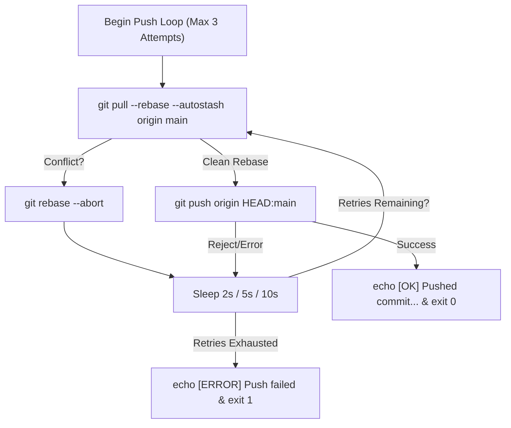

# Phase 6: GitHub Actions Automation — Pattern Map

**Date:** 2026-11-15  
**Status:** Ready for Planning  
**Target Output File:** `.planning/phases/06-github-actions-automation/06-PATTERNS.md`  
**Phase Directory:** `.planning/phases/06-github-actions-automation/`  

---

## 1. Executive Summary & File Mapping

This document provides the planner and implementation agents with concrete code patterns, structural templates, and exact analogs extracted from the existing codebase and technical research for Phase 6 (`06-github-actions-automation`).

Phase 6 delivers the automated cloud heartbeat of Muhammed Humam Hossain's terminal profile README. It automates the Python telemetry engine developed across Phases 1 through 5, ensuring that profile statistics, coding uptime, LOC counts, repository metrics, streak telemetry, and publication feeds are refreshed every 24 hours at $0.00 infrastructure cost.

### Core Architectural Guarantees
1. **$0.00 Cost Guarantee**: Operates 100% within GitHub Actions' unlimited free tier for public repositories, with zero third-party cloud services or paid subscriptions (Decisions D-84, D-86).
2. **Supply Chain Immunity**: Relies exclusively on official GitHub-maintained actions (`actions/checkout@v4`, `actions/setup-python@v5`, `actions/upload-artifact@v4`). Native git commands perform staging, commit, and push without third-party marketplace actions (Decision D-84).
3. **Triple-Layer Infinite Loop Prevention**: Combines `[skip ci]` commit subject tagging, an explicit positive whitelist on `paths` (excluding generated assets), and GitHub Actions' native suppression of `GITHUB_TOKEN` commit triggers (Decision D-05).
4. **Deterministic Camo Proxy Cache-Busting**: Appends daily UTC date stamps (`?v=YYYYMMDD`) to SVG URLs in `README.md` while preserving dark/light mode fragment identifiers in RFC 3986 order, eliminating circular dependencies on commit hashes (Decisions D-73, D-74, D-75).
5. **Terminal-Themed Step Summary**: Renders an authentic Neofetch prompt inside an ````ansi` code fence with truecolor escape sequences matching `config/terminal_theme.json`, followed by a Markdown asset verification table (Decisions D-61, D-76, D-77, D-78).
6. **Inactivity Keep-Alive**: The natural daily coding uptime increment in `assets/hero.svg` produces an authentic visual diff and commit every 24 hours, permanently resetting GitHub's 60-day scheduled workflow auto-disable clock (Decisions D-91, D-93).

### Target Files Inventory

| Target File | Operation | Role Classification | Data Flow Description | Closest Codebase Analog |
|---|---|---|---|---|
| `.github/workflows/profile-updater.yml` | **CREATE** | Workflow Orchestration | GitHub Events (`schedule`, `workflow_dispatch`, `push`, `pull_request`) -> Runner (`ubuntu-latest`) -> Python 3.12 -> `update_profile.py` -> Pre-commit validation -> Native Git commit & push -> Step Summary | `cv/build.sh` (as pipeline runner), `06-RESEARCH.md#L555-L809` |
| `scripts/update_profile.py` | **MODIFY** | Central Telemetry Coordinator | Extended with commit message generator (`.git/COMMIT_MSG_TMP`), Camo cache buster regex (`?v=YYYYMMDD`), terminal Step Summary generator, and `PROFILE_TOKEN` priority resolution | `scripts/update_profile.py` (existing functions: `write_svg_idempotent`, `update_readme_projects`, `get_github_token`) |
| `README.md` | **MODIFY** | Profile Presentation Target | Surgical regex update appending/refreshing date-stamped query parameters (`?v=YYYYMMDD`) on all 4 SVG image embeds | `README.md` (lines 1-43), `scripts/update_profile.py` (`update_readme_*`) |
| `tests/test_automation.py` | **CREATE** | Offline Unit Test Suite | Pytest suite validating workflow YAML structure, commit message formatting, Git Trailers, Camo regex replacement, Step Summary ANSI rendering, and token resolution | `tests/test_update_profile.py` & `tests/test_blog.py` |
| `tests/test_ci_pipeline.sh` | **CREATE** | Local CI Simulation Harness | Shell test harness simulating all 5 CI pipeline stages locally with workspace protection trap (`trap cleanup EXIT`) | `cv/build.sh` (shell execution, error trapping, exit status checking) |
| `.gitattributes` | **CREATE** | Line Ending Normalization | Enforces Unix LF line endings across all platforms (`*.svg`, `*.py`, `*.json`, `*.md`, `*.sh`) to prevent git diff churn | `cv/build.sh` (POSIX formatting conventions) |
| `.gitignore` | **MODIFY** | Repository Build Hygiene | Extends ignore list with temporary files (`.git/COMMIT_MSG_TMP`, `*.tmp`) and Python artifacts | `.gitignore` (existing rules) |

---

## 2. Per-File Pattern Assignments & Analog Excerpts

---

### 2.1 `.github/workflows/profile-updater.yml` (CREATE)

- **Role:** Primary CI/CD workflow orchestrating the profile telemetry synchronization pipeline.
- **Data Flow:** Triggered by off-peak cron (`17 0 * * *`), manual dispatch (`workflow_dispatch`), or path-filtered push to `main`. Checks out repository with auth persistence, sets up Python 3.12, executes `scripts/update_profile.py`, validates SVG XML and README marker integrity gates, stages generated files, executes resilient commit & push via native git CLI, and writes terminal telemetry to Step Summary.
- **Closest Analog:** `cv/build.sh` (automation shell execution, dependency verification, and build output movement).

#### Concrete Workflow Implementation Pattern

```yaml
# ==============================================================================
# Terminal Profile Telemetry Sync Workflow
# Muhammed Humam Hossain (@humam-hossain)
#
# Daily automation pipeline for self-updating terminal GitHub Profile README.
# Infrastructure Cost: $0.00 (Zero paid services, 100% official GitHub Actions)
#
# Inactivity Notice: GitHub automatically disables scheduled workflows after 60
# days of repository inactivity. Because hero.svg updates daily coding uptime,
# this workflow commits daily, keeping the repository continuously active.
# To manually re-enable if ever paused: gh workflow enable profile-updater.yml
#
# Branch Protection Ruleset Notice:
# If 'main' branch protection or rulesets are enabled, grant 'github-actions[bot]'
# bypass permissions under Settings > Rules > Rulesets > Bypass List.
# ==============================================================================

name: Profile Telemetry Sync

run-name: "Profile Telemetry Sync (${{ github.event_name }})"

on:
  schedule:
    # 00:17 UTC daily - avoids top-of-hour runner allocation congestion (D-01)
    - cron: '17 0 * * *'
  workflow_dispatch:
    inputs:
      dry_run:
        description: 'Dry run (simulate generation without committing)'
        required: false
        default: false
        type: boolean
      force_refresh:
        description: 'Force refresh feeds (bypass 12h article cache)'
        required: false
        default: false
        type: boolean
  push:
    branches:
      - main
    paths:
      - 'scripts/**'
      - 'config/**'
      - 'templates/**'
      - '.github/workflows/profile-updater.yml'
  pull_request:
    branches:
      - main
    paths:
      - 'scripts/**'
      - 'config/**'
      - 'templates/**'
      - '.github/workflows/profile-updater.yml'

# Concurrency serialization: prevent race conditions without killing in-flight jobs (D-03)
concurrency:
  group: profile-telemetry-sync
  cancel-in-progress: false

# Granular least-privilege permissions (D-13)
permissions:
  contents: write
  pull-requests: read

defaults:
  run:
    shell: bash

jobs:
  sync-profile:
    name: "⚡ Refresh Profile Telemetry"
    runs-on: ubuntu-latest
    timeout-minutes: 10

    env:
      PYTHONUNBUFFERED: "1"
      TZ: "UTC"
      LC_ALL: "C.UTF-8"
      LANG: "C.UTF-8"
      GITHUB_TOKEN: ${{ secrets.PROFILE_SECRET || secrets.GITHUB_TOKEN }}
      GH_TOKEN: ${{ secrets.PROFILE_SECRET || secrets.GITHUB_TOKEN }}

    steps:
      - name: "📥 Check out repository"
        uses: actions/checkout@v4
        with:
          fetch-depth: 1
          persist-credentials: true
          lfs: false
          submodules: false

      - name: "🐍 Set up Python 3.12"
        uses: actions/setup-python@v5
        with:
          python-version: "3.12"

      - name: "⚙️ Configure Git environment"
        run: |
          git config --global --add safe.directory "$GITHUB_WORKSPACE"
          git config --local user.name "github-actions[bot]"
          git config --local user.email "41898282+github-actions[bot]@users.noreply.github.com"
          git config --local core.autocrlf input

      - name: "🚀 Execute Profile Telemetry Engine"
        id: run-engine
        env:
          EVENT_NAME: ${{ github.event_name }}
          INPUT_DRY_RUN: ${{ inputs.dry_run }}
          INPUT_FORCE_REFRESH: ${{ inputs.force_refresh }}
          IS_DEBUG: ${{ runner.debug }}
        run: |
          ARGS=()
          
          # Pass --refresh if requested via workflow_dispatch
          if [ "$INPUT_FORCE_REFRESH" = "true" ]; then
            ARGS+=("--refresh")
          fi
          
          # Pass --dry-run for pull requests or manual dry-run dispatches
          if [ "$EVENT_NAME" = "pull_request" ] || [ "$INPUT_DRY_RUN" = "true" ]; then
            ARGS+=("--dry-run")
          fi
          
          # Pass --verbose when debug logging is enabled
          if [ "$IS_DEBUG" = "1" ]; then
            ARGS+=("--verbose")
          fi
          
          python -u scripts/update_profile.py "${ARGS[@]}"

      - name: "🛡️ Validate Asset Integrity"
        run: |
          # Verify all SVGs exist, parse as valid XML, and meet size threshold (>500B)
          python - << 'EOF'
          import sys
          from pathlib import Path
          import xml.etree.ElementTree as ET

          svg_files = [
              Path("assets/hero.svg"),
              Path("assets/projects.svg"),
              Path("assets/metrics.svg"),
              Path("assets/skills.svg"),
          ]

          for svg in svg_files:
              if not svg.is_file():
                  print(f"[FAIL] Missing SVG asset: {svg}", file=sys.stderr)
                  sys.exit(1)
              size = svg.stat().st_size
              if size < 500:
                  print(f"[FAIL] SVG asset too small ({size} bytes): {svg}", file=sys.stderr)
                  sys.exit(1)
              try:
                  ET.parse(str(svg))
              except ET.ParseError as e:
                  print(f"[FAIL] Malformed XML in {svg}: {e}", file=sys.stderr)
                  sys.exit(1)

          # Verify README section markers
          readme_content = Path("README.md").read_text(encoding="utf-8")
          required_markers = [
              ("<!-- PROJECTS:START -->", "<!-- PROJECTS:END -->"),
              ("<!-- METRICS:START -->", "<!-- METRICS:END -->"),
              ("<!-- SKILLS:START -->", "<!-- SKILLS:END -->"),
              ("<!-- BLOG:START -->", "<!-- BLOG:END -->"),
          ]

          for start, end in required_markers:
              if start not in readme_content or end not in readme_content:
                  print(f"[FAIL] Missing README marker pair: {start} ... {end}", file=sys.stderr)
                  sys.exit(1)

          print("[OK] All SVG assets and README markers verified successfully.")
          EOF

      - name: "🚀 Commit and push updated profile assets"
        if: success() && github.event_name != 'pull_request' && inputs.dry_run != true
        env:
          GITHUB_REF_NAME: ${{ github.ref_name }}
        run: |
          # 1. Normalize file permissions before staging (D-20)
          chmod 644 assets/*.svg README.md data/cache.json 2>/dev/null || true

          # 2. Stage target generated files (D-19)
          git add assets/*.svg README.md data/cache.json

          # 3. Check for unexpected untracked files (informational audit D-29)
          UNTRACKED=$(git ls-files --others --exclude-standard)
          if [ -n "$UNTRACKED" ]; then
            echo "[WARN] Untracked files present in workspace:"
            echo "$UNTRACKED"
          fi

          # 4. Check if user-facing profile assets changed (D-21, D-22)
          if git diff --cached --quiet -- assets/*.svg README.md; then
            echo "[INFO] No user-facing profile changes detected. Skipping commit."
            git reset --quiet HEAD
            exit 0
          fi

          # 5. Display concise change summary (D-30)
          echo "[INFO] Staged changes for commit:"
          git status -s
          git diff --cached --stat

          # 6. Commit using Python-generated commit message (D-16, D-17, D-18)
          if [ -f .git/COMMIT_MSG_TMP ]; then
            git commit --no-verify -F .git/COMMIT_MSG_TMP
            rm -f .git/COMMIT_MSG_TMP
          else
            git commit --no-verify -m "chore(profile): auto-sync terminal telemetry [skip ci]"
          fi

          # 7. Resilient push with rebase autostash and exponential backoff (D-23, D-24, D-25)
          MAX_RETRIES=3
          BACKOFF=(2 5 10)
          PUSH_SUCCESS=0

          for i in $(seq 0 $((MAX_RETRIES - 1))); do
            echo "[INFO] Push attempt $((i + 1)) of $MAX_RETRIES..."
            
            if ! git pull --rebase --autostash origin main; then
              echo "[WARN] Rebase conflict on attempt $((i + 1)). Aborting..."
              git rebase --abort 2>/dev/null || true
            else
              if git push origin HEAD:main; then
                echo "[OK] Successfully pushed commit $(git rev-parse --short HEAD) to origin/main"
                PUSH_SUCCESS=1
                break
              else
                echo "[WARN] Push failed on attempt $((i + 1))."
              fi
            fi
            
            if [ $i -lt $((MAX_RETRIES - 1)) ]; then
              DELAY=${BACKOFF[$i]}
              echo "[INFO] Retrying in ${DELAY}s..."
              sleep "$DELAY"
            fi
          done

          if [ "$PUSH_SUCCESS" -ne 1 ]; then
            echo "[ERROR] Failed to push to origin/main after $MAX_RETRIES attempts." >&2
            exit 1
          fi

      - name: "📦 Upload debug artifacts on failure"
        if: failure()
        uses: actions/upload-artifact@v4
        with:
          name: profile-sync-debug
          path: |
            assets/*.svg
            data/cache.json
            README.md
          retention-days: 7
```

---

### 2.2 `scripts/update_profile.py` (MODIFY)

- **Role:** Central telemetry coordinator engine.
- **Modifications for Phase 6:**
  1. Extended `get_github_token` to support `PROFILE_TOKEN` priority (Decision D-44).
  2. Added `write_commit_message_file` to generate `.git/COMMIT_MSG_TMP` adhering to Conventional Commits and Git Trailers (Decisions D-16, D-17, D-18).
  3. Added `update_readme_cache_busters` to replace/insert `?v=YYYYMMDD` across all SVG links in `README.md` (Decisions D-73, D-74, D-75).
  4. Added `append_github_step_summary` to write terminal Neofetch prompt in ````ansi` fence and asset table to `$GITHUB_STEP_SUMMARY` (Decisions D-61, D-76, D-77, D-78).
  5. Updated `main()` with `--dry-run`, `--refresh`, `--verbose` argument parsing, duration tracking, and integration calls.
- **Closest Analogs:** Existing functions in `scripts/update_profile.py` (`get_github_token:97-133`, `write_svg_idempotent:412-429`, `update_readme_projects:1280-1320`).

#### Concrete Code Patterns to Add / Update

**1. Extended Token Resolution Hierarchy (Decision D-44):**
```python
# [Update scripts/update_profile.py:97-134]
def get_github_token(root_dir: Path) -> str | None:
    """
    Resolves GitHub token in strict priority order:
    1. PROFILE_TOKEN environment variable (custom PAT for private repos)
    2. GITHUB_TOKEN environment variable (default GitHub Actions secret)
    3. GH_TOKEN environment variable (GitHub CLI compatibility)
    4. .env file in root directory (stdlib parser)
    Returns None if no token is found.
    Never exposes or logs token values.
    """
    token = os.environ.get("PROFILE_TOKEN")
    if token and token.strip():
        return token.strip()

    token = os.environ.get("GITHUB_TOKEN")
    if token and token.strip():
        return token.strip()

    token = os.environ.get("GH_TOKEN")
    if token and token.strip():
        return token.strip()

    env_path = root_dir / ".env"
    if env_path.is_file():
        try:
            with open(env_path, "r", encoding="utf-8") as f:
                for line in f:
                    line = line.strip()
                    if not line or line.startswith("#"):
                        continue
                    if "=" in line:
                        k, v = line.split("=", 1)
                        k = k.strip()
                        v = v.strip().strip("'\"")
                        if k in ("PROFILE_TOKEN", "GITHUB_TOKEN", "GH_TOKEN") and v:
                            return v
        except Exception as e:
            log_warn(f"Failed to read .env file: {e}")

    return None
```

**2. Commit Message File Generator (Decisions D-16, D-17, D-18):**
```python
def write_commit_message_file(
    root_dir: Path,
    uptime_str: str,
    loc_add: str,
    loc_del: str,
    current_streak: int = 0,
    longest_streak: int = 0,
) -> Path | None:
    """
    Generates a structured multiline commit message and writes it to .git/COMMIT_MSG_TMP.
    Adheres strictly to Conventional Commits (<=60 char subject, <=72 char body lines, Git Trailers).
    Eliminates shell string escaping hazards in GitHub Actions.
    """
    git_dir = root_dir / ".git"
    if not git_dir.is_dir():
        log_info("Not a git repository; skipping commit message file generation.")
        return None

    target_path = git_dir / "COMMIT_MSG_TMP"
    now_utc = datetime.datetime.now(datetime.timezone.utc).strftime("%Y-%m-%dT%H:%M:%SZ")

    run_id = os.environ.get("GITHUB_RUN_ID")
    event_name = os.environ.get("GITHUB_EVENT_NAME", "manual")
    server_url = os.environ.get("GITHUB_SERVER_URL", "https://github.com")
    repository = os.environ.get("GITHUB_REPOSITORY", "humam-hossain/humam-hossain")

    run_url = f"{server_url}/{repository}/actions/runs/{run_id}" if run_id else "local-execution"

    lines = [
        "chore(profile): auto-sync terminal telemetry [skip ci]",
        "",
        f"Coding Uptime:  {uptime_str}",
        f"Lines of Code:  {loc_add} / {loc_del}",
        f"Commit Streak:  {current_streak} days (longest: {longest_streak} days)",
        f"Last Synced:    {now_utc}",
        "",
        f"Workflow-Run: {run_url}",
        f"Workflow-Event: {event_name}",
    ]

    content = "\n".join(lines) + "\n"
    target_path.write_text(content, encoding="utf-8")
    log_info(f"Generated commit message file at {target_path}")
    return target_path
```

**3. Camo Cache-Busting Regex & URL Replacer (Decisions D-73, D-74, D-75):**
```python
def update_readme_cache_busters(readme_path: Path, date_str: str | None = None) -> bool:
    """
    Updates or inserts UTC date stamp query parameters (?v=YYYYMMDD) on all asset SVG
    image links in README.md to force GitHub Camo proxy cache invalidation daily.
    Preserves dark/light mode fragment identifiers in valid RFC 3986 order.
    Example: ./assets/hero.svg?v=20261115#gh-dark-mode-only
    """
    if not readme_path.is_file():
        return False

    if not date_str:
        date_str = datetime.datetime.now(datetime.timezone.utc).strftime("%Y%m%d")

    content = readme_path.read_text(encoding="utf-8")

    # Match: (./assets/name.svg)(?optional_query)(#optional_fragment)
    pattern = re.compile(
        r'((?:\./)?assets/[a-zA-Z0-9_-]+\.svg)(?:\?v=[^"\'#\s>]+)?(#[^"\'\s>]+)?'
    )

    def repl(m: re.Match) -> str:
        base_path = m.group(1)
        fragment = m.group(2) or ""
        return f"{base_path}?v={date_str}{fragment}"

    new_content = pattern.sub(repl, content)

    if new_content == content:
        log_info("README.md cache-buster query parameters already up to date (idempotent skip)")
        return False

    readme_path.write_text(new_content, encoding="utf-8")
    log_ok(f"Updated README.md asset links with cache buster ?v={date_str}")
    return True
```

**4. GitHub Step Summary Telemetry Generator (Decisions D-61, D-76, D-77, D-78):**
```python
def append_github_step_summary(
    uptime_str: str,
    loc_add: str,
    loc_del: str,
    streak_info: dict,
    elapsed_sec: float,
    assets: list[Path],
    readme_path: Path,
) -> None:
    """
    Writes terminal-themed Neofetch status block and Markdown verification table
    to $GITHUB_STEP_SUMMARY for display in the GitHub Actions run summary.
    """
    summary_path = os.environ.get("GITHUB_STEP_SUMMARY")
    if not summary_path:
        return

    event_name = os.environ.get("GITHUB_EVENT_NAME", "local")
    cur_streak = streak_info.get("current_streak", 0)
    max_streak = streak_info.get("longest_streak", 0)

    # ANSI truecolor escape codes matching config/terminal_theme.json
    C_BLUE = "\033[38;2;88;166;255m"    # #58a6ff
    C_CYAN = "\033[38;2;165;214;255m"   # #a5d6ff
    C_AMBER = "\033[38;2;255;166;87m"   # #ffa657
    C_GREEN = "\033[38;2;63;185;80m"    # #3fb950
    C_RED = "\033[38;2;248;81;73m"      # #f85149
    C_MUTED = "\033[38;2;97;110;127m"   # #616e7f
    C_VAL = "\033[38;2;201;209;217m"    # #c9d1d9
    C_RESET = "\033[0m"

    ansi_lines = [
        "```ansi",
        f"{C_BLUE}humam@workstation{C_RESET}:{C_CYAN}~{C_RESET}$ profile-sync --status",
        f"{C_MUTED}--------------------------------------------------{C_RESET}",
        f"{C_AMBER}Host:      {C_RESET}{C_VAL}Workstation (GitHub Actions Runner){C_RESET}",
        f"{C_AMBER}Event:     {C_RESET}{C_VAL}{event_name}{C_RESET}",
        f"{C_AMBER}Uptime:    {C_RESET}{C_GREEN}{uptime_str}{C_RESET}",
        f"{C_AMBER}LOC:       {C_RESET}{C_GREEN}{loc_add}{C_RESET} / {C_RED}{loc_del}{C_RESET}",
        f"{C_AMBER}Streak:    {C_RESET}{C_VAL}{cur_streak} days (longest: {max_streak} days){C_RESET}",
        f"{C_AMBER}Duration:  {C_RESET}{C_BLUE}{elapsed_sec:.2f}s{C_RESET}",
        f"{C_MUTED}--------------------------------------------------{C_RESET}",
        "```",
        "",
        "### 📋 Profile Asset Verification",
        "",
        "| Asset | Size | Status | XML Integrity |",
        "| :--- | :--- | :---: | :---: |",
    ]

    for asset in assets:
        if asset.is_file():
            size_kb = asset.stat().st_size / 1024
            ansi_lines.append(f"| `{asset.name}` | `{size_kb:.1f} KB` | ✅ Synced | Valid XML |")
        else:
            ansi_lines.append(f"| `{asset.name}` | `N/A` | ❌ Missing | Invalid |")

    if readme_path.is_file():
        readme_kb = readme_path.stat().st_size / 1024
        ansi_lines.append(f"| `README.md` | `{readme_kb:.1f} KB` | ✅ Updated | 4/4 Markers OK |")

    ansi_lines.append("")

    try:
        with open(summary_path, "a", encoding="utf-8") as f:
            f.write("\n".join(ansi_lines) + "\n")
        log_ok("Wrote terminal execution telemetry to $GITHUB_STEP_SUMMARY")
    except Exception as e:
        log_warn(f"Failed to append to $GITHUB_STEP_SUMMARY: {e}")
```

**5. Updated `main()` Entrypoint Integration:**
```python
def main() -> int:
    """CLI Entry point for profile update engine."""
    start_time = time.time()
    log_info("humam@workstation profile updater v1.0.0")

    dry_run = "--dry-run" in sys.argv
    force_refresh = "--refresh" in sys.argv
    verbose = "--verbose" in sys.argv

    if dry_run:
        log_info("Executing in --dry-run mode (full write to disk, no commit).")

    with open(CONFIG_PATH, "r", encoding="utf-8") as f:
        config = json.load(f)

    cache = load_cache(CACHE_PATH)
    token = get_github_token(ROOT_DIR)

    if not token:
        log_warn("No token found. Running offline with cached/mock telemetry")

    # 1. Hero SVG
    baseline_dt = get_baseline_date(config, cache, token)
    now_utc = datetime.datetime.now(datetime.timezone.utc)
    y, m, d = compute_calendar_diff(baseline_dt, now_utc)
    uptime_str = format_uptime_neofetch(y, m, d)
    log_info(f"Coding uptime: {uptime_str} (since {baseline_dt.strftime('%Y-%m-%d')})")

    adds, dels = aggregate_loc(config, cache, token)
    add_str, del_str = format_loc_counts(adds, dels)
    log_info(f"Aggregate LOC: {add_str} / {del_str}")

    hero_svg_content = generate_svg(uptime=uptime_str, loc_add=add_str, loc_del=del_str)
    write_svg_idempotent(HERO_SVG_PATH, hero_svg_content)

    # 2. Projects Dashboard telemetry
    log_info("Refreshing open source projects dashboard telemetry...")
    curated = load_curated_projects(PROJECTS_CONFIG_PATH)
    projects_data = fetch_project_telemetry(curated, cache, token)
    projects_svg = generate_projects_svg(projects_data)
    write_svg_idempotent(PROJECTS_SVG_PATH, projects_svg)
    update_readme_projects(README_PATH, projects_data)

    # 3. Languages, Streaks & Metrics
    log_info("Refreshing languages, streaks & telemetry...")
    streak_data = fetch_streak_telemetry(cache, token)
    languages_data = fetch_language_telemetry(config, cache, token)
    metrics_svg = generate_metrics_svg(streak_data, languages_data, theme=config)
    write_svg_idempotent(METRICS_SVG_PATH, metrics_svg)

    activities = fetch_recent_activity(cache, token)
    activity_html = format_git_activity_stream(activities)
    update_readme_metrics(README_PATH, activity_html)
    update_readme_badges(README_PATH)

    # 4. Categorized Skills Matrix
    log_info("Refreshing categorized skills matrix...")
    skills = load_skills_config(SKILLS_CONFIG_PATH)
    skills_svg = generate_skills_svg(skills)
    write_svg_idempotent(SKILLS_SVG_PATH, skills_svg)
    update_readme_skills(README_PATH)

    # 5. Blog & Publications Section
    log_info("Refreshing blog & publications section...")
    articles_config = load_articles_config(ARTICLES_CONFIG_PATH)
    articles = fetch_articles(articles_config, cache, force_refresh=force_refresh)
    blog_html = format_articles_terminal_log(articles, max_display=articles_config.get("max_display", 4))
    update_readme_blog(README_PATH, blog_html)

    # 6. Camo Proxy Cache Busting for README.md
    update_readme_cache_busters(README_PATH)

    # 7. Persist Cache
    save_cache(CACHE_PATH, cache)

    # 8. Commit Message Preparation (Phase 6)
    cur_streak = streak_data.get("current_streak", 0) if isinstance(streak_data, dict) else 0
    max_streak = streak_data.get("longest_streak", 0) if isinstance(streak_data, dict) else 0
    write_commit_message_file(
        ROOT_DIR,
        uptime_str=uptime_str,
        loc_add=add_str,
        loc_del=del_str,
        current_streak=cur_streak,
        longest_streak=max_streak,
    )

    # 9. GitHub Step Summary (Phase 6)
    elapsed_sec = time.time() - start_time
    append_github_step_summary(
        uptime_str=uptime_str,
        loc_add=add_str,
        loc_del=del_str,
        streak_info=streak_data if isinstance(streak_data, dict) else {},
        elapsed_sec=elapsed_sec,
        assets=[HERO_SVG_PATH, PROJECTS_SVG_PATH, METRICS_SVG_PATH, SKILLS_SVG_PATH],
        readme_path=README_PATH,
    )

    log_ok(f"Profile telemetry refresh complete in {elapsed_sec:.2f}s.")
    return 0
```

---

### 2.3 `README.md` (MODIFY)

- **Role:** Target profile README presenting the terminal dashboard.
- **Modifications for Phase 6:** All SVG image URLs in `README.md` are upgraded to include the date stamp query parameter `?v=YYYYMMDD`. This breaks GitHub Camo proxy image caching across 24h intervals.
- **Closest Analog:** Existing `README.md` image tags.

#### Before / After Comparison

**Before (Static URL without query parameter):**
```html
<div align="center">
  
</div>
...
<!-- PROJECTS:START -->
<div align="center">
  
</div>
...
<!-- METRICS:START -->
<div align="center">
  
</div>
...
<!-- SKILLS:START -->
<div align="center">
  
</div>
```

**After (Dynamic Camo-Busted URL):**
```html
<div align="center">
  
</div>
...
<!-- PROJECTS:START -->
<div align="center">
  
</div>
...
<!-- METRICS:START -->
<div align="center">
  
</div>
...
<!-- SKILLS:START -->
<div align="center">
  
</div>
```

*Note:* If dark/light mode fragment identifiers are added in the future (e.g. `#gh-dark-mode-only`), RFC 3986 order is preserved: `./assets/hero.svg?v=20261115#gh-dark-mode-only`.

---

### 2.4 `tests/test_automation.py` (CREATE)

- **Role:** Pytest suite testing workflow YAML syntax, commit message generation, Camo regex cache busting, Step Summary formatting, and token resolution hierarchy.
- **Closest Analogs:** `tests/test_update_profile.py` (testing coordinator functions) and `tests/test_blog.py` (testing offline regex and cache logic).

#### Concrete Test Implementations

```python
"""
tests/test_automation.py
Offline unit test suite for GitHub Actions workflow and Phase 6 automation helpers.
Enforces 100% network isolation with zero external API calls.
"""

from __future__ import annotations

import os
from pathlib import Path
import re
import xml.etree.ElementTree as ET

import pytest

from scripts.update_profile import (
    ROOT_DIR,
    append_github_step_summary,
    get_github_token,
    update_readme_cache_busters,
    write_commit_message_file,
)

WORKFLOW_PATH = ROOT_DIR / ".github" / "workflows" / "profile-updater.yml"


def test_workflow_yaml_syntax_and_structure():
    """Validates that profile-updater.yml exists, parses as valid YAML, and enforces key constraints."""
    assert WORKFLOW_PATH.is_file(), f"Missing workflow file: {WORKFLOW_PATH}"

    try:
        import yaml
        with open(WORKFLOW_PATH, "r", encoding="utf-8") as f:
            data = yaml.safe_load(f)
    except ImportError:
        pytest.skip("PyYAML not installed in current environment")

    # 1. Triggers
    assert "on" in data
    triggers = data["on"]
    assert "schedule" in triggers
    assert triggers["schedule"][0]["cron"] == "17 0 * * *"
    assert "workflow_dispatch" in triggers
    assert "push" in triggers
    assert "pull_request" in triggers

    # 2. Permissions
    assert data.get("permissions") == {"contents": "write", "pull-requests": "read"}

    # 3. Concurrency
    concurrency = data.get("concurrency")
    assert concurrency["group"] == "profile-telemetry-sync"
    assert concurrency["cancel-in-progress"] is False

    # 4. Job structure
    job = data["jobs"]["sync-profile"]
    assert job["runs-on"] == "ubuntu-latest"
    assert job["timeout-minutes"] == 10

    # 5. Injection safety: env block usage
    steps = job["steps"]
    step_names = [s.get("name", "") for s in steps]
    assert any("Check out repository" in n for n in step_names)
    assert any("Set up Python" in n for n in step_names)
    assert any("Execute Profile Telemetry Engine" in n for n in step_names)
    assert any("Validate Asset Integrity" in n for n in step_names)
    assert any("Commit and push" in n for n in step_names)


def test_token_resolution_priority_extended(tmp_path, monkeypatch):
    """
    Validates 4-tier token resolution hierarchy:
    PROFILE_TOKEN > GITHUB_TOKEN > GH_TOKEN > .env file > None.
    """
    monkeypatch.delenv("PROFILE_TOKEN", raising=False)
    monkeypatch.delenv("GITHUB_TOKEN", raising=False)
    monkeypatch.delenv("GH_TOKEN", raising=False)

    # 1. Empty -> None
    assert get_github_token(tmp_path) is None

    # 2. .env file
    env_file = tmp_path / ".env"
    env_file.write_text("GITHUB_TOKEN=token_env_file\n", encoding="utf-8")
    assert get_github_token(tmp_path) == "token_env_file"

    # 3. GH_TOKEN overrides .env
    monkeypatch.setenv("GH_TOKEN", "token_gh")
    assert get_github_token(tmp_path) == "token_gh"

    # 4. GITHUB_TOKEN overrides GH_TOKEN
    monkeypatch.setenv("GITHUB_TOKEN", "token_github")
    assert get_github_token(tmp_path) == "token_github"

    # 5. PROFILE_TOKEN overrides GITHUB_TOKEN
    monkeypatch.setenv("PROFILE_TOKEN", "token_profile")
    assert get_github_token(tmp_path) == "token_profile"


def test_commit_message_generation(tmp_path, monkeypatch):
    """Validates .git/COMMIT_MSG_TMP generation, Conventional Commit format, and Git Trailers."""
    git_dir = tmp_path / ".git"
    git_dir.mkdir(parents=True)

    monkeypatch.setenv("GITHUB_RUN_ID", "987654321")
    monkeypatch.setenv("GITHUB_EVENT_NAME", "schedule")
    monkeypatch.setenv("GITHUB_REPOSITORY", "humam-hossain/humam-hossain")

    msg_path = write_commit_message_file(
        root_dir=tmp_path,
        uptime_str="6 yrs, 1 mo, 28 days",
        loc_add="++55,543",
        loc_del="--656",
        current_streak=5,
        longest_streak=14,
    )

    assert msg_path is not None
    assert msg_path.is_file()

    content = msg_path.read_text(encoding="utf-8")
    lines = content.strip().splitlines()

    # Subject line <= 60 characters
    subject = lines[0]
    assert subject == "chore(profile): auto-sync terminal telemetry [skip ci]"
    assert len(subject) <= 60

    # Empty second line
    assert lines[1] == ""

    # Telemetry in body
    assert "Coding Uptime:  6 yrs, 1 mo, 28 days" in content
    assert "Lines of Code:  ++55,543 / --656" in content
    assert "Commit Streak:  5 days (longest: 14 days)" in content

    # Git Trailers
    assert "Workflow-Run: https://github.com/humam-hossain/humam-hossain/actions/runs/987654321" in content
    assert "Workflow-Event: schedule" in content

    # Clean line wrapping (no lines over 72 chars except long URLs)
    for line in lines:
        if not line.startswith("Workflow-Run:"):
            assert len(line) <= 72


def test_camo_cache_buster_regex(tmp_path):
    """Validates updating ?v=YYYYMMDD on SVG links in README while preserving fragments."""
    readme = tmp_path / "README.md"
    sample = (
        '\n'
        '\n'
        '\n'
        '\n'
    )
    readme.write_text(sample, encoding="utf-8")

    res = update_readme_cache_busters(readme, date_str="20261115")
    assert res is True

    updated = readme.read_text(encoding="utf-8")
    assert './assets/hero.svg?v=20261115"' in updated
    assert './assets/projects.svg?v=20261115"' in updated
    assert './assets/metrics.svg?v=20261115#gh-dark-mode-only"' in updated
    assert './assets/skills.svg?v=20261115#gh-light-mode-only"' in updated

    # Idempotent second call
    res2 = update_readme_cache_busters(readme, date_str="20261115")
    assert res2 is False


def test_step_summary_generation(tmp_path, monkeypatch):
    """Validates ANSI Neofetch code block and Markdown asset verification table output."""
    summary_file = tmp_path / "step_summary.md"
    monkeypatch.setenv("GITHUB_STEP_SUMMARY", str(summary_file))
    monkeypatch.setenv("GITHUB_EVENT_NAME", "schedule")

    hero_svg = tmp_path / "hero.svg"
    hero_svg.write_text("<svg></svg>", encoding="utf-8")

    readme = tmp_path / "README.md"
    readme.write_text("# Test", encoding="utf-8")

    append_github_step_summary(
        uptime_str="6 yrs, 1 mo, 28 days",
        loc_add="++55,543",
        loc_del="--656",
        streak_info={"current_streak": 5, "longest_streak": 14},
        elapsed_sec=1.42,
        assets=[hero_svg],
        readme_path=readme,
    )

    assert summary_file.is_file()
    summary = summary_file.read_text(encoding="utf-8")

    # Check ANSI code block
    assert "```ansi" in summary
    assert "humam@workstation" in summary
    assert "profile-sync --status" in summary
    assert "6 yrs, 1 mo, 28 days" in summary
    assert "1.42s" in summary

    # Check Markdown table
    assert "### 📋 Profile Asset Verification" in summary
    assert "| `hero.svg` |" in summary
    assert "| `README.md` |" in summary
```

---

### 2.5 `tests/test_ci_pipeline.sh` (CREATE)

- **Role:** Standalone shell test harness simulating all GitHub Actions workflow stages locally before pushing.
- **Data Flow:** Executes stages sequentially: YAML syntax & actionlint, dry-run Python execution, SVG XML well-formedness and byte size floor, README marker verification, and git change detection idempotency. Installs a bash trap (`trap cleanup EXIT`) to guarantee zero residual modifications in the local workspace.
- **Closest Analog:** `cv/build.sh` (POSIX bash script, shell error handling with `set -euo pipefail`, exit status verification).

#### Concrete Shell Script Implementation

```bash
#!/usr/bin/env bash
# ==============================================================================
# tests/test_ci_pipeline.sh
# Local simulation test harness for Profile Telemetry Sync CI workflow.
# Simulates all GitHub Actions pipeline stages locally:
# 1. YAML syntax and schema validation
# 2. Python engine execution in dry-run mode
# 3. Pre-commit SVG ElementTree XML validity and byte size gates
# 4. Pre-commit README section marker verification
# 5. Git status and idempotent diff change detection
# ==============================================================================

set -euo pipefail

SCRIPT_DIR="$(cd "$(dirname "${BASH_SOURCE[0]}")" && pwd)"
REPO_ROOT="$(cd "$SCRIPT_DIR/.." && pwd)"

cd "$REPO_ROOT"

# Terminal ANSI colors matching workstation theme
C_BLUE='\033[38;2;88;166;255m'
C_GREEN='\033[38;2;63;185;80m'
C_AMBER='\033[38;2;255;166;87m'
C_RED='\033[38;2;248;81;73m'
C_RESET='\033[0m'

log_info() { echo -e "${C_BLUE}[INFO]${C_RESET} $*"; }
log_ok()   { echo -e "${C_GREEN}[OK]${C_RESET} $*"; }
log_warn() { echo -e "${C_AMBER}[WARN]${C_RESET} $*"; }
log_err()  { echo -e "${C_RED}[FAIL]${C_RESET} $*" >&2; }

# Trap to restore workspace on exit (D-82)
cleanup() {
  log_info "Cleaning up local test modifications..."
  git checkout assets/hero.svg assets/projects.svg assets/metrics.svg assets/skills.svg README.md data/cache.json 2>/dev/null || true
  rm -f .git/COMMIT_MSG_TMP
  log_ok "Workspace restored to pristine state."
}
trap cleanup EXIT

echo "=================================================="
echo " Starting Profile Telemetry CI Pipeline Simulation"
echo "=================================================="

# Stage 1: YAML Syntax Validation
log_info "Stage 1: Validating .github/workflows/profile-updater.yml syntax..."
WORKFLOW_FILE=".github/workflows/profile-updater.yml"

if [ ! -f "$WORKFLOW_FILE" ]; then
  log_err "Workflow file $WORKFLOW_FILE not found!"
  exit 1
fi

python3 - << 'EOF'
import sys
try:
    import yaml
    with open(".github/workflows/profile-updater.yml", "r", encoding="utf-8") as f:
        yaml.safe_load(f)
    print("YAML parsed successfully.")
except ImportError:
    print("PyYAML not installed; syntax check skipped.")
except Exception as e:
    print(f"YAML syntax error: {e}", file=sys.stderr)
    sys.exit(1)
EOF

if command -v actionlint >/dev/null 2>&1; then
  log_info "Running actionlint on workflow files..."
  actionlint "$WORKFLOW_FILE"
  log_ok "actionlint passed."
else
  log_warn "actionlint not detected on PATH; skipped lint check."
fi
log_ok "Stage 1 passed: YAML is valid."

# Stage 2: Python Engine Dry-Run Execution
log_info "Stage 2: Running update_profile.py in --dry-run mode..."
python3 -u scripts/update_profile.py --dry-run
log_ok "Stage 2 passed: update_profile.py exited 0."

# Stage 3: SVG ElementTree Validation Gate
log_info "Stage 3: Validating SVG XML well-formedness and byte size..."
python3 - << 'EOF'
import sys
from pathlib import Path
import xml.etree.ElementTree as ET

svgs = [
    Path("assets/hero.svg"),
    Path("assets/projects.svg"),
    Path("assets/metrics.svg"),
    Path("assets/skills.svg"),
]

for svg in svgs:
    if not svg.is_file():
        print(f"Missing asset: {svg}", file=sys.stderr)
        sys.exit(1)
    size = svg.stat().st_size
    if size < 500:
        print(f"Asset too small ({size}B): {svg}", file=sys.stderr)
        sys.exit(1)
    ET.parse(str(svg))
    print(f"Verified {svg} ({size} bytes, valid XML)")
EOF
log_ok "Stage 3 passed: All SVGs are valid XML and >500B."

# Stage 4: README Marker Verification Gate
log_info "Stage 4: Verifying README.md section marker pairs..."
python3 - << 'EOF'
import sys
from pathlib import Path

content = Path("README.md").read_text(encoding="utf-8")
markers = [
    ("<!-- PROJECTS:START -->", "<!-- PROJECTS:END -->"),
    ("<!-- METRICS:START -->", "<!-- METRICS:END -->"),
    ("<!-- SKILLS:START -->", "<!-- SKILLS:END -->"),
    ("<!-- BLOG:START -->", "<!-- BLOG:END -->"),
]

for start, end in markers:
    if start not in content or end not in content:
        print(f"Missing marker pair: {start} ... {end}", file=sys.stderr)
        sys.exit(1)
    s_idx = content.index(start)
    e_idx = content.index(end)
    if s_idx >= e_idx:
        print(f"Inverted markers: {start} appears after {end}", file=sys.stderr)
        sys.exit(1)
print("All 4 marker pairs exist and are correctly ordered.")
EOF
log_ok "Stage 4 passed: README markers verified."

# Stage 5: Git Idempotency & Staging Simulation
log_info "Stage 5: Simulating git change detection and staging..."
git add assets/*.svg README.md data/cache.json
if git diff --cached --quiet -- assets/*.svg README.md; then
  log_info "User-facing assets unchanged; no-op skip verified."
else
  log_info "User-facing changes detected; commit would proceed."
fi
git reset --quiet HEAD

log_ok "All 5 CI Simulation Stages PASSED successfully!"
```

---

### 2.6 Supporting Configuration: `.gitattributes` & `.gitignore`

#### 1. `.gitattributes` (CREATE)
Enforces Unix LF line endings across all platforms to prevent CRLF git diff churn (Decision D-98):
```gitattributes
# Auto-normalize line endings to LF across all operating systems
* text=auto eol=lf

# Force strict LF on generated and automation source files
*.svg text eol=lf
*.py text eol=lf
*.json text eol=lf
*.md text eol=lf
*.sh text eol=lf
*.yml text eol=lf
*.yaml text eol=lf
```

#### 2. `.gitignore` (MODIFY)
Ensures temporary commit message handoff files and Python artifacts are never committed (Decision D-101):
```gitignore
# Temporary automation files
.git/COMMIT_MSG_TMP
*.tmp

# Python artifacts
__pycache__/
*.py[cod]
*$py.class
.pytest_cache/
```

---

## 3. Core Algorithms to Implement

### 3.1 Commit Message & Git Trailer Generation Algorithm (Decisions D-16, D-17, D-18)

Automated commits require structured metadata for maintainer clarity and Actions UI traceability:

```
┌────────────────────────────────────────────────────────┐
│ chore(profile): auto-sync terminal telemetry [skip ci] │ <= Subject (<=60 chars)
├────────────────────────────────────────────────────────┤
│                                                        │ <= Empty line
│ Coding Uptime:  6 yrs, 1 mo, 28 days                   │
│ Lines of Code:  ++55,543 / --656                       │ <= Telemetry body
│ Commit Streak:  5 days (longest: 14 days)              │    (<=72 chars per line)
│ Last Synced:    2026-11-15T00:17:00Z                   │
│                                                        │ <= Empty line
│ Workflow-Run: https://github.com/.../actions/runs/...  │ <= RFC-compliant
│ Workflow-Event: schedule                               │    Git Trailers
└────────────────────────────────────────────────────────┘
```

#### Invariant Pipeline:
1. Subject line formatted as `chore(profile): auto-sync terminal telemetry [skip ci]` (56 chars, strictly <=60 chars).
2. Telemetry items formatted with aligned columnar spacing.
3. Context values resolved from environment:
   - `GITHUB_RUN_ID`: Run ID or `"local-execution"` fallback.
   - `GITHUB_EVENT_NAME`: Trigger event (`schedule`, `workflow_dispatch`, `push`).
   - `GITHUB_SERVER_URL` & `GITHUB_REPOSITORY`: Workflow run URL construction.
4. Output written to `.git/COMMIT_MSG_TMP` with UTF-8 encoding.
5. In workflow step, `git commit --no-verify -F .git/COMMIT_MSG_TMP` consumes the file and `rm -f .git/COMMIT_MSG_TMP` cleans it up.

---

### 3.2 Camo Proxy Cache-Busting Regex & RFC 3986 URL Rewriting (Decisions D-73, D-74, D-75)

GitHub Camo proxy aggressively caches images. To refresh SVGs daily without introducing circular commit SHA dependencies, SVG links in `README.md` are appended with a UTC date stamp query parameter `?v=YYYYMMDD`.

#### Regular Expression:
```python
pattern = re.compile(
    r'((?:\./)?assets/[a-zA-Z0-9_-]+\.svg)(?:\?v=[^"\'#\s>]+)?(#[^"\'\s>]+)?'
)
```

#### Match Groups:
- `Group 1`: Base file path (`./assets/hero.svg` or `assets/hero.svg`).
- `Group 2` (Optional): Anchor fragment identifier (`#gh-dark-mode-only` or `#gh-light-mode-only`).

#### Replacement Function:
```python
def repl(m: re.Match) -> str:
    base_path = m.group(1)
    fragment = m.group(2) or ""
    return f"{base_path}?v={date_str}{fragment}"
```

#### RFC 3986 Compliance Guarantee:
Query parameters precede anchor fragments:
- **Valid**: `./assets/hero.svg?v=20261115#gh-dark-mode-only`
- **Invalid**: `./assets/hero.svg#gh-dark-mode-only?v=20261115`

---

### 3.3 GitHub Actions Step Summary Terminal ANSI & Table Renderer (Decisions D-61, D-76, D-77, D-78)

GitHub Actions renders ANSI escape sequences inside an ````ansi` markdown code fence.

```
Step Summary Layout:
┌────────────────────────────────────────────────────────┐
│ ```ansi                                                │
│ humam@workstation:~$ profile-sync --status             │
│ --------------------------------------------------     │
│ Host:      Workstation (GitHub Actions Runner)         │
│ Event:     schedule                                    │
│ Uptime:    6 yrs, 1 mo, 28 days                        │
│ LOC:       ++55,543 / --656                            │
│ Streak:    5 days (longest: 14 days)                   │
│ Duration:  1.42s                                       │
│ --------------------------------------------------     │
│ ```                                                    │
├────────────────────────────────────────────────────────┤
│ ### 📋 Profile Asset Verification                      │
│                                                        │
│ | Asset | Size | Status | XML Integrity |              │
│ | :--- | :--- | :---: | :---: |                        │
│ | `assets/hero.svg` | `14.2 KB` | ✅ Synced | Valid XML │
│ | `assets/projects.svg` | `11.8 KB` | ✅ Synced | Valid │
│ | `assets/metrics.svg` | `18.5 KB` | ✅ Synced | Valid  │
│ | `assets/skills.svg` | `13.1 KB` | ✅ Synced | Valid   │
│ | `README.md` | `2.8 KB` | ✅ Updated | 4/4 Markers OK │
└────────────────────────────────────────────────────────┘
```

#### Color Mapping from `config/terminal_theme.json`:
- Blue: `\033[38;2;88;166;255m` (`#58a6ff`)
- Cyan: `\033[38;2;165;214;255m` (`#a5d6ff`)
- Amber: `\033[38;2;255;166;87m` (`#ffa657`)
- Green: `\033[38;2;63;185;80m` (`#3fb950`)
- Red: `\033[38;2;248;81;73m` (`#f85149`)
- Muted: `\033[38;2;97;110;127m` (`#616e7f`)

---

### 3.4 Git Push Rebase-Autostash Exponential Backoff Retry Loop (Decisions D-23, D-24, D-25)

To handle race conditions where concurrent pushes or manual commits advance `main`, the push step uses a resilient retry loop:



#### Bash Implementation Invariant:
- `MAX_RETRIES=3`
- `BACKOFF=(2 5 10)`
- `git rebase --abort 2>/dev/null || true` prevents wedged rebase states.
- Terminal exit code 1 triggers GitHub Actions failure alerting.

---

### 3.5 Triple-Layer Infinite Loop Prevention Defense Matrix (Decisions D-05, D-34)

```
Automated Commit Loop Prevention
├── Tier 1: Commit Subject [skip ci]
│           └─ GitHub runner natively suppresses workflows triggered by [skip ci] commits
├── Tier 2: Positive Paths Whitelist
│           └─ Push trigger matches 'scripts/**', 'config/**', 'templates/**', '.github/workflows/**'
│           └─ Generated files (assets/**, README.md, data/cache.json) DO NOT match paths filter
└── Tier 3: GITHUB_TOKEN Event Suppression
            └─ GitHub Actions natively avoids triggering subsequent runs from GITHUB_TOKEN commits
```

> [!CAUTION]
> Specifying both `paths` and `paths-ignore` for the same event trigger causes an immediate GitHub Actions schema validation error. The workflow strictly uses the positive `paths` whitelist.

---

### 3.6 Automated Heartbeat & 60-Day Inactivity Keep-Alive Invariant (Decisions D-91, D-93)

GitHub disables scheduled workflows on public repositories that experience no commit activity for 60 consecutive days.

#### Heartbeat Mechanics:
1. `compute_calendar_diff` computes uptime in `scripts/update_profile.py` based on `first_commit_date`.
2. Every 24 hours, the calendar day advances (e.g. `6 yrs, 1 mo, 28 days` -> `6 yrs, 1 mo, 29 days`).
3. `assets/hero.svg` text DOM hook updates with the incremented uptime string.
4. `git diff --cached --quiet -- assets/*.svg README.md` detects the visual asset diff.
5. The commit step runs and pushes to `main`.
6. GitHub registers commit activity, resetting the 60-day auto-disable clock permanently.

---

## 4. Cross-Cutting Patterns Checklist

Before committing any implementation file in Phase 6, verify conformance against these architectural invariants:

- [ ] **Zero Third-Party Marketplace Actions**: Only official `actions/checkout@v4`, `actions/setup-python@v5`, and `actions/upload-artifact@v4` are used. Native git CLI executes staging, committing, and pushing.
- [ ] **Pure Python Standard Library**: No external pip packages installed on runner or imported in Python scripts.
- [ ] **Intermediate Environment Variables for Injection Defense**: All GitHub context expressions (`${{ github.event_name }}`, `${{ github.ref }}`) are assigned to `env:` variables before evaluation in bash scripts.
- [ ] **Secret Masking & Scope Scoping**: `GITHUB_TOKEN` is passed via `env:` block only, never via CLI arguments or process flags. Permissions are scoped strictly to `contents: write, pull-requests: read`.
- [ ] **Graceful No-Op on Unchanged Profile**: If user-facing assets (`assets/*.svg`, `README.md`) are unchanged, the commit step resets staged cache files and exits 0 cleanly.
- [ ] **Pre-Commit Gate Invariants**: All 4 SVGs parse as valid XML via `ElementTree` and exceed 500 bytes; all 4 README section marker pairs exist and maintain valid ordering.
- [ ] **100% Offline Test Isolation**: Unit tests in `tests/test_automation.py` run completely offline without network calls.
- [ ] **Workspace Cleanup Trap**: `tests/test_ci_pipeline.sh` installs a bash trap (`trap cleanup EXIT`) that restores the working tree upon script completion.
- [ ] **LF Line Endings Enforced**: `.gitattributes` enforces LF line endings to eliminate cross-platform CRLF git diff churn.
