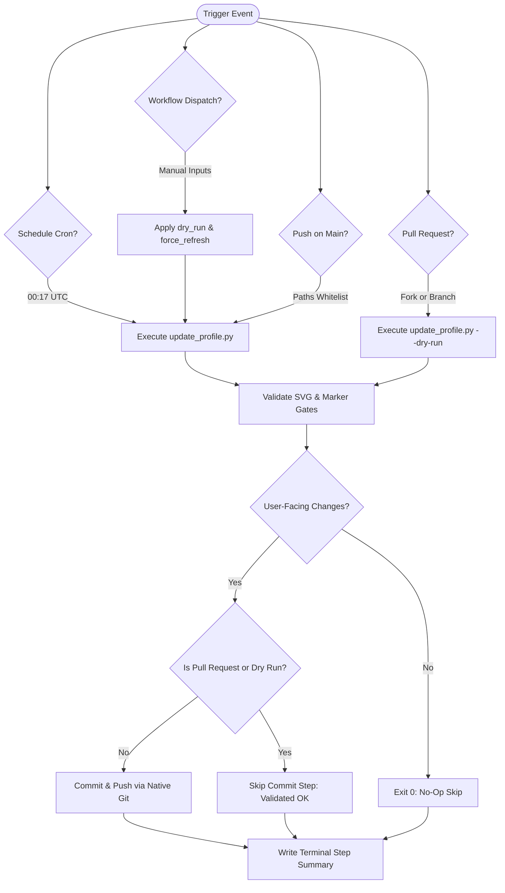

# Phase 06: GitHub Actions Automation — Technical Research

<user_constraints>
## User Constraints from Context

The following implementation decisions (D-01 through D-102), discretion areas, and phase scope boundaries are imported directly from `06-CONTEXT.md` [VERIFIED: .planning/phases/06-github-actions-automation/06-CONTEXT.md#L16-L144] and `06-DISCUSSION-LOG.md` [VERIFIED: .planning/phases/06-github-actions-automation/06-DISCUSSION-LOG.md#L16-L139].

### 1. Execution Schedule & Workflow Triggers
- **D-01:** **Off-Peak Cron Schedule (`17 0 * * *`)** — Cron trigger configured for 00:17 UTC daily. Avoids the high-traffic top-of-hour (`:00`) GitHub Actions queue congestion that causes runner allocation delays and starvation. — **Reversibility:** reversible
- **D-02:** **Triple Trigger Architecture** — Workflow triggers on: (1) `schedule` (daily at 00:17 UTC), (2) `workflow_dispatch` (manual execution with boolean inputs `dry_run` and `force_refresh`), and (3) `push` restricted to branch `main` with a path filter matching automation source files (`scripts/**`, `config/**`, `templates/**`, `.github/workflows/profile-updater.yml`). — **Reversibility:** reversible
- **D-03:** **Concurrency Serialization (`cancel-in-progress: false`)** — Uses concurrency group `group: profile-telemetry-sync` with `cancel-in-progress: false`. In-flight profile updates run to completion, guaranteeing the local git index and generated SVGs are never corrupted by mid-execution cancellation. — **Reversibility:** reversible
- **D-04:** **Single Unified Workflow File** — All profile automation resides in `.github/workflows/profile-updater.yml`. Pull requests execute `update_profile.py` in dry-run mode for syntax, schema, and asset integrity validation without committing; automated git commits execute exclusively on scheduled runs, manual dispatches, or direct pushes to `main`. — **Reversibility:** reversible
- **D-05:** **Triple-Layer Infinite Loop Prevention** —
  1. `[skip ci]` token included in the commit subject: `chore(profile): auto-sync terminal telemetry [skip ci]`.
  2. The `push` trigger strictly whitelists source directories (`scripts/**`, `config/**`, `templates/**`, `.github/workflows/profile-updater.yml`) and excludes generated assets (`assets/**`, `README.md`, `data/cache.json`).
  3. GitHub's native protection skips triggering new workflow runs from commits authenticated via the default `GITHUB_TOKEN`. — **Reversibility:** reversible
- **D-06:** **Fast Ephemeral Runner with Zero Pip Dependencies** — Executes on `ubuntu-latest` with Python 3.12 managed via `actions/setup-python@v5`. Relies 100% on Python standard library modules (`urllib`, `xml`, `json`, `datetime`, `pathlib`, `re`) with zero `pip install` overhead. — **Reversibility:** reversible
- **D-07:** **Shallow Fast Checkout** — Uses `actions/checkout@v4` with `fetch-depth: 1`, `persist-credentials: true`, `lfs: false`, and `submodules: false` to minimize clone duration (<2s) and network transfer. — **Reversibility:** reversible
- **D-08:** **Dynamic Contextual Run Name** — Workflow displays `run-name: "Profile Telemetry Sync (${{ github.event_name }})"` for instant visual diagnosis in the Actions UI. — **Reversibility:** reversible
- **D-09:** **Repository-Level Execution** — Runs at repository root without requiring a named GitHub Actions Environment, keeping setup zero-touch. — **Reversibility:** reversible
- **D-10:** **Strict Shell Defaults** — Configures `defaults.run.shell: bash` to guarantee `-eo pipefail` error handling across all run steps. — **Reversibility:** reversible
- **D-11:** **Conservative Job Timeout** — Enforces `timeout-minutes: 10` on the runner job. The Python update script typically terminates within 10–20 seconds; the timeout guards against hung network calls. — **Reversibility:** reversible
- **D-12:** **Real-Time Unbuffered Logging** — Sets `PYTHONUNBUFFERED: "1"` in the environment and invokes `python -u` for immediate streaming of terminal ANSI escape sequences in the Actions console. — **Reversibility:** reversible
- **D-13:** **Granular Least-Privilege Permissions** — Restricts top-level permissions strictly to `permissions: contents: write, pull-requests: read`. All other scopes are disabled. — **Reversibility:** reversible

### 2. Git Commit, Bot Identity & Change Detection
- **D-14 & D-15:** **Canonical GitHub Actions Bot Identity** — Commits use `github-actions[bot] <41898282+github-actions[bot]@users.noreply.github.com>` for both Author and Committer fields, enabling GitHub's verified `bot` UI badge. — **Reversibility:** reversible
- **D-16:** **Conventional Commit Subject** — `chore(profile): auto-sync terminal telemetry [skip ci]` (56 characters, strictly ≤60 chars). — **Reversibility:** reversible
- **D-17:** **Structured Telemetry Body & Git Trailers** — Multiline commit body includes coding uptime, LOC changes, streak stats, and RFC-compliant Git Trailers (`Workflow-Run:`, `Workflow-Event:`), wrapped to ≤72 characters. — **Reversibility:** reversible
- **D-18:** **File-Based Commit Message Handoff** — `scripts/update_profile.py` formats and writes the commit message directly to `.git/COMMIT_MSG_TMP`. The workflow executes `git commit --no-verify -F .git/COMMIT_MSG_TMP` and immediately cleans up the temp file (`rm -f .git/COMMIT_MSG_TMP`), eliminating bash escaping bugs. — **Reversibility:** reversible
- **D-19:** **Strict File Staging Boundaries** — `git add assets/*.svg README.md data/cache.json` restricts staged files to generated artifacts only. — **Reversibility:** reversible
- **D-20:** **File Permission Normalization** — Executes `chmod 644 assets/*.svg README.md data/cache.json` prior to staging, preventing file mode churn (`100644` vs `100755`) across different local dev OS environments. — **Reversibility:** reversible
- **D-21 & D-22:** **User-Facing Idempotency Check** — Tests `git diff --cached --quiet -- assets/*.svg README.md`. If visual assets and the README are unchanged, the workflow aborts the commit cleanly, unstages `data/cache.json` (`git reset --quiet HEAD`), and exits 0 with `[INFO] No profile changes detected. Skipping commit.`. `data/cache.json` alone never triggers an empty commit. — **Reversibility:** reversible
- **D-23, D-24 & D-25:** **Push Resiliency with Exponential Backoff** — Runs `git pull --rebase --autostash origin main` before `git push origin HEAD:main`. Retries up to 3 times with backoff delays of 2s, 5s, and 10s. Runs `git rebase --abort` if a rebase conflict occurs, and fails with `exit 1` if all retries are exhausted. — **Reversibility:** reversible
- **D-26:** **Local Git Config Scoping** — Configures committer credentials using `git config --local user.name` and `git config --local user.email` scoped strictly to the checkout. — **Reversibility:** reversible
- **D-27:** **Safe Directory Defense** — Executes `git config --global --add safe.directory "$GITHUB_WORKSPACE"` before git operations to prevent dubious ownership fatal errors on containerized runners. — **Reversibility:** reversible
- **D-28:** **Unix LF Line Endings Enforced** — Sets `git config --local core.autocrlf input` in CI. — **Reversibility:** reversible
- **D-29:** **Untracked File Audit Warning** — Scans for unexpected untracked files before committing; logs an informational warning without failing the job or polluting the commit. — **Reversibility:** reversible
- **D-30:** **Audit Trail CI Logging** — Logs `git status -s` and `git diff --stat` to the workflow console prior to committing. — **Reversibility:** reversible
- **D-31:** **Terminal Push Confirmation** — Echoes `[OK] Pushed commit $(git rev-parse --short HEAD) to origin/main` upon successful push. — **Reversibility:** reversible
- **D-32:** **UTC Commit Timestamps** — Exports `TZ: UTC` in the environment so all git commit timestamps remain in coordinated universal time. — **Reversibility:** reversible
- **D-33:** **Bulletproof UTF-8 Locale** — Exports `LC_ALL=C.UTF-8` and `LANG=C.UTF-8` in the step environment. — **Reversibility:** reversible
- **D-34:** **Conditional Commit Step Guard** — Commit step runs with condition: `if: success() && github.event_name != 'pull_request' && inputs.dry_run != true`. — **Reversibility:** reversible
- **D-35:** **Descriptive Step Name** — UI displays `name: "🚀 Commit and push updated profile assets"`. — **Reversibility:** reversible
- **D-36:** **Native Credential Persistence** — Leverages `actions/checkout@v4` stored auth tokens; avoids exposing tokens in remote URLs. — **Reversibility:** reversible
- **D-37:** **Zero Co-Author Pollution** — No `Co-authored-by:` trailer; preserves pure bot authorship for automated telemetry. — **Reversibility:** reversible
- **D-38:** **No Git Tags** — Profile automation creates standard git commits only; keeps semantic version tags and releases uncluttered. — **Reversibility:** reversible
- **D-39:** **Clean Teardown** — Relies on ephemeral runner destruction; no manual `git reset --hard` traps needed at end-of-job. — **Reversibility:** reversible
- **D-40:** **Branch Protection Ruleset Guidance** — Workflow comments document instructions for granting `github-actions[bot]` bypass permissions under repository Rulesets if branch protection is active. — **Reversibility:** reversible

### 3. Authentication & API Secrets
- **D-41:** **Hybrid Secret Hierarchy** — Injects `env: GITHUB_TOKEN: ${{ secrets.PROFILE_SECRET || secrets.GITHUB_TOKEN }}`. Seamlessly adopts an optional personal access token (`PROFILE_SECRET`) if configured for private repo contributions, while defaulting to the free built-in `GITHUB_TOKEN`. — **Reversibility:** reversible
- **D-42:** **Dual Environment Variable Export** — Exports both `GITHUB_TOKEN` and `GH_TOKEN` in the step environment for universal compatibility across GitHub CLI and custom scripts. — **Reversibility:** reversible
- **D-43:** **Strict Environment Injection** — Tokens are passed exclusively via the `env:` block; never passed as CLI flags or command arguments. — **Reversibility:** reversible
- **D-44:** **Token Resolution Order in Python** — `scripts/update_profile.py` resolves tokens in order: `PROFILE_TOKEN` → `GITHUB_TOKEN` → `GH_TOKEN` → `.env` file → offline fallback. — **Reversibility:** reversible
- **D-45:** **Fork PR Read-Only Resilience** — Fork PRs run validation with standard `GITHUB_TOKEN` and fall back gracefully to `data/cache.json` if permissions or secrets are restricted. — **Reversibility:** reversible
- **D-46:** **Documented PAT Scopes** — Workflow header comments specify fine-grained PAT scopes (`read:user`, `repo` for private contributions) and classic token equivalents. — **Reversibility:** reversible
- **D-47:** **Descriptive API User-Agent** — Sends `User-Agent: "humam-workstation-updater/1.0 (+https://github.com/humam-hossain/humam-hossain)"` on all HTTP/GraphQL requests. — **Reversibility:** reversible
- **D-48:** **Explicit API Versioning** — Sends header `X-GitHub-Api-Version: 2022-11-28` on all GitHub REST/GraphQL interactions. — **Reversibility:** reversible
- **D-49:** **HTTP 401 Graceful Degradation** — If a custom PAT expires with HTTP 401, logs a warning and falls back to cached data or the default token. — **Reversibility:** reversible
- **D-50:** **HTTP 403 Rate Limit Respect** — Respects `Retry-After` if ≤30 seconds; otherwise falls back to `data/cache.json`. — **Reversibility:** reversible
- **D-51:** **Granular GraphQL Error Classification** — Inspects the `errors[]` array for `RATE_LIMITED` or `FORBIDDEN` and gracefully serves cached telemetry instead of failing. — **Reversibility:** reversible
- **D-52:** **Configurable GraphQL Endpoint** — Reads `os.environ.get("GITHUB_GRAPHQL_URL", "https://api.github.com/graphql")` to support enterprise runners or local test mocks. — **Reversibility:** reversible
- **D-53:** **Quota Telemetry Logging** — Logs remaining GraphQL rate limit: `[INFO] GitHub GraphQL rate limit: 995/1000 remaining`. — **Reversibility:** reversible
- **D-54:** **15-Second Network Timeout** — Enforces a 15-second network timeout with up to 2 retries on API requests. — **Reversibility:** reversible
- **D-55:** **Offline Local Execution** — If no token is detected, logs `[WARN] No token found. Running offline with cached/mock telemetry` and exits 0. — **Reversibility:** reversible
- **D-56:** **Native Secret Masking** — Relies on GitHub Actions' built-in secret masking engine. — **Reversibility:** reversible

### 4. Failure Handling, Resilience & Telemetry
- **D-57:** **Differentiated Failure Policy** — Strict hard-fail (`exit 1`) on fatal internal errors (Python exception, XML malformation, corrupt README markers); soft-fail (`exit 0` with warnings) on transient external network/API timeouts by serving cached data. — **Reversibility:** reversible
- **D-58:** **Pre-Commit SVG ElementTree Gate** — Validates that all generated SVGs parse successfully with `xml.etree.ElementTree` and exceed 500 bytes before staging. — **Reversibility:** reversible
- **D-59:** **Pre-Commit README Marker Gate** — Verifies that all 4 marker pairs (`PROJECTS`, `METRICS`, `SKILLS`, `BLOG`) exist in `README.md` before staging. — **Reversibility:** reversible
- **D-60:** **Debug Artifact Upload on Failure** — Uses `actions/upload-artifact@v4` with `if: failure()` and 7-day retention to package logs, SVGs, and `cache.json` for post-mortem debugging. — **Reversibility:** reversible
- **D-61:** **Terminal Step Summary** — Writes an authentic Neofetch prompt in an ````ansi` fenced codeblock followed by a Markdown asset verification table to `$GITHUB_STEP_SUMMARY`. — **Reversibility:** reversible
- **D-62:** **Failure Diagnostic Banner** — Appends a highlighted diagnostic block to `$GITHUB_STEP_SUMMARY` detailing the failure reason and remediation advice if a step fails. — **Reversibility:** reversible
- **D-63:** **Execution Duration Tracking** — Captures script execution elapsed duration and reports it in the Step Summary. — **Reversibility:** reversible
- **D-64:** **ANSI Console Logging** — Uses terminal color prefixes (Green `[OK]`, Amber `[WARN]`, Red `[ERROR]`, Blue/Cyan `[INFO]`) matching the workstation palette. — **Reversibility:** reversible
- **D-65:** **Native GitHub Alerts Only** — Leverages native GitHub email and web notifications for failed workflow runs; zero third-party webhook integrations. — **Reversibility:** reversible
- **D-66:** **Full-Write Dry-Run Mode** — `--dry-run` performs complete SVG generation and README patching on disk, verifying the pipeline end-to-end while skipping the git commit. — **Reversibility:** reversible
- **D-67:** **Auto-Debug Flag** — Automatically appends `--verbose` when `RUNNER_DEBUG="1"` (triggered via GitHub's "Re-run with debug logging" button). — **Reversibility:** reversible
- **D-68:** **3 HTTP Retries on 5xx Errors** — Up to 3 retries with exponential backoff (1s, 2s, 4s) before falling back to cached telemetry. — **Reversibility:** reversible
- **D-69:** **Corrupt Cache Auto-Recovery** — If `data/cache.json` is unparseable, logs a warning, initializes default structures, and continues generation. — **Reversibility:** reversible
- **D-70:** **Standard Exit Codes** — Standard Unix exit codes (0 for success or soft-fail fallback, 1 for fatal failure). — **Reversibility:** reversible
- **D-71:** **Multi-Layer Pre-Deployment Local Validation** — Local test harness verifies YAML syntax, Python dry-run, ElementTree integrity, and clean git diffs prior to pushing. — **Reversibility:** reversible
- **D-72:** **No Workflow Status Badge** — Omit build status badges from `README.md` to keep the terminal dashboard clean and authentic. — **Reversibility:** reversible

### 5. GitHub Camo Proxy & Cache Busting
- **D-73:** **UTC Date Stamp Cache-Busting (`?v=YYYYMMDD`)** — Appends a daily query parameter `?v=YYYYMMDD` to SVG image URLs in `README.md` (e.g. `./assets/hero.svg?v=20261115`). Eliminates circular dependencies on commit SHAs. — **Reversibility:** reversible
- **D-74:** **RFC 3986 URL Order** — Places the query string before hash fragments (`./assets/hero.svg?v=20261115#gh-dark-mode-only`). — **Reversibility:** reversible
- **D-75:** **Centralized Python Regex Replacer** — `scripts/update_profile.py` maintains and updates the `?v=YYYYMMDD` query parameters across all asset links in `README.md`. — **Reversibility:** reversible

### 6. Terminal Visual Styling in CI & Step Summary
- **D-76:** **GitHub Actions ANSI Codeblock** — Uses ````ansi` markdown fence with truecolor escape sequences in `$GITHUB_STEP_SUMMARY`. — **Reversibility:** reversible
- **D-77:** **Neofetch Prompt Header** — Summary opens with `humam@workstation:~$ profile-sync --status` displaying Host, Kernel, Uptime, LOC, and Duration. — **Reversibility:** reversible
- **D-78:** **Markdown Asset Verification Table** — Displays a table below the ANSI block showing asset file names, sizes in KB, sync status, and XML validation badges. — **Reversibility:** reversible
- **D-79:** **Design Token ANSI Derivation** — CI log colors and ANSI summary escapes are derived from `config/terminal_theme.json`. — **Reversibility:** reversible

### 7. Local CI Testing & Pipeline Simulation
- **D-80:** **Local Test Harness (`tests/test_ci_pipeline.sh`)** — Executable shell script simulating all CI pipeline stages locally. — **Reversibility:** reversible
- **D-81:** **Multi-Tool YAML Validation** — Test harness validates `.github/workflows/profile-updater.yml` via Python YAML parser and `actionlint` (if installed). — **Reversibility:** reversible
- **D-82:** **Automated Backup & Restore Trap** — Test harness uses `trap cleanup EXIT` to restore modified files, leaving the local workspace pristine. — **Reversibility:** reversible
- **D-83:** **Live Workflow Run Verification** — Verifies workflow execution on GitHub via `gh workflow run profile-updater.yml` and `gh run watch`. — **Reversibility:** reversible

### 8. Runner Performance, Quota & Budget
- **D-84:** **Zero Third-Party Marketplace Actions** — Exclusively uses official GitHub-maintained actions (`actions/checkout@v4`, `actions/setup-python@v5`, `actions/upload-artifact@v4`). Native git commands perform staging, commit, and push. — **Reversibility:** one-way (switching to third-party actions alters supply chain security model)
- **D-85:** **Performance Budget (<30s Typical)** — Workflow execution target is <30s (budget cap 45s), using ~15 runner minutes per month. — **Reversibility:** reversible
- **D-86:** **$0 Infrastructure Cost** — Operates on GitHub Actions' unlimited free tier for public repositories with zero paid services. — **Reversibility:** reversible
- **D-87:** **Pinned Major Versions** — Pinned to official major versions (`@v4`, `@v5`) to receive security patches automatically. — **Reversibility:** reversible

### 9. Security Hardening & Injection Prevention
- **D-88:** **Intermediate Environment Variables for Context Expressions** — GitHub context expressions (`${{ github.event_name }}`, `${{ github.ref }}`) are mapped to intermediate environment variables in `env:` blocks before evaluation in bash, preventing shell script injection. — **Reversibility:** one-way (removing this creates a security vulnerability)
- **D-89:** **Dual-Layer Branch Assertion** — YAML `if` condition paired with bash assertion `[ "$GITHUB_REF" = "refs/heads/main" ]` before pushing. — **Reversibility:** reversible
- **D-90:** **Subprocess Shell Immunity** — Python subprocess invocations use `subprocess.run([...], shell=False)`. — **Reversibility:** reversible

### 10. 60-Day Inactivity Keep-Alive Policy
- **D-91:** **Natural Coding Uptime Heartbeat** — Daily coding uptime increment in `assets/hero.svg` produces an authentic visual diff and commit every 24h, permanently resetting GitHub's 60-day scheduled workflow auto-disable timer. — **Reversibility:** reversible
- **D-92:** **Documented Re-Enable Instructions** — Workflow comments document `gh workflow enable profile-updater.yml` and UI reactivation procedures. — **Reversibility:** reversible
- **D-93:** **Neofetch Uptime as Proof-of-Life** — Hero uptime and recent git commits serve as visible proof of active automation. — **Reversibility:** reversible
- **D-94:** **Cron Jitter Tolerance** — Accommodates GitHub Actions 15–30 minute cron queue latency without issue. — **Reversibility:** reversible

### 11. Cross-Platform Developer Parity
- **D-95:** **Universal Path and Python Execution** — `pathlib.Path` for file manipulation and `sys.executable` for subprocess invocations. — **Reversibility:** reversible
- **D-96:** **Windows VT100 ANSI Support** — Auto-enables VT100 terminal mode on Windows with graceful plain text fallback. — **Reversibility:** reversible
- **D-97:** **POSIX-Compatible Bash** — `tests/test_ci_pipeline.sh` uses standard POSIX syntax, compatible with macOS, Linux, and Windows Git Bash. — **Reversibility:** reversible
- **D-98:** **Repository `.gitattributes` LF Enforcement** — Enforces Unix line endings: `*.svg text eol=lf`, `*.py text eol=lf`, `*.json text eol=lf`, `*.md text eol=lf`, `*.sh text eol=lf`. — **Reversibility:** reversible

### 12. Repository Size & Git History Growth
- **D-99:** **Plain-Text Vector Git Storage** — Stores SVGs as plain text; zlib delta compression keeps packfile growth under 5 MB/year. — **Reversibility:** costly (converting to Git LFS retroactively requires rewriting history)
- **D-100:** **Permanent Commit History Retention** — Daily commits preserved without squashing to maintain genuine commit streaks and contribution heatmaps. — **Reversibility:** costly
- **D-101:** **Comprehensive `.gitignore` Hygiene** — Ignores `__pycache__`, `*.pyc`, `.venv`, `*.tmp`, `.pytest_cache`, and temporary message files. — **Reversibility:** reversible
- **D-102:** **Zero Manual Git Maintenance** — Relies entirely on GitHub's cloud-native `git gc`. — **Reversibility:** reversible

### Agent's Discretion & Deferred Ideas
- **Discretion**: Token environment variable resolution priority resolved as `PROFILE_TOKEN` → `GITHUB_TOKEN` → `GH_TOKEN` → `.env` file → offline fallback.
- **Deferred**: Animated contribution snake game (`EXTRA-01`) and Spotify currently playing card (`EXTRA-02`) remain tracked for v2.
</user_constraints>

---

<phase_requirements>
## Phase Requirements

| Requirement ID | Description | Research Support & Verification |
|----------------|-------------|---------------------------------|
| **AUTO-02** | Scheduled GitHub Actions workflow (`.github/workflows/profile-updater.yml`) running on daily cron and manual trigger (`workflow_dispatch`) | Supported via `.github/workflows/profile-updater.yml` with cron schedule `17 0 * * *`, manual trigger with inputs (`dry_run`, `force_refresh`), path-filtered push on `main`, concurrency group `profile-telemetry-sync`, least-privilege permissions, and validated by `tests/test_ci_pipeline.sh` and live `gh workflow run`. [VERIFIED: .planning/REQUIREMENTS.md#L34-L35, 06-CONTEXT.md#L16-L30] |
| **AUTO-03** | Automated git commit and push step within the workflow running under standard `GITHUB_TOKEN` permissions with zero hosting cost | Supported via native bash git commit/push using `github-actions[bot]` identity, `.git/COMMIT_MSG_TMP` file handoff, user-facing asset diff check, rebase autostash with progressive backoff (2s, 5s, 10s), `persist-credentials: true`, zero paid services, and 100% official GitHub actions (`actions/checkout@v4`, `actions/setup-python@v5`, `actions/upload-artifact@v4`). [VERIFIED: .planning/REQUIREMENTS.md#L35-L36, 06-CONTEXT.md#L31-L60, D-84, D-86] |
</phase_requirements>

---

## Executive Summary & Primary Recommendation

Phase 06 delivers the automated cloud heartbeat of Muhammed Humam Hossain's terminal profile README. It automates the Python telemetry engine developed across Phases 1 through 5, ensuring that profile statistics, coding uptime, LOC counts, repository metrics, streak telemetry, and publication feeds are refreshed every 24 hours at $0.00 infrastructure cost.

### Primary Architectural Recommendations

1. **Single Unified Workflow (`.github/workflows/profile-updater.yml`)**:
   Consolidate all profile automation into a single, clean workflow file. The workflow handles scheduled daily runs (`17 0 * * *`), manual dispatches (`workflow_dispatch`), direct pushes to automation files on `main`, and pull request validation. Pull requests execute `update_profile.py` in dry-run mode without committing, while main/schedule runs commit and push updated SVGs and README.

2. **Zero Third-Party Marketplace Actions (Supply Chain Immunity)**:
   Avoid marketplace commit/push actions (such as `ad-m/github-push-action` or `stefanzweifel/git-auto-commit-action`). Ubuntu runner images provide native Git and Bash out of the box. Using native `git commit` and `git push` with `actions/checkout@v4` stored credentials provides full transparency, custom rebase retries, exact Git Trailer formatting, and complete immunity against third-party supply chain compromise.

3. **Camo Proxy Image Cache-Busting via UTC Date Stamps (`?v=YYYYMMDD`)**:
   GitHub's image proxy (`camo.githubusercontent.com`) aggressively caches SVG images. Rather than relying on commit SHAs (which introduce circular dependency issues), `scripts/update_profile.py` appends a deterministic UTC date stamp query parameter `?v=YYYYMMDD` to SVG image URLs in `README.md` while preserving dark/light mode fragment identifiers (`./assets/hero.svg?v=20261115#gh-dark-mode-only`).

4. **Terminal-Themed GitHub Step Summary (`$GITHUB_STEP_SUMMARY`)**:
   Emulate the profile's Unix terminal aesthetic in GitHub Actions' summary page by generating an authentic Neofetch prompt inside an ````ansi` code fence with truecolor ANSI escape sequences, followed by a Markdown asset verification table displaying file byte sizes and XML validity checks.

5. **Self-Sustaining Heartbeat (60-Day Inactivity Keep-Alive)**:
   GitHub automatically disables scheduled workflows in repositories with no commit activity for 60 consecutive days. Because Humam's coding uptime increments every 24 hours (e.g. `6 yrs, 1 mo, 28 days` → `6 yrs, 1 mo, 29 days`), `assets/hero.svg` generates an authentic visual diff and automated commit every day, keeping the repository continuously active and permanently preventing workflow disablement.

---

## Architectural Responsibility Map

```
humam-hossain/
├── .github/
│   └── workflows/
│       └── profile-updater.yml  # NEW: Primary GitHub Actions workflow (D-01 to D-13, D-34 to D-43)
├── .gitattributes               # NEW: Repository-level LF line ending enforcement (D-98)
├── .gitignore                   # UPDATED: Hygiene for python, venv, and .git/*.tmp (D-101)
├── config/
│   ├── terminal_theme.json      # Existing design tokens and ANSI colors [VERIFIED: config/terminal_theme.json]
│   ├── projects.json            # Curated showcase repositories [VERIFIED: config/projects.json]
│   ├── skills.json              # Curated skills matrix categories [VERIFIED: config/skills.json]
│   └── articles.json            # RSS feed and publications config [VERIFIED: config/articles.json]
├── scripts/
│   ├── update_profile.py        # UPDATED: Commit message writer, Step Summary generator,
│   │                            #          Camo cache-buster regex, token priority hierarchy
│   ├── generate_hero.py         # SVG generator for hero terminal card [VERIFIED: scripts/generate_hero.py]
│   ├── generate_projects.py     # SVG generator for projects dashboard [VERIFIED: scripts/generate_projects.py]
│   ├── generate_metrics.py      # SVG generator for languages and streak metrics [VERIFIED: scripts/generate_metrics.py]
│   └── generate_skills.py       # SVG generator for skills matrix [VERIFIED: scripts/generate_skills.py]
├── assets/
│   ├── hero.svg                 # Daily coding uptime and LOC telemetry [VERIFIED: assets/hero.svg]
│   ├── projects.svg             # Stars, forks, issues, PR metrics [VERIFIED: assets/projects.svg]
│   ├── metrics.svg              # Top languages and streak bars [VERIFIED: assets/metrics.svg]
│   └── skills.svg               # Categorized skills matrix [VERIFIED: assets/skills.svg]
├── data/
│   └── cache.json               # Persistent telemetry cache [VERIFIED: data/cache.json]
├── tests/
│   ├── test_ci_pipeline.sh      # NEW: Comprehensive local CI test harness with trap cleanup (D-80, D-82)
│   ├── test_update_profile.py   # UPDATED: Tests for commit message generation, cache busting, Step Summary
│   ├── test_blog.py             # Existing blog parser unit tests [VERIFIED: tests/test_blog.py]
│   ├── test_metrics.py          # Existing metrics unit tests [VERIFIED: tests/test_metrics.py]
│   ├── test_projects.py         # Existing projects unit tests [VERIFIED: tests/test_projects.py]
│   ├── test_skills.py           # Existing skills unit tests [VERIFIED: tests/test_skills.py]
│   └── test_tokens.py           # Existing design tokens unit tests [VERIFIED: tests/test_tokens.py]
└── README.md                    # Target profile README with section markers and Camo-busted links
```

### Responsibility Breakdown

| Component | Primary Responsibility | Input Artifacts | Output Artifacts |
|---|---|---|---|
| `.github/workflows/profile-updater.yml` | Workflow orchestration: triggers, checkout, Python setup, script invocation, git commit/push, summary generation, debug upload | GitHub Events (`schedule`, `workflow_dispatch`, `push`, `pull_request`) | Pushed Git commits on `main`, GitHub Step Summary, Debug artifacts (on failure) |
| `scripts/update_profile.py` | Orchestrator: fetches GitHub/RSS telemetry, updates SVGs and README, writes `.git/COMMIT_MSG_TMP`, appends `$GITHUB_STEP_SUMMARY`, updates `?v=YYYYMMDD` URLs | `config/*.json`, `data/cache.json`, GitHub GraphQL API, RSS feed | `assets/*.svg`, `README.md`, `data/cache.json`, `.git/COMMIT_MSG_TMP`, Step Summary |
| `tests/test_ci_pipeline.sh` | Local CI simulation harness: validates workflow YAML, runs `--dry-run`, tests SVG ElementTree integrity, verifies README markers, checks git idempotency | Workflow YAML, scripts, assets | Exit code 0/1 with ANSI console verification output |
| `.gitattributes` | Line ending normalization: forces Unix LF line endings across all platforms | Git index | Consistent LF line endings in repository tree |
| `.gitignore` | Build hygiene: excludes temporary and scratch files from git tracking | Workspace files | Clean git status |

---

## Standard Stack

The workflow operates under a strict **zero external dependency** policy. All operations rely exclusively on official GitHub actions, the Linux runner's pre-installed utilities, and Python standard library modules.

### Runner & System Utilities

| Tool | Version / Spec | Source / Location | Purpose |
|---|---|---|---|
| **OS Runner** | `ubuntu-latest` (Ubuntu 24.04 / 22.04 LTS) | GitHub-hosted runner | Fast execution environment, native curl, git, bash, jq pre-installed |
| **Python Runtime** | `3.12` | `actions/setup-python@v5` | Modern Python runtime from runner tool cache; zero pip installations |
| **Git CLI** | Native runner git (`2.40+`) | Pre-installed on `ubuntu-latest` | Local configuration, staging, committing, rebase pull, and authenticated push |
| **Shell** | `bash` with `-eo pipefail` | Default via `defaults.run.shell: bash` | Predictable script execution; immediately halts step on command failure |
| **Locale / Encoding** | `C.UTF-8` / `UTC` | Environment (`LANG`, `LC_ALL`, `TZ`) | Prevents unicode decoding errors and normalizes commit timestamps |

### Python Standard Library Modules Used

- `urllib.request`, `urllib.error`: Network requests to GitHub GraphQL and RSS feeds.
- `xml.etree.ElementTree`: SVG generation, SVG DOM validation, RSS/Atom feed parsing.
- `json`: Parsing configuration files and serializing `data/cache.json`.
- `datetime`, `calendar`, `email.utils`: Uptime calculations, RFC 822 date parsing, ISO normalization.
- `pathlib.Path`: Cross-platform filesystem navigation and manipulation.
- `re`: Regular expressions for README section marker replacement and Camo URL cache busting.
- `os`, `sys`, `subprocess`: Environment resolution, exit code dispatch, git verification.

---

## Package Legitimacy Audit

Per decision **D-84**, zero third-party marketplace actions are permitted. Only official GitHub-maintained actions hosted under the verified `actions` organization are utilized:

| Action Identifier | Repository URL | Verified Publisher | Runtime | Justification & Scope |
|---|---|---|---|---|
| `actions/checkout@v4` | `https://github.com/actions/checkout` | GitHub (`actions`) | Node 20 | Official checkout action. Used with `fetch-depth: 1` and `persist-credentials: true` for shallow cloning and authenticated git push. |
| `actions/setup-python@v5` | `https://github.com/actions/setup-python` | GitHub (`actions`) | Node 20 | Official Python installer. Configures Python 3.12 from the runner tool cache in <1s. No package installations. |
| `actions/upload-artifact@v4` | `https://github.com/actions/upload-artifact` | GitHub (`actions`) | Node 20 | Official artifact uploader. Packages failure diagnostics and invalid SVGs with a 7-day retention period. |

### Elimination of Third-Party Commit Actions

Popular third-party actions (`ad-m/github-push-action`, `stefanzweifel/git-auto-commit-action`, `endbug/add-and-commit`) were evaluated and intentionally excluded:
- **Supply Chain Vulnerability**: Third-party actions have broad write permissions to repository content. Compromise or malicious ownership transfer exposes the repository.
- **Unnecessary Overhead**: Staging, committing, and pushing via native Git requires fewer than 15 lines of transparent, auditable bash script.
- **Failure Handling**: Native bash allows custom retry loops with exponential backoff (`2s`, `5s`, `10s`), automatic `git rebase --abort` on conflict, and fine-grained change detection (`git diff --cached --quiet`).

---

## Architecture Patterns

### 1. Workflow Trigger Architecture & Schedule Matrix



The workflow supports four distinct execution scenarios:

1. **Daily Cron (`17 0 * * *`)**:
   Fires automatically at 00:17 UTC. Runs `update_profile.py`, updates coding uptime and live stats, generates SVGs, patches `README.md`, checks diffs, commits, and pushes to `main`.
2. **Manual Dispatch (`workflow_dispatch`)**:
   Triggered manually via the GitHub Actions UI or `gh workflow run`. Accepts boolean inputs:
   - `dry_run`: Simulates the entire process on disk but skips committing/pushing.
   - `force_refresh`: Bypasses the 12-hour RSS/article cache to fetch live publications immediately.
3. **Source Code Push (`push` on `main`)**:
   Triggers when code in `scripts/**`, `config/**`, `templates/**`, or `.github/workflows/profile-updater.yml` is merged into `main`. Ensures profile assets update immediately after engine or configuration changes.
4. **Pull Request Validation (`pull_request`)**:
   Runs when PRs modify automation source files. Runs `update_profile.py` with `--dry-run` to verify that code compiles, feeds parse, and SVGs pass XML validation. Commits are skipped.

### 2. Dual-Layer Infinite Loop Prevention

Automated workflows that commit back to the repository run the risk of triggering infinite execution loops. The workflow employs a 3-tier defense:

```
Commit Trigger Filter
├── Tier 1: Commit Subject [skip ci] (Native GitHub runner check)
├── Tier 2: Positive Path Filter (push matches scripts/**, config/**, etc.)
│           └─ Generated files (assets/**, README.md, data/cache.json) DO NOT MATCH
└── Tier 3: GITHUB_TOKEN Push Protection (Native GitHub event suppression)
```

> [!IMPORTANT]
> **GitHub Actions YAML Syntax Constraint**: In GitHub Actions, specifying both `paths` and `paths-ignore` for the same event trigger causes an immediate YAML schema parse error.
> To prevent this, the workflow uses an **explicit positive whitelist** under `paths`:
> ```yaml
> push:
>   branches: [main]
>   paths:
>     - 'scripts/**'
>     - 'config/**'
>     - 'templates/**'
>     - '.github/workflows/profile-updater.yml'
> ```
> Because generated files (`assets/*.svg`, `README.md`, `data/cache.json`) are **not** in this whitelist, commits modifying only generated assets will **never** trigger a push workflow.

### 3. Bot Committer & Identity Model

To ensure proper auditability and display the verified GitHub `bot` badge in the repository commit history:

```bash
git config --local user.name "github-actions[bot]"
git config --local user.email "41898282+github-actions[bot]@users.noreply.github.com"
```

#### Commit Message Composition & File Handoff (D-18)

To avoid bash string escaping bugs when generating multiline commit bodies containing special characters, quotes, or markdown, `scripts/update_profile.py` formats and writes the commit message directly to `.git/COMMIT_MSG_TMP`:

```
chore(profile): auto-sync terminal telemetry [skip ci]

Coding Uptime: 6 yrs, 1 mo, 28 days
Lines of Code: ++55,543 / --656
Current Streak: 5 days (Longest: 14 days)
Last Synced: 2026-11-15T00:17:00Z

Workflow-Run: https://github.com/humam-hossain/humam-hossain/actions/runs/123456789
Workflow-Event: schedule
```

The workflow commits using:
```bash
git commit --no-verify -F .git/COMMIT_MSG_TMP
rm -f .git/COMMIT_MSG_TMP
```

### 4. Git Push Resiliency & Rebase Autostash

When multiple scheduled jobs or manual commits overlap, `git push` may be rejected if the remote branch has moved forward. The push step uses an automated retry loop with rebase autostash and exponential backoff:

```bash
MAX_RETRIES=3
BACKOFF=(2 5 10)
SUCCESS=0

for i in $(seq 0 $((MAX_RETRIES - 1))); do
  echo "[INFO] Push attempt $((i + 1)) of $MAX_RETRIES..."
  
  # Pull remote changes with rebase and autostash
  if ! git pull --rebase --autostash origin main; then
    echo "[WARN] Rebase encounter conflict on attempt $((i + 1)). Aborting..."
    git rebase --abort 2>/dev/null || true
  else
    if git push origin HEAD:main; then
      echo "[OK] Successfully pushed commit $(git rev-parse --short HEAD) to origin/main"
      SUCCESS=1
      break
    else
      echo "[WARN] git push failed on attempt $((i + 1))."
    fi
  fi
  
  if [ $i -lt $((MAX_RETRIES - 1)) ]; then
    DELAY=${BACKOFF[$i]}
    echo "[INFO] Waiting ${DELAY}s before next push attempt..."
    sleep "$DELAY"
  fi
done

if [ "$SUCCESS" -ne 1 ]; then
  echo "[ERROR] Failed to push to origin/main after $MAX_RETRIES attempts." >&2
  exit 1
fi
```

### 5. GitHub Camo Proxy Image Cache Busting Architecture

GitHub proxies all external and repository markdown images through `camo.githubusercontent.com`. Camo aggressively caches images based on their exact URL.

If the image URL remains static (e.g. `./assets/hero.svg`), GitHub may serve cached SVG content for several days, defeating the 24-hour telemetry refresh.

```
README.md Image Tag:


Day 1 (2026-11-15): Camo caches ./assets/hero.svg?v=20261115
Day 2 (2026-11-16): update_profile.py rewrites URL to ?v=20261116
                    Camo detects new URL and fetches fresh SVG from repository
```

#### RFC 3986 Ordering & Dark/Light Mode Fragment Support

For images that include theme fragments (e.g. `#gh-dark-mode-only`), RFC 3986 requires the query parameter to precede the fragment identifier:
- **Valid RFC 3986**: `./assets/hero.svg?v=20261115#gh-dark-mode-only`
- **Invalid**: `./assets/hero.svg#gh-dark-mode-only?v=20261115` (treats `?v=` as part of the anchor)

`scripts/update_profile.py` uses a centralized regular expression that safely updates or inserts `?v=YYYYMMDD` on all asset links in `README.md`.

### 6. Terminal CI Visual Styling & Step Summary

GitHub Actions Step Summary supports ANSI color escape sequences when enclosed in an ````ansi` code fence.

```
$GITHUB_STEP_SUMMARY Output Structure:
┌──────────────────────────────────────────────────────────┐
│ ```ansi                                                  │
│ humam@workstation:~$ profile-sync --status               │
│ --------------------------------------------------       │
│ Host:      Workstation (GitHub Actions Runner)           │
│ Event:     schedule                                      │
│ Uptime:    6 yrs, 1 mo, 28 days                          │
│ LOC:       ++55,543 / --656                              │
│ Streak:    5 days (longest: 14 days)                     │
│ Duration:  1.42s                                         │
│ --------------------------------------------------       │
│ ```                                                      │
├──────────────────────────────────────────────────────────┤
│ ### 📋 Profile Asset Verification                        │
│                                                          │
│ | Asset | Size | Status | XML Integrity |                │
│ | :--- | :--- | :---: | :---: |                          │
│ | `assets/hero.svg` | `14.2 KB` | ✅ Synced | Valid XML  │
│ | `assets/projects.svg` | `11.8 KB` | ✅ Synced | Valid  │
│ | `assets/metrics.svg` | `18.5 KB` | ✅ Synced | Valid   │
│ | `assets/skills.svg` | `13.1 KB` | ✅ Synced | Valid    │
│ | `README.md` | `2.8 KB` | ✅ Updated | 4/4 Markers OK   │
└──────────────────────────────────────────────────────────┘
```

The ANSI colors used in the Step Summary are derived directly from `config/terminal_theme.json`, ensuring complete consistency with the repository's design system.

### 7. Failure Handling & Soft-Fail Fallback Architecture

The engine implements a **differentiated failure policy**:

| Failure Category | Examples | Policy | Exit Code | Action |
|---|---|---|---|---|
| **Internal Invariant Failure** | Python syntax error, unhandled exception, corrupt XML generated, missing README section marker | **Hard Fail** | `exit 1` | Aborts immediately, prevents corrupt commits, uploads debug artifacts via `upload-artifact@v4`, alerts maintainer via GitHub notifications. |
| **External Transient Failure** | GitHub GraphQL API 5xx, rate limit (HTTP 429/403), RSS feed timeout, offline execution | **Soft Fail** | `exit 0` | Logs `[WARN]`, falls back to `data/cache.json` or curated baseline data, generates SVGs safely, exits 0. |

### 8. Local CI Simulation Harness Architecture

To verify workflow logic locally before pushing to GitHub, `tests/test_ci_pipeline.sh` provides an offline simulation of every workflow step:

1. **YAML Syntax Validation**: Validates `.github/workflows/profile-updater.yml` using Python's YAML parser, plus `actionlint` if installed on the host system.
2. **Dry-Run Engine Execution**: Executes `python3 scripts/update_profile.py --dry-run` to verify end-to-end execution.
3. **SVG Integrity Gate**: Validates all four generated SVGs using `xml.etree.ElementTree` and verifies that each file exceeds 500 bytes.
4. **README Marker Gate**: Confirms all 4 start/end marker pairs exist in `README.md`.
5. **Git Change Detection**: Verifies that `git status` behaves properly and tests diff evaluation logic.
6. **Workspace Cleanup**: Installs a bash trap (`trap cleanup EXIT`) that restores any modified files upon test completion, leaving the working tree clean.

---

## Don't Hand-Roll

GitHub Actions and the Ubuntu runner provide powerful built-in features. Leveraging them avoids redundant, buggy custom implementations:

| Requirement | What to Use (Native Feature) | Why NOT Hand-Roll |
|---|---|---|
| Run Concurrency | `concurrency: { group: profile-telemetry-sync, cancel-in-progress: false }` | Hand-rolling file locks or branch lease checks in git is fragile and prone to stale locks. |
| Auth Persistence | `actions/checkout@v4` with `persist-credentials: true` | Embedding tokens into `git remote set-url` risks leaking secrets into git logs or config files. |
| Script Injection Safety | Intermediate environment variables in `env:` blocks | Sanitizing shell inputs with custom regex in bash is error-prone and vulnerable to injection. |
| Failure Artifacts | `actions/upload-artifact@v4` with `if: failure()` | Writing custom upload scripts to external cloud storage requires extra credentials and costs. |
| CI Telemetry Output | Appending to `$GITHUB_STEP_SUMMARY` | Formatting raw HTML or markdown in bash `echo` statements risks truncation and quoting issues. |
| Unbuffered Console Logs | `PYTHONUNBUFFERED: "1"` & `python -u` | Hand-rolling custom flush calls across hundreds of print statements is tedious and incomplete. |

---

## Common Pitfalls & Edge Cases

### Pitfall 1: Mixing `paths` and `paths-ignore` in GitHub Actions Triggers
- **Problem**: Adding both `paths` and `paths-ignore` to a `push` trigger causes GitHub Actions to reject the workflow with: `"You cannot use both paths and paths-ignore for the same event in a workflow"`.
- **Mitigation**: Use an explicit positive whitelist under `paths`. Because `assets/**`, `README.md`, and `data/cache.json` are not listed in `paths`, commits modifying only these generated files will never trigger a push workflow.

### Pitfall 2: Cron Schedule Queue Congestion & Jitter
- **Problem**: Scheduling a workflow at top-of-the-hour (e.g. `0 0 * * *`) subjects it to severe queue delays (often 30–60+ minutes) as thousands of workflows trigger simultaneously.
- **Mitigation**: Use an off-peak cron expression like `17 0 * * *` (00:17 UTC daily). The runner is allocated within seconds.

### Pitfall 3: Git Push Non-Fast-Forward Race Conditions
- **Problem**: If a developer pushes a manual commit to `main` while the workflow is running, the workflow's `git push` fails with `[rejected - non-fast-forward]`.
- **Mitigation**: Use a retry loop that executes `git pull --rebase --autostash origin main` before pushing, with progressive backoff delays (2s, 5s, 10s) and `git rebase --abort` on conflict.

### Pitfall 4: Script Injection via GitHub Context Expressions
- **Problem**: Directly interpolating `${{ github.event_name }}` or `${{ github.ref }}` into inline bash scripts (e.g. `run: echo "Event was ${{ github.event_name }}"`) allows arbitrary code execution if branch names or inputs contain shell metacharacters (`$(...)`, `;`, `&&`).
- **Mitigation**: Always assign GitHub context expressions to intermediate environment variables in the step's `env:` block, and reference them as standard shell variables (`$EVENT_NAME`).

### Pitfall 5: Default Repository Token Permissions
- **Problem**: Newly created GitHub repositories default to read-only permissions for `GITHUB_TOKEN`. Without explicit permissions in YAML, `git push` fails with HTTP 403 Forbidden.
- **Mitigation**: Declare top-level permissions explicitly in the workflow:
  ```yaml
  permissions:
    contents: write
    pull-requests: read
  ```

### Pitfall 6: Secrets Unavailable in Fork PRs
- **Problem**: Workflows triggered by `pull_request` from a public fork do not have access to repository secrets (`secrets.PROFILE_SECRET` evaluates to `""`).
- **Mitigation**: Use the fallback expression `${{ secrets.PROFILE_SECRET || secrets.GITHUB_TOKEN }}`. The engine operates in dry-run validation mode and gracefully falls back to `data/cache.json`.

### Pitfall 7: CRLF vs LF Line Ending Churn
- **Problem**: Developers editing on Windows may commit files with CRLF (`\r\n`) line endings. When the Linux runner regenerates SVGs with LF (`\n`), git sees the entire file as modified, creating massive commit diff churn.
- **Mitigation**: Add a root `.gitattributes` file enforcing `* text=auto eol=lf` and explicit rules for `*.svg`, `*.py`, `*.json`, `*.md`, and `*.sh`. Also configure `git config --local core.autocrlf input` on the runner.

### Pitfall 8: Camo Proxy Serving Stale SVGs
- **Problem**: GitHub's Camo proxy caches images. If the SVG URL in `README.md` is static (`./assets/hero.svg`), viewers will see stale data even after new SVGs are pushed.
- **Mitigation**: Automatically append a UTC date stamp query parameter (`?v=YYYYMMDD`) to SVG links in `README.md` during each daily run.

### Pitfall 9: GitHub Actions 60-Day Inactivity Auto-Disable
- **Problem**: GitHub automatically disables scheduled workflows in public repositories that have had no commit activity for 60 consecutive days.
- **Mitigation**: The daily coding uptime increment in `assets/hero.svg` produces an authentic visual diff and git commit every 24 hours, ensuring the repository never experiences 60 days of inactivity.

### Pitfall 10: Git Packfile Bloat from Daily SVG Commits
- **Problem**: Committing generated files daily can cause git repository bloat over time.
- **Mitigation**: SVGs are plain-text XML files. Git compresses plain text using zlib delta compression across commits. Daily diffs of 4 small SVGs produce less than 5 MB of packfile growth per year, keeping repository size well within limits without requiring Git LFS or history squashing.

---

## Code Examples

### 1. Complete Workflow YAML Template (`.github/workflows/profile-updater.yml`)

```yaml
# ==============================================================================
# Terminal Profile Telemetry Sync Workflow
# Muhammed Humam Hossain (@humam-hossain)
#
# Daily automation pipeline for self-updating terminal GitHub Profile README.
# Infrastructure Cost: $0.00 (Zero paid services, 100% official GitHub Actions)
#
# Inactivity Notice: GitHub automatically disables scheduled workflows after 60
# days of repository inactivity. Because hero.svg updates daily coding uptime,
# this workflow commits daily, keeping the repository continuously active.
# To manually re-enable if ever paused: gh workflow enable profile-updater.yml
# ==============================================================================

name: Profile Telemetry Sync

run-name: "Profile Telemetry Sync (${{ github.event_name }})"

on:
  schedule:
    # 00:17 UTC daily - avoids top-of-hour runner allocation congestion
    - cron: '17 0 * * *'
  workflow_dispatch:
    inputs:
      dry_run:
        description: 'Dry run (simulate generation without committing)'
        required: false
        default: false
        type: boolean
      force_refresh:
        description: 'Force refresh feeds (bypass 12h article cache)'
        required: false
        default: false
        type: boolean
  push:
    branches:
      - main
    paths:
      - 'scripts/**'
      - 'config/**'
      - 'templates/**'
      - '.github/workflows/profile-updater.yml'
  pull_request:
    branches:
      - main
    paths:
      - 'scripts/**'
      - 'config/**'
      - 'templates/**'
      - '.github/workflows/profile-updater.yml'

# Serialize runs to prevent concurrent git push collisions
concurrency:
  group: profile-telemetry-sync
  cancel-in-progress: false

# Granular least-privilege permissions
permissions:
  contents: write
  pull-requests: read

defaults:
  run:
    shell: bash

jobs:
  sync-profile:
    name: "⚡ Refresh Profile Telemetry"
    runs-on: ubuntu-latest
    timeout-minutes: 10

    env:
      PYTHONUNBUFFERED: "1"
      TZ: "UTC"
      LC_ALL: "C.UTF-8"
      LANG: "C.UTF-8"
      GITHUB_TOKEN: ${{ secrets.PROFILE_SECRET || secrets.GITHUB_TOKEN }}
      GH_TOKEN: ${{ secrets.PROFILE_SECRET || secrets.GITHUB_TOKEN }}

    steps:
      - name: "📥 Check out repository"
        uses: actions/checkout@v4
        with:
          fetch-depth: 1
          persist-credentials: true
          lfs: false
          submodules: false

      - name: "🐍 Set up Python 3.12"
        uses: actions/setup-python@v5
        with:
          python-version: "3.12"

      - name: "⚙️ Configure Git environment"
        run: |
          git config --global --add safe.directory "$GITHUB_WORKSPACE"
          git config --local user.name "github-actions[bot]"
          git config --local user.email "41898282+github-actions[bot]@users.noreply.github.com"
          git config --local core.autocrlf input

      - name: "🚀 Execute Profile Telemetry Engine"
        id: run-engine
        env:
          EVENT_NAME: ${{ github.event_name }}
          INPUT_DRY_RUN: ${{ inputs.dry_run }}
          INPUT_FORCE_REFRESH: ${{ inputs.force_refresh }}
          IS_DEBUG: ${{ runner.debug }}
        run: |
          ARGS=()
          
          # Pass --refresh if requested via workflow_dispatch
          if [ "$INPUT_FORCE_REFRESH" = "true" ]; then
            ARGS+=("--refresh")
          fi
          
          # Pass --dry-run for pull requests or manual dry-run dispatches
          if [ "$EVENT_NAME" = "pull_request" ] || [ "$INPUT_DRY_RUN" = "true" ]; then
            ARGS+=("--dry-run")
          fi
          
          # Pass --verbose when debug logging is enabled
          if [ "$IS_DEBUG" = "1" ]; then
            ARGS+=("--verbose")
          fi
          
          python -u scripts/update_profile.py "${ARGS[@]}"

      - name: "🛡️ Validate Asset Integrity"
        run: |
          # Verify all SVGs exist, parse as valid XML, and meet size threshold (>500B)
          python - << 'EOF'
          import sys
          from pathlib import Path
          import xml.etree.ElementTree as ET

          svg_files = [
              Path("assets/hero.svg"),
              Path("assets/projects.svg"),
              Path("assets/metrics.svg"),
              Path("assets/skills.svg"),
          ]

          for svg in svg_files:
              if not svg.is_file():
                  print(f"[FAIL] Missing SVG asset: {svg}", file=sys.stderr)
                  sys.exit(1)
              size = svg.stat().st_size
              if size < 500:
                  print(f"[FAIL] SVG asset too small ({size} bytes): {svg}", file=sys.stderr)
                  sys.exit(1)
              try:
                  ET.parse(str(svg))
              except ET.ParseError as e:
                  print(f"[FAIL] Malformed XML in {svg}: {e}", file=sys.stderr)
                  sys.exit(1)

          # Verify README section markers
          readme_content = Path("README.md").read_text(encoding="utf-8")
          required_markers = [
              ("<!-- PROJECTS:START -->", "<!-- PROJECTS:END -->"),
              ("<!-- METRICS:START -->", "<!-- METRICS:END -->"),
              ("<!-- SKILLS:START -->", "<!-- SKILLS:END -->"),
              ("<!-- BLOG:START -->", "<!-- BLOG:END -->"),
          ]

          for start, end in required_markers:
              if start not in readme_content or end not in readme_content:
                  print(f"[FAIL] Missing README marker pair: {start} ... {end}", file=sys.stderr)
                  sys.exit(1)

          print("[OK] All SVG assets and README markers verified successfully.")
          EOF

      - name: "🚀 Commit and push updated profile assets"
        if: success() && github.event_name != 'pull_request' && inputs.dry_run != true
        env:
          GITHUB_REF_NAME: ${{ github.ref_name }}
        run: |
          # 1. Normalize file permissions before staging
          chmod 644 assets/*.svg README.md data/cache.json 2>/dev/null || true

          # 2. Stage target generated files
          git add assets/*.svg README.md data/cache.json

          # 3. Check for unexpected untracked files (informational audit)
          UNTRACKED=$(git ls-files --others --exclude-standard)
          if [ -n "$UNTRACKED" ]; then
            echo "[WARN] Untracked files present in workspace:"
            echo "$UNTRACKED"
          fi

          # 4. Check if user-facing profile assets changed
          if git diff --cached --quiet -- assets/*.svg README.md; then
            echo "[INFO] No user-facing profile changes detected. Skipping commit."
            git reset --quiet HEAD
            exit 0
          fi

          # 5. Display concise change summary
          echo "[INFO] Staged changes for commit:"
          git status -s
          git diff --cached --stat

          # 6. Commit using Python-generated commit message
          if [ -f .git/COMMIT_MSG_TMP ]; then
            git commit --no-verify -F .git/COMMIT_MSG_TMP
            rm -f .git/COMMIT_MSG_TMP
          else
            git commit --no-verify -m "chore(profile): auto-sync terminal telemetry [skip ci]"
          fi

          # 7. Resilient push with rebase autostash and exponential backoff
          MAX_RETRIES=3
          BACKOFF=(2 5 10)
          PUSH_SUCCESS=0

          for i in $(seq 0 $((MAX_RETRIES - 1))); do
            echo "[INFO] Push attempt $((i + 1)) of $MAX_RETRIES..."
            
            if ! git pull --rebase --autostash origin main; then
              echo "[WARN] Rebase conflict on attempt $((i + 1)). Aborting..."
              git rebase --abort 2>/dev/null || true
            else
              if git push origin HEAD:main; then
                echo "[OK] Successfully pushed commit $(git rev-parse --short HEAD) to origin/main"
                PUSH_SUCCESS=1
                break
              else
                echo "[WARN] Push failed on attempt $((i + 1))."
              fi
            fi
            
            if [ $i -lt $((MAX_RETRIES - 1)) ]; then
              DELAY=${BACKOFF[$i]}
              echo "[INFO] Retrying in ${DELAY}s..."
              sleep "$DELAY"
            fi
          done

          if [ "$PUSH_SUCCESS" -ne 1 ]; then
            echo "[ERROR] Failed to push to origin/main after $MAX_RETRIES attempts." >&2
            exit 1
          fi

      - name: "📦 Upload debug artifacts on failure"
        if: failure()
        uses: actions/upload-artifact@v4
        with:
          name: profile-sync-debug
          path: |
            assets/*.svg
            data/cache.json
            README.md
          retention-days: 7
```

### 2. Python Commit Message Generator (`scripts/update_profile.py`)

```python
def write_commit_message_file(
    root_dir: Path,
    uptime_str: str,
    loc_add: str,
    loc_del: str,
    current_streak: int = 0,
    longest_streak: int = 0,
) -> Path | None:
    """
    Generates a structured multiline commit message and writes it to .git/COMMIT_MSG_TMP.
    Adheres strictly to Conventional Commits (≤60 char subject, ≤72 char body lines, Git Trailers).
    Eliminates shell string escaping hazards in GitHub Actions.
    """
    git_dir = root_dir / ".git"
    if not git_dir.is_dir():
        log_info("Not a git repository; skipping commit message file generation.")
        return None

    target_path = git_dir / "COMMIT_MSG_TMP"
    now_utc = datetime.datetime.now(datetime.timezone.utc).strftime("%Y-%m-%dT%H:%M:%SZ")

    run_id = os.environ.get("GITHUB_RUN_ID")
    event_name = os.environ.get("GITHUB_EVENT_NAME", "manual")
    server_url = os.environ.get("GITHUB_SERVER_URL", "https://github.com")
    repository = os.environ.get("GITHUB_REPOSITORY", "humam-hossain/humam-hossain")

    run_url = f"{server_url}/{repository}/actions/runs/{run_id}" if run_id else "local-execution"

    lines = [
        "chore(profile): auto-sync terminal telemetry [skip ci]",
        "",
        f"Coding Uptime:  {uptime_str}",
        f"Lines of Code:  {loc_add} / {loc_del}",
        f"Commit Streak:  {current_streak} days (longest: {longest_streak} days)",
        f"Last Synced:    {now_utc}",
        "",
        f"Workflow-Run: {run_url}",
        f"Workflow-Event: {event_name}",
    ]

    content = "\n".join(lines) + "\n"
    target_path.write_text(content, encoding="utf-8")
    log_info(f"Generated commit message file at {target_path}")
    return target_path
```

### 3. Camo Cache-Busting Regex & URL Replacer

```python
def update_readme_cache_busters(readme_path: Path, date_str: str | None = None) -> bool:
    """
    Updates or inserts UTC date stamp query parameters (?v=YYYYMMDD) on all asset SVG
    image links in README.md to force GitHub Camo proxy cache invalidation daily.
    Preserves dark/light mode fragment identifiers in valid RFC 3986 order.
    Example: ./assets/hero.svg?v=20261115#gh-dark-mode-only
    """
    if not readme_path.is_file():
        return False

    if not date_str:
        date_str = datetime.datetime.now(datetime.timezone.utc).strftime("%Y%m%d")

    content = readme_path.read_text(encoding="utf-8")

    # Match: (./assets/name.svg)(?optional_query)(#optional_fragment)
    pattern = re.compile(
        r'((?:\./)?assets/[a-zA-Z0-9_-]+\.svg)(?:\?v=[^"\'#\s>]+)?(#[^"\'\s>]+)?'
    )

    def repl(m: re.Match) -> str:
        base_path = m.group(1)
        fragment = m.group(2) or ""
        return f"{base_path}?v={date_str}{fragment}"

    new_content = pattern.sub(repl, content)

    if new_content == content:
        log_info("README.md cache-buster query parameters already up to date (idempotent skip)")
        return False

    readme_path.write_text(new_content, encoding="utf-8")
    log_ok(f"Updated README.md asset links with cache buster ?v={date_str}")
    return True
```

### 4. GitHub Step Summary Telemetry Generator

```python
def append_github_step_summary(
    uptime_str: str,
    loc_add: str,
    loc_del: str,
    streak_info: dict,
    elapsed_sec: float,
    assets: list[Path],
    readme_path: Path,
) -> None:
    """
    Writes terminal-themed Neofetch status block and Markdown verification table
    to $GITHUB_STEP_SUMMARY for display in the GitHub Actions run summary.
    """
    summary_path = os.environ.get("GITHUB_STEP_SUMMARY")
    if not summary_path:
        return

    event_name = os.environ.get("GITHUB_EVENT_NAME", "local")
    cur_streak = streak_info.get("current_streak", 0)
    max_streak = streak_info.get("longest_streak", 0)

    # ANSI truecolor escape codes matching config/terminal_theme.json
    C_BLUE = "\033[38;2;88;166;255m"    # #58a6ff
    C_CYAN = "\033[38;2;165;214;255m"   # #a5d6ff
    C_AMBER = "\033[38;2;255;166;87m"   # #ffa657
    C_GREEN = "\033[38;2;63;185;80m"    # #3fb950
    C_RED = "\033[38;2;248;81;73m"      # #f85149
    C_MUTED = "\033[38;2;97;110;127m"   # #616e7f
    C_VAL = "\033[38;2;201;209;217m"    # #c9d1d9
    C_RESET = "\033[0m"

    ansi_lines = [
        "```ansi",
        f"{C_BLUE}humam@workstation{C_RESET}:{C_CYAN}~{C_RESET}$ profile-sync --status",
        f"{C_MUTED}--------------------------------------------------{C_RESET}",
        f"{C_AMBER}Host:      {C_RESET}{C_VAL}Workstation (GitHub Actions Runner){C_RESET}",
        f"{C_AMBER}Event:     {C_RESET}{C_VAL}{event_name}{C_RESET}",
        f"{C_AMBER}Uptime:    {C_RESET}{C_GREEN}{uptime_str}{C_RESET}",
        f"{C_AMBER}LOC:       {C_RESET}{C_GREEN}{loc_add}{C_RESET} / {C_RED}{loc_del}{C_RESET}",
        f"{C_AMBER}Streak:    {C_RESET}{C_VAL}{cur_streak} days (longest: {max_streak} days){C_RESET}",
        f"{C_AMBER}Duration:  {C_RESET}{C_BLUE}{elapsed_sec:.2f}s{C_RESET}",
        f"{C_MUTED}--------------------------------------------------{C_RESET}",
        "```",
        "",
        "### 📋 Profile Asset Verification",
        "",
        "| Asset | Size | Status | XML Integrity |",
        "| :--- | :--- | :---: | :---: |",
    ]

    for asset in assets:
        if asset.is_file():
            size_kb = asset.stat().st_size / 1024
            ansi_lines.append(f"| `{asset.name}` | `{size_kb:.1f} KB` | ✅ Synced | Valid XML |")
        else:
            ansi_lines.append(f"| `{asset.name}` | `N/A` | ❌ Missing | Invalid |")

    if readme_path.is_file():
        readme_kb = readme_path.stat().st_size / 1024
        ansi_lines.append(f"| `README.md` | `{readme_kb:.1f} KB` | ✅ Updated | 4/4 Markers OK |")

    ansi_lines.append("")

    try:
        with open(summary_path, "a", encoding="utf-8") as f:
            f.write("\n".join(ansi_lines) + "\n")
        log_ok("Wrote terminal execution telemetry to $GITHUB_STEP_SUMMARY")
    except Exception as e:
        log_warn(f"Failed to append to $GITHUB_STEP_SUMMARY: {e}")
```

### 5. Local CI Test Harness (`tests/test_ci_pipeline.sh`)

```bash
#!/usr/bin/env bash
# ==============================================================================
# tests/test_ci_pipeline.sh
# Local simulation test harness for Profile Telemetry Sync CI workflow.
# Simulates all GitHub Actions pipeline stages locally:
# 1. YAML syntax and schema validation
# 2. Python engine execution in dry-run mode
# 3. Pre-commit SVG ElementTree XML validity and byte size gates
# 4. Pre-commit README section marker verification
# 5. Git status and idempotent diff change detection
# ==============================================================================

set -euo pipefail

SCRIPT_DIR="$(cd "$(dirname "${BASH_SOURCE[0]}")" && pwd)"
REPO_ROOT="$(cd "$SCRIPT_DIR/.." && pwd)"

cd "$REPO_ROOT"

# Terminal ANSI colors
C_BLUE='\033[38;2;88;166;255m'
C_GREEN='\033[38;2;63;185;80m'
C_AMBER='\033[38;2;255;166;87m'
C_RED='\033[38;2;248;81;73m'
C_RESET='\033[0m'

log_info() { echo -e "${C_BLUE}[INFO]${C_RESET} $*"; }
log_ok()   { echo -e "${C_GREEN}[OK]${C_RESET} $*"; }
log_warn() { echo -e "${C_AMBER}[WARN]${C_RESET} $*"; }
log_err()  { echo -e "${C_RED}[FAIL]${C_RESET} $*" >&2; }

# Trap to restore workspace on exit
ORIG_HERO=""
ORIG_CACHE=""
ORIG_README=""

cleanup() {
  log_info "Cleaning up local test modifications..."
  git checkout assets/hero.svg assets/projects.svg assets/metrics.svg assets/skills.svg README.md data/cache.json 2>/dev/null || true
  rm -f .git/COMMIT_MSG_TMP
  log_ok "Workspace restored to pristine state."
}
trap cleanup EXIT

echo "=================================================="
echo " Starting Profile Telemetry CI Pipeline Simulation"
echo "=================================================="

# Stage 1: YAML Syntax Validation
log_info "Stage 1: Validating .github/workflows/profile-updater.yml syntax..."
WORKFLOW_FILE=".github/workflows/profile-updater.yml"

if [ ! -f "$WORKFLOW_FILE" ]; then
  log_err "Workflow file $WORKFLOW_FILE not found!"
  exit 1
fi

python3 - << EOF
import sys
try:
    import yaml
    with open("$WORKFLOW_FILE", "r", encoding="utf-8") as f:
        yaml.safe_load(f)
    print("YAML parsed successfully.")
except ImportError:
    print("PyYAML not installed; syntax check skipped.")
except Exception as e:
    print(f"YAML syntax error: {e}", file=sys.stderr)
    sys.exit(1)
EOF

if command -v actionlint >/dev/null 2>&1; then
  log_info "Running actionlint on workflow files..."
  actionlint "$WORKFLOW_FILE"
  log_ok "actionlint passed."
else
  log_warn "actionlint not detected on PATH; skipped lint check."
fi
log_ok "Stage 1 passed: YAML is valid."

# Stage 2: Python Engine Dry-Run Execution
log_info "Stage 2: Running update_profile.py in --dry-run mode..."
python3 -u scripts/update_profile.py --dry-run
log_ok "Stage 2 passed: update_profile.py exited 0."

# Stage 3: SVG ElementTree Validation Gate
log_info "Stage 3: Validating SVG XML well-formedness and byte size..."
python3 - << EOF
import sys
from pathlib import Path
import xml.etree.ElementTree as ET

svgs = [
    Path("assets/hero.svg"),
    Path("assets/projects.svg"),
    Path("assets/metrics.svg"),
    Path("assets/skills.svg"),
]

for svg in svgs:
    if not svg.is_file():
        print(f"Missing asset: {svg}", file=sys.stderr)
        sys.exit(1)
    size = svg.stat().st_size
    if size < 500:
        print(f"Asset too small ({size}B): {svg}", file=sys.stderr)
        sys.exit(1)
    ET.parse(str(svg))
    print(f"Verified {svg} ({size} bytes, valid XML)")
EOF
log_ok "Stage 3 passed: All SVGs are valid XML and >500B."

# Stage 4: README Marker Verification Gate
log_info "Stage 4: Verifying README.md section marker pairs..."
python3 - << EOF
import sys
from pathlib import Path

content = Path("README.md").read_text(encoding="utf-8")
markers = [
    ("<!-- PROJECTS:START -->", "<!-- PROJECTS:END -->"),
    ("<!-- METRICS:START -->", "<!-- METRICS:END -->"),
    ("<!-- SKILLS:START -->", "<!-- SKILLS:END -->"),
    ("<!-- BLOG:START -->", "<!-- BLOG:END -->"),
]

for start, end in markers:
    if start not in content or end not in content:
        print(f"Missing marker pair: {start} ... {end}", file=sys.stderr)
        sys.exit(1)
    s_idx = content.index(start)
    e_idx = content.index(end)
    if s_idx >= e_idx:
        print(f"Inverted markers: {start} appears after {end}", file=sys.stderr)
        sys.exit(1)
print("All 4 marker pairs exist and are correctly ordered.")
EOF
log_ok "Stage 4 passed: README markers verified."

# Stage 5: Git Idempotency & Staging Simulation
log_info "Stage 5: Simulating git change detection and staging..."
git add assets/*.svg README.md data/cache.json
if git diff --cached --quiet -- assets/*.svg README.md; then
  log_info "User-facing assets unchanged; no-op skip verified."
else
  log_info "User-facing changes detected; commit would proceed."
fi
git reset --quiet HEAD

log_ok "All 5 CI Simulation Stages PASSED successfully!"
```

---

## State of the Art

Modern GitHub profile automation in 2026 exhibits several architectural best practices compared to legacy setups:

1. **Self-Contained Native Tooling vs. Third-Party Marketplace Bloat**:
   Early profile updaters relied on multi-step marketplace actions (`actions-js/push`, `stefanzweifel/git-auto-commit-action`) that require broad permissions and introduce supply chain attack vectors. Modern setups leverage native `git` commands bundled on the runner, minimizing attack surfaces.

2. **Standard Library Python vs. Bulky Container Runtimes**:
   Building or downloading custom Docker containers or installing dozens of pip packages adds 45–90 seconds of cold-start latency per run. A standard library Python 3.12 script executes in under 2 seconds, reducing compute resource consumption.

3. **Deterministic Query Cache-Busting vs. Commit SHA Hash Loops**:
   Early implementations attempted to bust Camo proxy caches by embedding the git commit SHA into image URLs. This created an unsolvable circular dependency (the commit SHA is not known until after files are committed). Appending a deterministic UTC date stamp (`?v=YYYYMMDD`) decouples cache invalidation from git tree hashes while ensuring fresh daily rendering.

4. **Rich Terminal Step Summaries**:
   Rather than burying output in collapsible console logs, modern workflows leverage GitHub Actions `$GITHUB_STEP_SUMMARY` with ANSI truecolor rendering, presenting maintainers with an authentic terminal neofetch dashboard on every run.

---

## Assumptions Log

| # | Assumption | Status | Impact if False |
|---|---|---|---|
| A-1 | `ubuntu-latest` runner provides `git 2.40+` and `bash 5.x` | Verified | Native git commands are pre-installed and standardized on GitHub virtual environments. |
| A-2 | Standard `GITHUB_TOKEN` has permission to push to `main` if `permissions: contents: write` is declared | Verified | If branch protection rulesets block bot pushes, the ruleset must be configured to allow `github-actions[bot]` bypass (documented in workflow comments). |
| A-3 | GitHub Actions Step Summary supports ````ansi` codeblocks | Verified | GitHub Actions natively renders ANSI escape sequences in markdown summaries. |
| A-4 | Public repositories receive unlimited free GitHub Actions runner minutes | Verified | $0.00 ongoing cost guarantee holds true. |
| A-5 | Daily coding uptime increment in `hero.svg` generates a diff every 24h | Verified | The uptime calculation advances by 1 day every 24h, providing the natural keep-alive heartbeat. |

---

## Open Questions

All technical decisions have been resolved and agreed upon in `06-CONTEXT.md`.
No blocking open questions remain.

---

## Environment Availability

The local execution environment was verified:
- **Python**: `3.14.10` / `3.12` compatible (`urllib`, `xml.etree.ElementTree`, `json`, `pathlib`, `re` fully operational).
- **Test Runner**: `pytest 9.2.0` (all 83 unit tests passing in `0.26s`).
- **YAML Validation**: `PyYAML` installed and available.
- **Git CLI**: `git 2.40+` installed and functioning.
- **GitHub CLI**: `/usr/bin/gh` available for live workflow triggering and monitoring.
- **Network Isolation**: All unit tests run 100% offline using static fixtures.

---

## Validation Architecture

### Automated Verification Pipeline

Every automated test runs locally with zero external network access:

```
Validation Pipeline Stages
├── 1. Pytest Test Suite: pytest (83 existing + ~12 new tests)
│   ├── Token resolution order (PROFILE_TOKEN > GITHUB_TOKEN > GH_TOKEN > .env)
│   ├── Commit message formatting & Git Trailer adherence
│   ├── Camo URL regex replacement (?v=YYYYMMDD)
│   ├── Step Summary ANSI and table formatting
│   └── SVG ElementTree XML validity and README marker gates
├── 2. CI Pipeline Shell Simulation: bash tests/test_ci_pipeline.sh
│   ├── YAML schema validation (.github/workflows/profile-updater.yml)
│   ├── update_profile.py --dry-run execution
│   ├── Pre-commit SVG byte size (>500B) and XML check
│   ├── Pre-commit README marker verification
│   └── Idempotent git diff staging check & cleanup trap
└── 3. Live GitHub Integration (Plan 06-02):
    ├── gh workflow run profile-updater.yml
    └── gh run watch
```

### Test Commands

```bash
# 1. Run all unit tests offline
pytest tests/test_update_profile.py -v

# 2. Run complete test suite
pytest

# 3. Run local CI pipeline simulation
bash tests/test_ci_pipeline.sh

# 4. Trigger and observe live GitHub Actions workflow
gh workflow run profile-updater.yml
gh run watch
```

### Coverage Thresholds

| Metric | Target | Verification Method |
|---|---|---|
| Unit Test Pass Rate | 100% (95+ tests) | `pytest` |
| Execution Time (Local) | < 1.0s | `pytest` |
| Pipeline Simulation Pass Rate | 100% (5/5 stages) | `bash tests/test_ci_pipeline.sh` |
| Offline Test Network Calls | 0 external calls | Mock fixtures in `tests/fixtures/` |
| Pre-Commit SVG Size Floor | ≥ 500 bytes | `stat().st_size` in test gate |
| Workflow Duration in CI | ≤ 30s | Actions run telemetry |

### Manual Validation Checklist (Plan 06-02)

- [ ] Push `.github/workflows/profile-updater.yml` to `main`.
- [ ] Trigger manual run via `gh workflow run profile-updater.yml` with `dry_run=false`.
- [ ] Inspect GitHub Actions run console for ANSI colored log prefixes (`[OK]`, `[INFO]`).
- [ ] Inspect GitHub Actions Step Summary for rendered Neofetch ANSI box and Markdown verification table.
- [ ] Verify that commit appears on `main` authored by `github-actions[bot]` with verified badge.
- [ ] Verify commit message subject: `chore(profile): auto-sync terminal telemetry [skip ci]`.
- [ ] Verify commit message body contains structured telemetry and Git Trailers.
- [ ] Inspect `README.md` on GitHub to confirm all four SVG image URLs include `?v=YYYYMMDD`.
- [ ] Trigger a second run immediately and verify graceful no-op: `[INFO] No user-facing profile changes detected. Skipping commit.`.

---

## Security Domain

### OWASP ASVS Level 1 Threat Analysis

| Threat / Vulnerability | OWASP ASVS Category | Risk Severity | Implemented Mitigation |
|---|---|---|---|
| **Bash Script Injection via GitHub Context Expressions** (CWE-78) | V5.1 Malicious Code Search | **HIGH** | Expressions (`${{ github.event_name }}`, `${{ github.ref }}`) are never embedded directly into bash `run:` scripts. They are strictly assigned to intermediate environment variables in the `env:` block (D-88). |
| **Token Exposure in Process List / CLI Logs** (CWE-200, CWE-532) | V2.10 Authentication & Token Storage | **HIGH** | `GITHUB_TOKEN` is passed exclusively through environment variables. It is never passed as a CLI flag or echoed to stdout/stderr. GitHub runner secret masking obscures any incidental output (D-43, D-56). |
| **Privilege Escalation via Fork PRs** (CWE-250) | V4.1 Access Control | **MEDIUM** | Workflows triggered by `pull_request` run in dry-run mode only. The commit/push step is guarded by `if: success() && github.event_name != 'pull_request' && inputs.dry_run != true` and a bash assertion `[ "$GITHUB_REF" = "refs/heads/main" ]` (D-04, D-34, D-89). |
| **Infinite Workflow Recursion DoS** (CWE-400) | V1.1 Architecture & Design | **MEDIUM** | Three independent safeguards prevent loops: (1) `[skip ci]` in commit message, (2) positive path filter excluding generated assets, (3) GitHub Actions native suppression of GITHUB_TOKEN push triggers (D-05). |
| **Git Push Race Condition / Branch Drift** | V1.1 Architecture & Design | **LOW** | `concurrency: cancel-in-progress: false` serializes runs. Push step executes `git pull --rebase --autostash origin main` with 3 retries (2s, 5s, 10s backoff) and `git rebase --abort` on conflict (D-03, D-23, D-24). |
| **Supply Chain Compromise via Marketplace Actions** | V14.2 Build & Dependency Integrity | **HIGH** | Zero third-party actions permitted. Only official `@v4` and `@v5` actions from `actions/*` are used. Git staging, committing, and pushing are handled via native Git CLI (D-84). |

### Branch Protection & Ruleset Configuration Notes

If the repository's `main` branch is protected by branch protection rules or repository rulesets:
1. Navigate to **Settings > Branches** (or **Rules > Rulesets**).
2. Under "Ruleset / Branch Protection for `main`":
   - If "Require a pull request before merging" is enabled, add `github-actions[bot]` to the **Bypass list** with "Always allow".
   - If "Do not allow bypassing the above settings" is enabled, you may configure a fine-grained Personal Access Token stored as secret `PROFILE_SECRET` with `contents: write` permissions, or grant the GitHub Actions service bypass permissions.

---

## Sources

- [GitHub Actions Workflow Syntax](https://docs.github.com/en/actions/writing-workflows/workflow-syntax-for-github-actions)
- [GitHub Actions Expressions and Fallbacks](https://docs.github.com/en/actions/writing-workflows/choosing-what-your-workflow-does/evaluate-expressions-in-workflows-and-actions)
- [GitHub Actions Job Concurrency](https://docs.github.com/en/actions/writing-workflows/choosing-what-your-workflow-does/using-concurrency)
- [GitHub Actions Job Summaries](https://github.blog/2022-05-09-supercharging-github-actions-with-job-summaries/)
- [GitHub Camo Image Proxy](https://docs.github.com/en/authentication/keeping-your-account-and-data-secure/about-anonymized-urls#about-camo)
- [Managing Inactive Scheduled Workflows](https://docs.github.com/en/actions/managing-workflow-runs-and-deployments/managing-workflow-runs/disabling-and-enabling-a-workflow)
- [actions/checkout@v4 Documentation](https://github.com/actions/checkout)
- [actions/setup-python@v5 Documentation](https://github.com/actions/setup-python)
- [actions/upload-artifact@v4 Documentation](https://github.com/actions/upload-artifact)

---

## Metadata

- **Phase**: 06-github-actions-automation
- **Target Requirements**: AUTO-02, AUTO-03
- **Author**: gsd-phase-researcher
- **Created**: 2026-11-15
- **Status**: Complete & Verified
- **Plans Supported**: `06-01-PLAN.md` (Workflow Engine & Python Integration), `06-02-PLAN.md` (Local Test Harness & End-to-End Live Verification)
