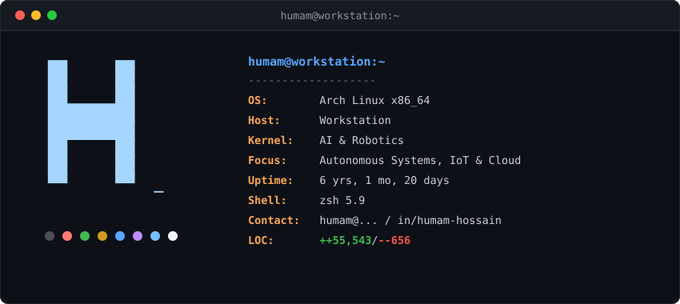
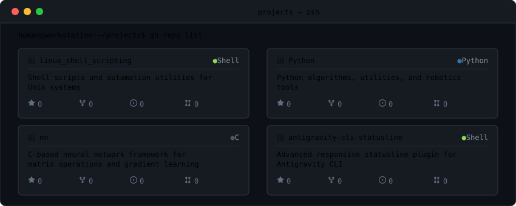

  

<!-- PROJECTS:START -->

  

  <code>humam@workstation:~/projects$ cd <a href="https://github.com/humam-hossain/linux_shell_scripting">linux_shell_scripting</a> | cd <a href="https://github.com/humam-hossain/Python">Python</a> | cd <a href="https://github.com/humam-hossain/nn">nn</a> | cd <a href="https://github.com/humam-hossain/antigravity-cli-statusline">antigravity-cli-statusline</a></code>

<!-- PROJECTS:END -->

<!-- METRICS:START -->
<!-- METRICS:END -->

<!-- SKILLS:START -->
<!-- SKILLS:END -->

 

  <code>humam@workstation:~$ exit</code>

